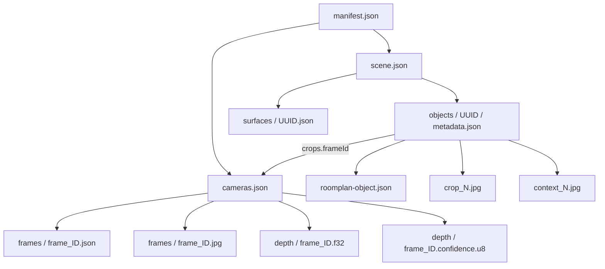

# RoomCanvas 实扫数据全量探查报告

分析日期：2026-10-17（Asia/Shanghai）。输入目录：`reference/ToCodex/ScanDemoResult/`。本文所有数量、示例、尺寸和质量观察均来自该目录实际文件；字段用途同时对照 App 写入代码与 `app/docs/DATA_CONTRACT.md`。未修改扫描输入，也未调用云端接口。

## 阅读索引

1. [结论与文件总览](#1-结论与文件总览)
2. [目录、命名与数据关联](#2-目录命名与数据关联)
3. [manifest.json：扫描总清单](#3-manifestjson扫描总清单)
4. [scene.json：标准化房间与家具](#4-scenejson标准化房间与家具)
5. [roomplan.json：Apple 最终原生编码](#5-roomplanjsonapple-最终原生编码)
6. [cameras.json 与逐帧记录](#6-camerasjson-与逐帧记录)
7. [JPEG 原图、裁剪与框选图](#7-jpeg-原图裁剪与框选图)
8. [深度与置信度二进制](#8-深度与置信度二进制)
9. [room-updates.jsonl：采集过程记录](#9-room-updatesjsonl采集过程记录)
10. [两个 USDZ 模型的内部结构](#10-两个-usdz-模型的内部结构)
11. [坐标、矩阵与 Web 接入](#11-坐标矩阵与-web-接入)
12. [完整性、质量与缺失数据](#12-完整性质量与缺失数据)
13. [附录 A：118 帧详细索引](#附录-a118-帧详细索引)
14. [附录 B：74 条采集过程索引](#附录-b74-条采集过程索引)
15. [附录 C：544 个文件逐项清单](#附录-c544-个文件逐项清单)

## 1. 结论与文件总览

这是一份可供 RoomCanvas 接入的**完成态扫描包**：`status=complete`，包含 9 面墙、3 扇门、1 个地板、2 张桌子、5 把椅子，以及 118 组 RGB + 相机参数 + 深度 + 置信度；7 件家具共产生 19 组裁剪图与框选预览。没有识别到窗户或额外 opening，不等于真实环境绝对没有窗。

总计 **544 个文件、84,488,768 字节，约 80.575 MiB**。JSON 和 JSONL 为 UTF-8 文本；JPEG 是已旋转的实际照片；深度是无文件头的原始数组；USDZ 是包含 USDA 的模型包。

| 位置 | 文件数 | 字节 | 约 MiB | 实际组成 |
| --- | --- | --- | --- | --- |
| [root] | 7 | 745,113 | 0.711 | 4 JSON + 1 JSONL + 2 USDZ |
| frames | 236 | 43,553,344 | 41.536 | 118 JPEG + 118 单帧 JSON |
| depth | 236 | 28,999,680 | 27.656 | 118 Float32 + 118 UInt8 |
| objects | 52 | 11,183,097 | 10.665 | 14 JSON + 19 crop JPEG + 19 context JPEG |
| surfaces | 13 | 7,534 | 0.007 | 13 原始结构面 JSON |

按扩展名计：149 个 `.json`、1 个 `.jsonl`、156 个 `.jpg`、118 个 `.f32`、118 个 `.u8`、2 个 `.usdz`。149 个 JSON = 根目录 4 + 单帧参数 118 + 家具参数 14 + 结构面 13；156 张图片 = 原图 118 + 裁剪 19 + 框选 19。

**实际限制**：

- `roomplan.raw.json` 不存在。manifest 明确记录了 Apple 原始中间数据的根级编码失败；最终 `roomplan.json`、标准场景和模型仍成功产出。不能用这份包保证重新执行 RoomBuilder 的 `capturedRoom(from:)`，也不能把 `roomplan.json` 当作 CapturedRoomData。
- USDZ 中的桌椅是按识别尺寸生成的简化盒子，不是照片贴图家具或精细重建模型；图生 3D 仍是后续独立步骤。
- 地板实际在原始世界坐标 `Y=-1.7297616m`，不在 Y=0；原点接近扫描起始相机的位置。
- 19 份裁剪全部为 `reviewRequired=true`，是 3D OBB 投影矩形，不是实例分割结果。

## 2. 目录、命名与数据关联

```text
ScanDemoResult/
├─ manifest.json                  本次扫描清单、状态、计数、警告、全部文件路径
├─ scene.json                     标准化结构 13 项、家具 7 项
├─ roomplan.json                  最终 CapturedRoom 的 Apple Codable 编码
├─ cameras.json                   118 个 CameraFrameRecord 的有序数组
├─ room-updates.jsonl             74 行 {timestamp, room} 采集过程记录
├─ room.usdz                      网格导出，内含 21 个 USDA
├─ room-parametric.usdz           参数化导出，内含 21 个 USDA
├─ frames/
│  ├─ frame_0001.jpg … frame_0118.jpg    118 张竖屏照片
│  └─ frame_0001.json … frame_0118.json  118 份单帧参数
├─ depth/
│  ├─ frame_0001.f32 … frame_0118.f32    118 张 Float32 深度图
│  └─ frame_0001.confidence.u8 …         118 张 UInt8 置信度图
├─ objects/<家具 UUID>/           7 个目录
│  ├─ metadata.json               与 scene.objects 对应对象完全相同
│  ├─ roomplan-object.json        Apple 原始家具参数
│  ├─ crop_1.jpg [crop_2/3.jpg]    包围框裁剪
│  └─ context_1.jpg […]           同一源帧整图 + 绿色矩形
└─ surfaces/<结构 UUID>.json      13 个 Apple 原始结构面参数
```

`frame_0001` 是零填充的帧 ID，可以按字典序与编号排序；本次编号 0001–0118 连续。家具/结构文件按 UUID 标识，不依赖文件系统遍历顺序。`crop_1/2/3` 表示该家具的候选排序，不表示采集时间先后，例如桌子 crop_1 对应 frame_0053，crop_2 对应更早的 frame_0052。



所有 manifest、scene、相机、裁剪中的路径均相对**扫描包根目录**，不是相对 metadata.json 所在目录。例如 `objects/.../crop_1.jpg` 不能再拼到 `objects/<UUID>/` 下。

## 3. manifest.json：扫描总清单

实际文件大小 20,160 字节，JSON Object；字段按键名排序、两空格缩进、LF 换行，路径保留 `/`，不是 JSONL。`files` 是 544 条完整相对路径组成的数组，包含 manifest 自身，已验证与实际文件集合完全一致。

| 字段 | JSON 类型 | 本次值 / 含义 |
| --- | --- | --- |
| schemaVersion | string | `roomcanvas.scan.v1`，此协议区别于 Web SceneManifest |
| id | string(UUID) | `E499A039-1B16-4BDE-A2B3-A71B7C7AEED7`，扫描 ID |
| title | string | `房间 2026年10月17日 3:39` |
| createdAt | string(ISO 8601) | `2026-10-16T19:39:33Z`，北京时间 10 月 17 日 03:39:33 |
| status | string | `complete`，处理完成但仍可能有 warnings |
| device | string | `iPhone`，不是具体 iPhone 型号 |
| systemVersion | string | `18.5` |
| appVersion | string | `1.0.0`，不能仅靠它确定具体 Git 构建版本 |
| objectCount | integer | 7 |
| frameCount | integer | 118 |
| croppedObjectCount | integer | 7，统计至少有一份裁剪的家具，不是裁剪总张数 |
| previewImagePath | string | `objects/F40E7902-2023-4033-8C78-027051ED914D/crop_1.jpg` |
| capturePolicy | object | 本次采集策略，见下表 |
| warnings | string[] | 2 项，见原文摘录 |
| files | string[] | 544 项路径清单 |

| capturePolicy 字段 | 本次值 | 解释 |
| --- | --- | --- |
| automaticIntervalSeconds | 0.8 | 自动关键帧目标间隔，秒 |
| maximumFrames | 300 | 采样上限，不是本次帧数 |
| maximumImageEdge | 1920 | 保存 JPEG 最大边长 |
| imageFormat | `jpeg` | 图像编码 |
| savesAvailableSceneDepth | true | 有 sceneDepth 才保存，不表示每次扫描都保证有深度 |
| imageOrientation | `portrait; native image rotated 90 degrees clockwise` | 原始传感器图像顺时针旋转为竖屏 |
| cropMethod | `final oriented bounding box projected into recorded RGB frames; not segmentation` | 最终家具框投影到 RGB，不是分割 |

两条警告原文：

```text
原始 RoomPlan JSON 保存失败，仍尝试构建房间：roomplan.raw.json JSON 编码失败 []：Invalid data
家具图像来自三维包围盒投影，可能含背景或遮挡；需人工核对，不是物体分割。
```

第一条现在明确定位为 **roomplan.raw.json、根级 codingPath=[]、Invalid data**，并没有指出 cameraToWorld 的 NaN。这是对先前失败原因分析的重要补充；118 份已保存相机矩阵和内参在本次包中均为有效有限数值。

## 4. scene.json：标准化房间与家具

大小 22,713 字节，是下游 Web 最适合优先消费的文件。它是 `roomcanvas.scene.v1`，不是前端当前定义的含 `room/furniture/cameras` 的 SceneManifest，接入时需要适配。

| 根字段 | 类型 | 本次值 |
| --- | --- | --- |
| schemaVersion | string | `roomcanvas.scene.v1` |
| scanId | string(UUID) | 与 manifest.id 一致 |
| roomIdentifier | string(UUID) | `FA499321-C35C-4FCB-A1C8-FF3FEE5F4DFB`，与扫描 ID 不是同一个概念 |
| units | string | `meters` |
| coordinateSystem | string | `ARKit right-handed, Y-up, original session world space` |
| matrixLayout | string | `column-major` |
| surfaces | object[] | 13 项 |
| objects | object[] | 7 项 |

### 4.1 objects：家具对象

| 字段 | 类型 / 排布 | 说明 |
| --- | --- | --- |
| id | UUID 字符串 | 与家具目录名、Apple identifier 一致 |
| category | string | 本次只有 `table` 与 `chair` |
| confidence | string | high / medium / low，本次 2 high、4 medium、1 low |
| dimensions | number[3] | 家具局部轴 X/Y/Z 的**完整尺寸**，米，不是半尺寸 |
| objectToWorld | number[16] | 列主序局部到世界变换；索引 12/13/14 为中心位置 |
| parentIdentifier | 可选 UUID | 本次标准化对象未写入该键；Apple 原文为 null |
| rawMetadataPath | string | 对应 roomplan-object.json |
| cropStatus | string | 本次全部 `needs-review` |
| crops | object[] | 最多 3 组，本次有一张桌子只有 1 组 |
| supplementalImages | object[] | 本次全部 `[]`，没有用户后补照片 |

下面位置、尺寸保留到 4 位小数；完整精度见原 JSON。偏航角由 `atan2(R[0,2], R[2,2])` 推导，单位度，只用于阅读，不是源数据新增字段。

| 序号/类别 | 完整 UUID | 尺寸 X/Y/Z(m) | 中心 X/Y/Z(m) | 偏航° | 置信度 | 裁剪数 |
| --- | --- | --- | --- | --- | --- | --- |
| 1 / table | `F40E7902-2023-4033-8C78-027051ED914D` | [1.3478, 0.7752, 0.7197] | [-3.1713, -1.3421, 0.2977] | 172.97 | high | 3 |
| 2 / chair | `B9467214-B781-43E7-ADC1-A273071DE30E` | [0.5119, 0.8446, 0.6028] | [-1.6226, -1.3075, -1.0927] | -21.83 | medium | 3 |
| 3 / chair | `2A7E184E-0218-4CAC-9012-F144CAC5A4F2` | [0.4643, 0.8625, 0.5347] | [-3.4931, -1.2985, -1.6233] | 46.80 | medium | 3 |
| 4 / chair | `574FAC64-2790-457B-9DC1-535408E72321` | [0.4988, 0.8207, 0.5662] | [-2.8021, -1.3194, -1.4102] | -21.98 | medium | 3 |
| 5 / table | `8DE5E4BB-6276-4D91-B614-9F01AA22B937` | [1.3362, 0.7347, 0.7509] | [1.1289, -1.3624, 0.5296] | -100.12 | high | 1 |
| 6 / chair | `F14ACB55-9D88-48B1-A07F-F634C265BA68` | [0.4589, 0.8183, 0.5418] | [-2.2854, -1.3206, -1.2247] | -18.72 | low | 3 |
| 7 / chair | `86D48463-B6A9-4B35-8632-C60E19DB28B1` | [0.4946, 0.8441, 0.5750] | [-2.3423, -1.3077, 0.7231] | 168.05 | medium | 3 |

7 件家具的底部 Y 均约为 `-1.7297616m`，与地板顶面一致。椅子原始属性统一为：`ChairType=dining`、`ChairLegType=four`、`ChairBackType=existing`、`ChairArmType=missing`。照片里的椅子仍可能与泛化的 dining 类别不同，不能据此当作商品真实品类。两张桌子均为 `TableShapeType=rectangular`、`TableType=unidentified`。

### 4.2 crops：照片关联与排序

每条 crop 包含：

| 字段 | 类型 | 具体含义 |
| --- | --- | --- |
| frameId | string | 对应 cameras.json 的 id |
| imagePath | string | crop_N.jpg |
| overlayPath | string | context_N.jpg |
| rectanglePixels | number[4] | `[x, y, width, height]`，在已保存竖屏 JPEG 中的像素矩形，左上为原点 |
| visibleFraction | number | 投影包围矩形落在图像内的面积比例，计算时不含外扩边距；不表示实际未遮挡率 |
| score | number | 视野面积、居中、sharpness 等组合启发式分数，不是检测置信度或生成质量 |
| reviewRequired | boolean | 本次全部 true |
| method | string | 本次全部 `projected-3d-obb` |

矩形已带约 6% 边距且被裁到图像边界。实测每一张 crop_N.jpg 宽高都与该矩形的 width/height 完全相等；对应 context 图保留源照片 1440×1920 完整分辨率。

| 家具 UUID 前缀 | 裁剪 | 源 frameId | [x,y,w,h] px | visibleFraction | score |
| --- | --- | --- | --- | --- | --- |
| F40E7902 | [crop_1.jpg](../ToCodex/ScanDemoResult/objects/F40E7902-2023-4033-8C78-027051ED914D/crop_1.jpg) | frame_0053 | [397, 958, 898, 949] | 1.000000 | 0.108505 |
| F40E7902 | [crop_2.jpg](../ToCodex/ScanDemoResult/objects/F40E7902-2023-4033-8C78-027051ED914D/crop_2.jpg) | frame_0052 | [453, 934, 779, 775] | 1.000000 | 0.093476 |
| F40E7902 | [crop_3.jpg](../ToCodex/ScanDemoResult/objects/F40E7902-2023-4033-8C78-027051ED914D/crop_3.jpg) | frame_0113 | [307, 965, 747, 849] | 1.000000 | 0.083844 |
| B9467214 | [crop_1.jpg](../ToCodex/ScanDemoResult/objects/B9467214-B781-43E7-ADC1-A273071DE30E/crop_1.jpg) | frame_0097 | [706, 757, 734, 1120] | 0.975393 | 0.183131 |
| B9467214 | [crop_2.jpg](../ToCodex/ScanDemoResult/objects/B9467214-B781-43E7-ADC1-A273071DE30E/crop_2.jpg) | frame_0098 | [489, 786, 775, 1119] | 1.000000 | 0.164912 |
| B9467214 | [crop_3.jpg](../ToCodex/ScanDemoResult/objects/B9467214-B781-43E7-ADC1-A273071DE30E/crop_3.jpg) | frame_0099 | [341, 789, 785, 1131] | 1.000000 | 0.144524 |
| 2A7E184E | [crop_1.jpg](../ToCodex/ScanDemoResult/objects/2A7E184E-0218-4CAC-9012-F144CAC5A4F2/crop_1.jpg) | frame_0091 | [17, 774, 761, 957] | 1.000000 | 0.104755 |
| 2A7E184E | [crop_2.jpg](../ToCodex/ScanDemoResult/objects/2A7E184E-0218-4CAC-9012-F144CAC5A4F2/crop_2.jpg) | frame_0089 | [245, 983, 624, 893] | 1.000000 | 0.078596 |
| 2A7E184E | [crop_3.jpg](../ToCodex/ScanDemoResult/objects/2A7E184E-0218-4CAC-9012-F144CAC5A4F2/crop_3.jpg) | frame_0092 | [0, 909, 622, 1011] | 0.661890 | 0.072403 |
| 574FAC64 | [crop_1.jpg](../ToCodex/ScanDemoResult/objects/574FAC64-2790-457B-9DC1-535408E72321/crop_1.jpg) | frame_0092 | [563, 781, 704, 1019] | 1.000000 | 0.141948 |
| 574FAC64 | [crop_2.jpg](../ToCodex/ScanDemoResult/objects/574FAC64-2790-457B-9DC1-535408E72321/crop_2.jpg) | frame_0093 | [214, 815, 663, 1039] | 1.000000 | 0.128224 |
| 574FAC64 | [crop_3.jpg](../ToCodex/ScanDemoResult/objects/574FAC64-2790-457B-9DC1-535408E72321/crop_3.jpg) | frame_0091 | [761, 714, 667, 908] | 1.000000 | 0.094003 |
| 8DE5E4BB | [crop_1.jpg](../ToCodex/ScanDemoResult/objects/8DE5E4BB-6276-4D91-B614-9F01AA22B937/crop_1.jpg) | frame_0029 | [109, 897, 1193, 1023] | 1.000000 | 0.118588 |
| F14ACB55 | [crop_1.jpg](../ToCodex/ScanDemoResult/objects/F14ACB55-9D88-48B1-A07F-F634C265BA68/crop_1.jpg) | frame_0096 | [169, 787, 719, 1076] | 1.000000 | 0.233135 |
| F14ACB55 | [crop_2.jpg](../ToCodex/ScanDemoResult/objects/F14ACB55-9D88-48B1-A07F-F634C265BA68/crop_2.jpg) | frame_0095 | [372, 869, 659, 1051] | 1.000000 | 0.210366 |
| F14ACB55 | [crop_3.jpg](../ToCodex/ScanDemoResult/objects/F14ACB55-9D88-48B1-A07F-F634C265BA68/crop_3.jpg) | frame_0094 | [439, 851, 689, 1069] | 1.000000 | 0.143074 |
| 86D48463 | [crop_1.jpg](../ToCodex/ScanDemoResult/objects/86D48463-B6A9-4B35-8632-C60E19DB28B1/crop_1.jpg) | frame_0053 | [57, 1089, 643, 831] | 0.966735 | 0.071660 |
| 86D48463 | [crop_2.jpg](../ToCodex/ScanDemoResult/objects/86D48463-B6A9-4B35-8632-C60E19DB28B1/crop_2.jpg) | frame_0114 | [407, 1121, 662, 799] | 0.949042 | 0.070657 |
| 86D48463 | [crop_3.jpg](../ToCodex/ScanDemoResult/objects/86D48463-B6A9-4B35-8632-C60E19DB28B1/crop_3.jpg) | frame_0052 | [170, 1028, 532, 738] | 1.000000 | 0.066384 |

### 4.3 surfaces：房间结构面

| 字段 | 排布 | 本次含义 |
| --- | --- | --- |
| id | UUID | 与 surfaces/<UUID>.json 一致 |
| kind | string | 9 wall、3 door、1 floor |
| dimensions | number[3] | 局部 X/Y/Z 完整尺寸，本次结构面 Z 均为 0，表示面，不是实体厚墙 |
| surfaceToWorld | number[16] | 列主序的结构局部坐标到世界坐标 |
| parentIdentifier | 可选 UUID | 3 扇门引用所属墙，其余缺省 |
| polygonCorners | number[][3] | 地板有 8 个局部顶点；墙和门均为 []，应按尺寸构造局部矩形 |
| rawMetadataPath | string | 对应 Apple 原始结构面 JSON |

| kind | 完整 UUID | 尺寸 X/Y/Z(m) | 中心 X/Y/Z(m) | 局部角点数 | 父墙 UUID |
| --- | --- | --- | --- | --- | --- |
| wall | `003C1531-DD52-4A09-A89D-7687463988C0` | [9.6778, 4.1156, 0.0000] | [-3.3733, 0.3280, 0.9417] | 0 | 无 |
| wall | `E76B2ECD-084D-48CC-8B6B-3FA4D2216444` | [6.7634, 4.1156, 0.0000] | [-4.7399, 0.3280, -2.2099] | 0 | 无 |
| wall | `2F9A90E4-EE89-4A29-943E-A2BE897BB4A6` | [4.8503, 4.1156, 0.0000] | [1.7834, 0.3280, -0.7027] | 0 | 无 |
| wall | `A71E604F-3A80-42F9-A01F-F068C3DFB401` | [2.5351, 4.1156, 0.0000] | [-8.2773, 0.3280, -1.4828] | 0 | 无 |
| wall | `418227C8-AEE5-44C4-9BBA-9E6D727C524B` | [2.2943, 4.1156, 0.0000] | [-1.2211, 0.3280, -2.8181] | 0 | 无 |
| wall | `CE47C81F-5917-49BB-BB44-2E781847EDA7` | [0.3821, 4.1156, 0.0000] | [-8.2854, 0.3280, -0.2009] | 0 | 无 |
| wall | `02511DF8-8283-48FA-89EA-C083CAF860DD` | [0.3661, 4.1156, 0.0000] | [-8.1251, 0.3280, 0.0096] | 0 | 无 |
| wall | `3A8F7A02-1035-425F-B22F-A6AA6A7AFB78` | [0.4688, 4.1156, 0.0000] | [0.0637, 0.3280, 1.2447] | 0 | 无 |
| wall | `AEA64136-4083-4750-9279-E79D1D1A37C1` | [3.3145, 4.1156, 0.0000] | [0.5585, 0.3280, -3.5249] | 0 | 无 |
| door | `4AB7262F-D644-4030-B510-6B6E04132B9E` | [1.2313, 2.2353, 0.0000] | [-7.4600, -0.6121, 0.2994] | 0 | 003C1531-DD52-4A09-A89D-7687463988C0 |
| door | `D0AFBE23-035F-4904-A796-0C1C66826A14` | [1.7642, 2.1607, 0.0000] | [-0.1381, -0.6494, -3.7104] | 0 | AEA64136-4083-4750-9279-E79D1D1A37C1 |
| door | `6EE6BE4A-BA7C-4EBB-B62D-3BD4CEC18813` | [0.8553, 2.2152, 0.0000] | [2.0868, -0.6222, -2.6332] | 0 | 2F9A90E4-EE89-4A29-943E-A2BE897BB4A6 |
| floor | `EF17CC11-B285-4A33-A0E3-13844558848F` | [10.0599, 5.1955, 0.0000] | [-3.1587, -1.7298, -1.6542] | 8 | 无 |

墙高统一为约 **4.1156m**，底部约 -1.7298m，顶部约 2.3858m。这是算法识别值，未与尺量校验。9 面墙是最终参数化墙段，不表示房间一定有 9 面独立物理墙；有些墙段宽度不足 0.5m。

地板完整 8 个局部角点和世界角点见下表。必须使用这些边界重建轮廓，不应直接拿 `dimensions=[10.05987,5.195512,0]` 生成整块 52.2662㎡ 矩形。按局部 XY 多边形鞋带公式计算面积约 **36.0401㎡**；它是扫描几何推导值，不是测绘认证面积。该多边形包含凹角，三角化应采用 Earcut / Three.js ShapeGeometry 等支持凹多边形的实现，不能将所有三角形面积取绝对值后直接作扇形求和。

| 角点序号 | 局部 [X,Y,Z](m) | 世界 [X,Y,Z](m) |
| --- | --- | --- |
| 0 | [5.029935, -2.597756, 0.000000] | [1.406871, -1.729761, 1.693039] |
| 1 | [-4.647859, -2.597755, 0.000000] | [-8.153556, -1.729761, 0.190401] |
| 2 | [-4.647860, -2.231667, 0.000000] | [-8.096716, -1.729761, -0.171247] |
| 3 | [-5.029937, -2.231667, 0.000000] | [-8.474160, -1.729761, -0.230571] |
| 4 | [-5.029936, 0.303449, 0.000000] | [-8.080540, -1.729761, -2.734943] |
| 5 | [1.733461, 0.303448, 0.000000] | [-1.399165, -1.729761, -1.684813] |
| 6 | [1.733461, 2.597756, 0.000000] | [-1.042936, -1.729761, -3.951297] |
| 7 | [5.029935, 2.252580, 0.000000] | [2.159967, -1.729761, -3.098475] |

## 5. roomplan.json：Apple 最终原生编码

实际 181,935 字节，根为 JSON Object。它保存的是 **最终 CapturedRoom**；标准化文件保留 Web 必要字段，这里还保留 Apple 原始属性。149 份 JSON 均能按严格 JSON 语法解析；家具和结构面的独立原始 JSON 与这个文件中的对应对象逐项一致。

| 字段 | 类型 | 本次内容 / 使用注意 |
| --- | --- | --- |
| version | integer | 2，是 Apple 数据版本，不是 roomcanvas.scene.v1 |
| story | integer | 0，本次单层记录 |
| walls / doors / floors | object[] | 9 / 3 / 1 项 |
| windows / openings | object[] | 均 [] |
| objects | object[] | 7 件，与 scene.objects 对应 |
| sections | object[] | 1 项，`label=unidentified`、`story=0`、中心 `[-2.6334522,0.3124156,-0.895863]` |
| referenceOriginTransform | number[16] | Apple 参考原点变换；已保存表面/物体变换保持 App 导出的原会话世界空间，不应接入时无依据再乘一次 |
| coreModel | base64 string | 166,148 个字符，严格 Base64 解码后为 124,609 字节 Apple opaque payload；不是 JPEG、JSON 或可直接加载的 GLB |

`coreModel` 可以恢复为一段原始二进制，但内部语义并无本项目公开解析器，本文不臆测其压缩、加密或具体 Apple 私有结构；它不能代替缺失的 CapturedRoomData。所有 74 条采集过程里的 coreModel 字符串长度均为 688，与最终结果不同。

Apple 原始家具字段：`identifier`、`category`、`confidence`、`dimensions`、`transform`、`parentIdentifier`、`attributes`、`story`。与标准化对象的主要区别：

```json
{
  "category": { "table": {} },
  "confidence": { "high": {} },
  "attributes": {
    "TableShapeType": "rectangular",
    "TableType": "unidentified"
  },
  "parentIdentifier": null,
  "story": 0
}
```

它的 enum 使用对象键表达，不是标准化文件中的字符串；`transform` 对应 `objectToWorld`。每个原始结构面还包含 `completedEdges`（本次均空）、`curve`（本次 null）和 `polygonCorners`；门类别为 `{"door":{"isOpen":false}}`，本次 3 扇门都记录为关闭。原始门 confidence 均 medium，墙与地板为 high。

`surfaces/<UUID>.json` 保存的就是上述单个原始结构面；`objects/<UUID>/roomplan-object.json` 保存的就是上述单个原始家具。不是每个文件各有一套不同格式，UUID 决定该记录描述哪个对象。

## 6. cameras.json 与逐帧记录

`cameras.json` 为 152,478 字节的 JSON **Array**，不是 `{frames:[...]}`；118 个元素按照编号和时间戳递增。每个 `frames/frame_XXXX.json` 是单个 JSON Object，与数组中相同 id 的元素完全相等，可用作相机索引恢复源。

时间范围：`2894.754476083` 至 `2989.000487541`，关键帧覆盖 **94.2460 秒**；不是从 manifest.createdAt 推出的总扫描时长，也不是 Unix 时间。117 段平均采样间隔 0.8055 秒，中位约 0.80025 秒，最小 0.70022 秒、最大 1.00032 秒。117 帧自动采样，`frame_0118` 为唯一手动请求帧（结束扫描前追加采样也使用此标记）。

| 字段 | 类型 / 长度 | 本次内容 / 解释 |
| --- | --- | --- |
| id | string | frame_0001 … frame_0118 |
| timestamp | double | ARKit/系统单调时间基准，单位秒，不直接当作墙钟 |
| imagePath | string | 对应 JPEG 相对路径 |
| imageWidth / imageHeight | integer | 全部 1440 / 1920（保存图像） |
| nativeImageWidth / nativeImageHeight | integer | 全部 1920 / 1440（传感器原始图像） |
| cameraToWorld | number[16] | 原始 ARKit 相机坐标到世界坐标，列主序 |
| intrinsics | number[9] | 原始 1920×1440 图像的 K，列主序 |
| nativePixelToSavedPixel | number[9] | 原始像素到竖屏 JPEG 像素的仿射变换 |
| trackingState | string | 118 帧均 normal，不能外推未保存帧也全部 normal |
| sharpness | number | 拉普拉斯绝对值采样均值，1.8123–5.1462，不是统一行业标定分 |
| manuallyRequested | boolean | 仅 frame_0118 为 true |
| lightIntensity | 可选 number | 118 条全部省略；从文件无法区分未提供还是无效值被省略，不应补 0 当作实测光照 |
| depth | object | 全部存在，字段见第 8 节 |

### 6.1 第一帧参数示例

```json
{
  "cameraToWorld": [
    -0.0032128354,
    -0.9993793,
    0.035083093,
    0,
    0.9996048,
    -0.0022298929,
    0.028020823,
    0,
    -0.02792521,
    0.03515925,
    0.99899155,
    0,
    0.0007277578,
    0.0008892529,
    -0.0019373022,
    1
  ],
  "depth": {
    "alignment": "native camera image orientation; scale intrinsics to depth resolution",
    "confidenceFormat": "uint8, tightly packed rows; 0=low, 1=medium, 2=high",
    "confidencePath": "depth/frame_0001.confidence.u8",
    "depthPath": "depth/frame_0001.f32",
    "format": "float32-little-endian, tightly packed rows, meters",
    "height": 192,
    "width": 256
  },
  "id": "frame_0001",
  "imageHeight": 1920,
  "imagePath": "frames/frame_0001.jpg",
  "imageWidth": 1440,
  "intrinsics": [
    1433.2249,
    0,
    0,
    0,
    1433.2249,
    0,
    968.57684,
    712.08203,
    1
  ],
  "manuallyRequested": false,
  "nativeImageHeight": 1440,
  "nativeImageWidth": 1920,
  "nativePixelToSavedPixel": [
    0,
    1,
    0,
    -1,
    0,
    0,
    1440,
    0,
    1
  ],
  "sharpness": 2.1194270833333335,
  "timestamp": 2894.754476083,
  "trackingState": "normal"
}
```

第一帧内参还原为数学矩阵：

```text
K = [ 1433.2249     0          968.57684 ]
    [    0      1433.2249      712.08203 ]
    [    0         0            1      ]

A = nativePixelToSavedPixel =
    [ 0  -1  1440 ]
    [ 1   0     0 ]
    [ 0   0     1 ]

u_saved = 1440 - v_native
v_saved = u_native
```

本次原生长边刚好 1920，因此没有额外缩小，只有旋转。K 随帧有小幅波动：fx=fy 约 1429.6837–1436.9344，cx 约 966.88873–968.57684，cy 约 711.27075–713.4029；不要用第一帧 K 替代所有帧的 K。

### 6.2 位姿质量与轨迹

118 个相机旋转矩阵行列式范围约 0.999999665–1.000000406，最大 `|RᵀR-I|` 约 4.65×10^-7，符合浮点误差下的刚体旋转。原始相机位置范围：X [-4.843304,0.231285]、Y [-0.222341,0.035744]、Z [-1.438724,0.091170] 米；相邻采样点直线距离和约 **18.624m**，这是离散轨迹长度估计，不是精确步行里程。相机相对扫描地板的高度约 1.5074–1.7655m。

附录 A 给出全部 118 帧的时间、中心位置、清晰度、相机文件、JPEG 与深度数据关联。

## 7. JPEG 原图、裁剪与框选图

全部 156 张 JPEG 已实际解码成功，均为 RGB，没有需要另行应用的 EXIF Orientation。原图已竖屏旋转，不能在 Web 再旋转一遍。分辨率、字节数和哈希见附录 C。

| 文件类别 | 数量 | 图像内容与排布 |
| --- | --- | --- |
| `frames/frame_XXXX.jpg` | 118 | 1440×1920，真正相机 RGB 帧，不含 App 扫描 UI |
| `objects/<UUID>/crop_N.jpg` | 19 | 从源帧矩形裁出的家具照片，大小各不相同，见 crop 表 |
| `objects/<UUID>/context_N.jpg` | 19 | 1440×1920，同一帧原图上画绿色矩形；便于核对投影结果，不宜直接当图生 3D 输入 |

已生成临时接触表并检查全部照片缩略图、全部裁剪与 context 预览。照片中可见房间墙面、门、桌椅，以及没有成为独立标准家具对象的其他物品（例如梯子）。这说明 RoomPlan objects 是语义识别结果，不是照片中所有物体的完整清单；可见物品是否应识别仍需用户确认。

### 7.1 每件家具的代表图与质量观察

**table / F40E7902-2023-4033-8C78-027051ED914D**：代表裁剪来自 `frame_0053`；[查看整图框选](../ToCodex/ScanDemoResult/objects/F40E7902-2023-4033-8C78-027051ED914D/context_1.jpg)。


**chair / B9467214-B781-43E7-ADC1-A273071DE30E**：代表裁剪来自 `frame_0097`；[查看整图框选](../ToCodex/ScanDemoResult/objects/B9467214-B781-43E7-ADC1-A273071DE30E/context_1.jpg)。


**chair / 2A7E184E-0218-4CAC-9012-F144CAC5A4F2**：代表裁剪来自 `frame_0091`；[查看整图框选](../ToCodex/ScanDemoResult/objects/2A7E184E-0218-4CAC-9012-F144CAC5A4F2/context_1.jpg)。


**chair / 574FAC64-2790-457B-9DC1-535408E72321**：代表裁剪来自 `frame_0092`；[查看整图框选](../ToCodex/ScanDemoResult/objects/574FAC64-2790-457B-9DC1-535408E72321/context_1.jpg)。


**table / 8DE5E4BB-6276-4D91-B614-9F01AA22B937**：代表裁剪来自 `frame_0029`；[查看整图框选](../ToCodex/ScanDemoResult/objects/8DE5E4BB-6276-4D91-B614-9F01AA22B937/context_1.jpg)。


**chair / F14ACB55-9D88-48B1-A07F-F634C265BA68**：代表裁剪来自 `frame_0096`；[查看整图框选](../ToCodex/ScanDemoResult/objects/F14ACB55-9D88-48B1-A07F-F634C265BA68/context_1.jpg)。


**chair / 86D48463-B6A9-4B35-8632-C60E19DB28B1**：代表裁剪来自 `frame_0053`；[查看整图框选](../ToCodex/ScanDemoResult/objects/86D48463-B6A9-4B35-8632-C60E19DB28B1/context_1.jpg)。


这些是图像目视观察，不是精确标注评价：

- 桌子 F40E7902 的三份裁剪都覆盖桌面与桌腿，但有地面、墙面或相邻椅子背景。
- 椅子 B9467214 的正面视图可用，crop_1 接近图像右边；visibleFraction 0.9754，不表示完全无遮挡。
- 椅子 2A7E184E 的 crop_3 可见比例仅 0.6619，目标部分靠画面外侧，明显弱于前两个视角，不适合优先送图生 3D。
- 椅子 574FAC64 的部分裁剪包含相邻椅子；单图生成时应先做目标确认或去背景。
- 桌子 8DE5E4BB 只有 frame_0029 一份合格视角，不是文件缺失；它的另外两个候选并未产生。
- 椅子 F14ACB55 检测 confidence=low，但裁剪画面中确有椅子；confidence 低不等于图片本身不可用，应核对是否重复对象、尺寸与位置。
- 椅子 86D48463 的裁剪常带旁边桌子，部分裁到图像底部；应保持 `reviewRequired`。

本次 19 份 `visibleFraction` 范围 0.66189–1.0，所有 `method=projected-3d-obb`。包里没有 alpha mask、实例分割掩码、目标抠图或透明背景 PNG。

## 8. 深度与置信度二进制

### 8.1 depth/frame_XXXX.f32

118 个文件，每个 **196,608 字节 = 256×192×4**。无文件头、无尺寸前缀、无压缩，尺寸从 cameras.json.depth 读取。按行紧密排列，原生相机方向，little-endian IEEE-754 Float32，单位米。

```text
row = y, col = x
linearIndex = y * 256 + x
byteOffset  = 4 * linearIndex
value       = Float32 little-endian at byteOffset
```

不能按 1440×1920 去解码，也不能当 JPEG 打开。深度保持 256×192 横屏排列；RGB JPEG 已旋转为 1440×1920，若叠加显示需按相同方向变换。内参从 1920×1440 缩到 256×192 时，fx、cx 乘 256/1920，fy、cy 乘 192/1440；二者本次均为 2/15，然后再处理需要的竖屏旋转。不要直接用 1920 级别焦距投影 256 宽的深度坐标。

实际读取全部 **5,799,936 个深度值**：

| 检查 | 本次结果 |
| --- | --- |
| NaN | 0 |
| 正负 Infinity | 0 |
| ≤0 | 0 |
| 全局最小 | 1.0478515625m |
| 全局最大 | 7.2734375m |
| 每文件字节数 | 全部正确 |

这些数值说明文件格式可读且本次样本有限，不代表所有像素都是高精度真值；应结合 confidence 使用。深度值语义遵循 ARKit sceneDepth，不能不经验证就当成沿任意射线的欧氏距离。

### 8.2 depth/frame_XXXX.confidence.u8

每个 **49,152 字节 = 256×192×1**，无文件头、按行紧密排列 UInt8，与对应 .f32 一一对齐。唯一实测值为 0 / 1 / 2：

| 数值 | 含义 | 全部像素计数 | 占比 |
| --- | --- | ---: | ---: |
| 0 | low | 466,574 | 8.0445% |
| 1 | medium | 388,696 | 6.7017% |
| 2 | high | 4,944,666 | 85.2538% |

不是 0–255 的概率，也不是二值前景掩码。置信度低的像素即使深度有限，也不宜等同高可信测量。

### 8.3 cameras.json.depth 对象

每帧均包含 `width=256`、`height=192`、`depthPath`、`confidencePath`，及三条字符串说明：

```text
format: float32-little-endian, tightly packed rows, meters
confidenceFormat: uint8, tightly packed rows; 0=low, 1=medium, 2=high
alignment: native camera image orientation; scale intrinsics to depth resolution
```

本次深度用于后续遮挡判断/几何辅助是可行输入，但当前 App 裁剪算法并没有用深度做遮挡分割。

## 9. room-updates.jsonl：采集过程记录

250,718 字节，74 个非空行。每一行都是完整 JSON Object，格式为 `{"timestamp":number,"room":object}`；不包在总数组里，不能用一次 `JSON.parse(整文件)` 读取，需要逐行解析。

`timestamp` 与 cameras.timestamp 使用相同会话时间基准；本次从 2899.65605075 到 2987.800115416，记录跨度 88.1441 秒。`room` 的键与最终 roomplan.json 相似，但采集过程返回内容可能是部分集合/不断更新的中间识别，不能用最后一行覆盖最终场景。

实测依据：第一行 0 家具、0 墙、1 地板，最后一行只有 1 家具、0 墙、1 地板；中途单行最多 3 家具、8 墙、3 门、1 地板，而最终结果是 7 家具、9 墙、3 门、1 地板。历史对象 UUID 合集包含全部最终 7 件家具；历史墙 UUID 有 10 个，其中 2 个未进入最终集合，最终还有 1 个新墙段 ID 未出现在日志中。这些都是中间状态正常可变的证据，不能据最后一行误判家具丢失。

每行 room 常见字段包括：`coreModel`、`walls`、`doors`、`windows`、`openings`、`floors`、`objects`、`sections`、`story`、`version`、`referenceOriginTransform`。日志适合排查识别过程、可视化时间线，不替代最终 `scene.json`；也不是包含 RGB 视频的录像。

## 10. 两个 USDZ 模型的内部结构

两个文件都按 USDZ/ZIP 成功校验 CRC，**均包含 21 个 UTF-8 USDA 文本层**，没有图像纹理；所有内部条目为 ZIP_STORED，数据起始地址满足 64 字节对齐。OpenUSD 26.8 能打开并组合两份 Stage，composition errors 为 0。这是实际解析结果，不是仅依据扩展名判断。

| 属性 | room.usdz | room-parametric.usdz |
| --- | --- | --- |
| 字节数 | 77,894 | 39,215 |
| 根层 | room.usda | room-parametric.usda |
| defaultPrim | /room | /roomparametric |
| upAxis / metersPerUnit | Y / 1 | Y / 1 |
| 几何 | 20 个 Mesh | 19 个 Cube + 1 个地板 Mesh |
| 网格顶点记录 | 752 | 地板 48 |
| 网格三角形 | 380 | 地板 28；Cube 是参数化原语，不在此数中 |
| 材质/着色器 | 20 Material + 20 Shader | 20 Material + 20 Shader |
| Xform | 19 | 19 |
| 纹理图片 | 0 | 0 |

**room.usdz 并非 LiDAR 原始稠密扫描网格。** 桌椅每件是 24 个面角点记录、12 个三角形组成的盒子；墙/门/地板由规则结构生成。24 个点中有重合角点，是按面法线拆分的顶点记录，不是 24 个独立几何角。

**room-parametric.usdz** 把 7 件家具、9 面墙、3 扇门表示成 `size=1` 的 Cube + `xformOp:scale` + `xformOp:transform`；地板保持 Mesh 以表达多边形。两包默认材质为 UsdPreviewSurface，不携带照片材质。

### 10.1 内部组织与每个 USDA 的内容

根层分为 Section_grp 与 Mesh_grp / Parametric_grp；后者下分 Arch_grp、Floor_grp、Object_grp，Object_grp 再按 Chair_grp / Table_grp 分类。根层主要列出子层引用；20 个资产层分别携带 Category、UUID、自身几何、变换、材质与着色器。

| 所属模型 | 包内路径 | 字节 | 源资产 UUID | 实际内容 |
| --- | --- | --- | --- | --- |
| room.usdz | `room.usda` | 4131 | 无 | 根 Stage：section/结构/地板/家具子层引用 |
| room.usdz | `assets/Mesh/Chair/Chair0.usda` | 2794 | B9467214-B781-43E7-ADC1-A273071DE30E | Mesh，24 顶点记录 / 12 三角形；位姿 + 单色材质 |
| room.usdz | `assets/Mesh/Chair/Chair1.usda` | 2771 | 2A7E184E-0218-4CAC-9012-F144CAC5A4F2 | Mesh，24 顶点记录 / 12 三角形；位姿 + 单色材质 |
| room.usdz | `assets/Mesh/Chair/Chair2.usda` | 2767 | 574FAC64-2790-457B-9DC1-535408E72321 | Mesh，24 顶点记录 / 12 三角形；位姿 + 单色材质 |
| room.usdz | `assets/Mesh/Chair/Chair3.usda` | 2796 | F14ACB55-9D88-48B1-A07F-F634C265BA68 | Mesh，24 顶点记录 / 12 三角形；位姿 + 单色材质 |
| room.usdz | `assets/Mesh/Chair/Chair4.usda` | 2797 | 86D48463-B6A9-4B35-8632-C60E19DB28B1 | Mesh，24 顶点记录 / 12 三角形；位姿 + 单色材质 |
| room.usdz | `assets/Mesh/Floors/Floor0.usda` | 4280 | EF17CC11-B285-4A33-A0E3-13844558848F | Mesh，48 顶点记录 / 28 三角形；位姿 + 单色材质 |
| room.usdz | `assets/Mesh/Table/Table0.usda` | 2774 | F40E7902-2023-4033-8C78-027051ED914D | Mesh，24 顶点记录 / 12 三角形；位姿 + 单色材质 |
| room.usdz | `assets/Mesh/Table/Table1.usda` | 2813 | 8DE5E4BB-6276-4D91-B614-9F01AA22B937 | Mesh，24 顶点记录 / 12 三角形；位姿 + 单色材质 |
| room.usdz | `assets/Mesh/Walls/Wall0/Door0.usda` | 2551 | 4AB7262F-D644-4030-B510-6B6E04132B9E | Mesh，24 顶点记录 / 12 三角形；位姿 + 单色材质 |
| room.usdz | `assets/Mesh/Walls/Wall0/Wall0.usda` | 5662 | 003C1531-DD52-4A09-A89D-7687463988C0 | Mesh，80 顶点记录 / 40 三角形；位姿 + 单色材质 |
| room.usdz | `assets/Mesh/Walls/Wall1/Wall1.usda` | 2556 | E76B2ECD-084D-48CC-8B6B-3FA4D2216444 | Mesh，24 顶点记录 / 12 三角形；位姿 + 单色材质 |
| room.usdz | `assets/Mesh/Walls/Wall2/Door2.usda` | 2637 | 6EE6BE4A-BA7C-4EBB-B62D-3BD4CEC18813 | Mesh，24 顶点记录 / 12 三角形；位姿 + 单色材质 |
| room.usdz | `assets/Mesh/Walls/Wall2/Wall2.usda` | 6136 | 2F9A90E4-EE89-4A29-943E-A2BE897BB4A6 | Mesh，88 顶点记录 / 44 三角形；位姿 + 单色材质 |
| room.usdz | `assets/Mesh/Walls/Wall3/Wall3.usda` | 4100 | A71E604F-3A80-42F9-A01F-F068C3DFB401 | Mesh，48 顶点记录 / 24 三角形；位姿 + 单色材质 |
| room.usdz | `assets/Mesh/Walls/Wall4/Wall4.usda` | 4200 | 418227C8-AEE5-44C4-9BBA-9E6D727C524B | Mesh，48 顶点记录 / 24 三角形；位姿 + 单色材质 |
| room.usdz | `assets/Mesh/Walls/Wall5/Wall5.usda` | 4073 | CE47C81F-5917-49BB-BB44-2E781847EDA7 | Mesh，48 顶点记录 / 24 三角形；位姿 + 单色材质 |
| room.usdz | `assets/Mesh/Walls/Wall6/Wall6.usda` | 2581 | 02511DF8-8283-48FA-89EA-C083CAF860DD | Mesh，24 顶点记录 / 12 三角形；位姿 + 单色材质 |
| room.usdz | `assets/Mesh/Walls/Wall7/Wall7.usda` | 2579 | 3A8F7A02-1035-425F-B22F-A6AA6A7AFB78 | Mesh，24 顶点记录 / 12 三角形；位姿 + 单色材质 |
| room.usdz | `assets/Mesh/Walls/Wall8/Door1.usda` | 2647 | D0AFBE23-035F-4904-A796-0C1C66826A14 | Mesh，24 顶点记录 / 12 三角形；位姿 + 单色材质 |
| room.usdz | `assets/Mesh/Walls/Wall8/Wall8.usda` | 5917 | AEA64136-4083-4750-9279-E79D1D1A37C1 | Mesh，80 顶点记录 / 40 三角形；位姿 + 单色材质 |
| room-parametric.usdz | `room-parametric.usda` | 4277 | 无 | 根 Stage：section/结构/地板/家具子层引用 |
| room-parametric.usdz | `assets/Parametric/Chair/Chair0.usda` | 1363 | B9467214-B781-43E7-ADC1-A273071DE30E | Cube，size=1 + 尺寸缩放；位姿 + 单色材质 |
| room-parametric.usdz | `assets/Parametric/Chair/Chair1.usda` | 1364 | 2A7E184E-0218-4CAC-9012-F144CAC5A4F2 | Cube，size=1 + 尺寸缩放；位姿 + 单色材质 |
| room-parametric.usdz | `assets/Parametric/Chair/Chair2.usda` | 1361 | 574FAC64-2790-457B-9DC1-535408E72321 | Cube，size=1 + 尺寸缩放；位姿 + 单色材质 |
| room-parametric.usdz | `assets/Parametric/Chair/Chair3.usda` | 1365 | F14ACB55-9D88-48B1-A07F-F634C265BA68 | Cube，size=1 + 尺寸缩放；位姿 + 单色材质 |
| room-parametric.usdz | `assets/Parametric/Chair/Chair4.usda` | 1366 | 86D48463-B6A9-4B35-8632-C60E19DB28B1 | Cube，size=1 + 尺寸缩放；位姿 + 单色材质 |
| room-parametric.usdz | `assets/Parametric/Floors/Floor0.usda` | 4320 | EF17CC11-B285-4A33-A0E3-13844558848F | Mesh，48 顶点记录 / 28 三角形；位姿 + 单色材质 |
| room-parametric.usdz | `assets/Parametric/Table/Table0.usda` | 1366 | F40E7902-2023-4033-8C78-027051ED914D | Cube，size=1 + 尺寸缩放；位姿 + 单色材质 |
| room-parametric.usdz | `assets/Parametric/Table/Table1.usda` | 1382 | 8DE5E4BB-6276-4D91-B614-9F01AA22B937 | Cube，size=1 + 尺寸缩放；位姿 + 单色材质 |
| room-parametric.usdz | `assets/Parametric/Walls/Wall0/Door0.usda` | 1379 | 4AB7262F-D644-4030-B510-6B6E04132B9E | Cube，size=1 + 尺寸缩放；位姿 + 单色材质 |
| room-parametric.usdz | `assets/Parametric/Walls/Wall0/Wall0.usda` | 1353 | 003C1531-DD52-4A09-A89D-7687463988C0 | Cube，size=1 + 尺寸缩放；位姿 + 单色材质 |
| room-parametric.usdz | `assets/Parametric/Walls/Wall1/Wall1.usda` | 1355 | E76B2ECD-084D-48CC-8B6B-3FA4D2216444 | Cube，size=1 + 尺寸缩放；位姿 + 单色材质 |
| room-parametric.usdz | `assets/Parametric/Walls/Wall2/Door2.usda` | 1382 | 6EE6BE4A-BA7C-4EBB-B62D-3BD4CEC18813 | Cube，size=1 + 尺寸缩放；位姿 + 单色材质 |
| room-parametric.usdz | `assets/Parametric/Walls/Wall2/Wall2.usda` | 1354 | 2F9A90E4-EE89-4A29-943E-A2BE897BB4A6 | Cube，size=1 + 尺寸缩放；位姿 + 单色材质 |
| room-parametric.usdz | `assets/Parametric/Walls/Wall3/Wall3.usda` | 1356 | A71E604F-3A80-42F9-A01F-F068C3DFB401 | Cube，size=1 + 尺寸缩放；位姿 + 单色材质 |
| room-parametric.usdz | `assets/Parametric/Walls/Wall4/Wall4.usda` | 1356 | 418227C8-AEE5-44C4-9BBA-9E6D727C524B | Cube，size=1 + 尺寸缩放；位姿 + 单色材质 |
| room-parametric.usdz | `assets/Parametric/Walls/Wall5/Wall5.usda` | 1359 | CE47C81F-5917-49BB-BB44-2E781847EDA7 | Cube，size=1 + 尺寸缩放；位姿 + 单色材质 |
| room-parametric.usdz | `assets/Parametric/Walls/Wall6/Wall6.usda` | 1358 | 02511DF8-8283-48FA-89EA-C083CAF860DD | Cube，size=1 + 尺寸缩放；位姿 + 单色材质 |
| room-parametric.usdz | `assets/Parametric/Walls/Wall7/Wall7.usda` | 1356 | 3A8F7A02-1035-425F-B22F-A6AA6A7AFB78 | Cube，size=1 + 尺寸缩放；位姿 + 单色材质 |
| room-parametric.usdz | `assets/Parametric/Walls/Wall8/Door1.usda` | 1380 | D0AFBE23-035F-4904-A796-0C1C66826A14 | Cube，size=1 + 尺寸缩放；位姿 + 单色材质 |
| room-parametric.usdz | `assets/Parametric/Walls/Wall8/Wall8.usda` | 1353 | AEA64136-4083-4750-9279-E79D1D1A37C1 | Cube，size=1 + 尺寸缩放；位姿 + 单色材质 |

网格资产典型字段：`faceVertexCounts`、`faceVertexIndices`、`points`、`normals`、`subdivisionScheme=none`、`xformOp:transform`、`material:binding`；参数化资产则主要是 `Cube.size`、`xformOp:scale` 与变换。USD Gf 矩阵的行向量表达与 JSON 列主序数组的阅读方式不同，使用 USD 库时让库处理其变换，不能把文本行直接当成 JSON 扁平矩阵照抄。

### 10.2 接入时必须注意的模型差异

- Mesh 版墙和地板有实体厚度与边缘扩展，地板底面约 Y=-1.88976m，顶面仍约 -1.72976m。结构 JSON 的 `dimensions.z=0` 仅表示面，不保证两者边界逐点相同。
- 参数化墙/门的厚度很小，不能直接作为可靠的玩家碰撞体厚度；Web 应显式设置墙体碰撞厚度并处理门洞。
- OpenUSD 打开时报告旧材质绑定写法缺少 MaterialBindingAPI 应用的兼容警告，但能解析到材质；并非 composition error，仍需目标渲染器验证。
- 多个同类资产以引用组合到同一个 Xform 分组，其父组的 customData.UUID 会被组合规则合并。例如 Chair_grp 的父级 UUID 读起来可能都是第一把椅子的 UUID。**不要靠合成后父组 UUID 区分所有家具**；使用本报告内部文件映射/各源资产 customData，或以 scene.json 的 id 构建对象。
- USD 默认包围缓存对本包部分 Cube 的 extent 与 size=1 表示存在差异；自动相机取景/碰撞若依赖缓存外框，应先核对实际点与变换后的几何范围。正文房间尺寸来自标准化结构，而非把 Stage 缓存框当真实房间面积。

## 11. 坐标、矩阵与 Web 接入

### 11.1 不要把扫描世界原点当作地面中心

本次地板中心 `[-3.158719,-1.7297616,-1.6541933]`，地板 8 个顶点基本同处 Y=-1.7297616。结构零厚度几何世界 AABB 约为 X [-8.47416,2.15997]、Y [-1.72976,2.38579]、Z [-3.95130,1.69304]。这只是轴对齐范围，不能当成房间内的全部可行走区域。

若保留原世界坐标，1.7m 眼高的相机应在 `floorY+1.7≈-0.0297616m`，而不是原始 Y=1.7m。当前空场景固定 Y=1.7 的逻辑不能直接不经适配就用于扫描数据。

建议扫描适配器显式定义 `scanToEditor = T(3.158719,1.7297616,1.6541933)`，仅做统一平移，保留源坐标元信息：

```text
worldEditor = scanToEditor * worldScan
objectToEditor = scanToEditor * objectToWorld
surfaceToEditor = scanToEditor * surfaceToWorld
cameraToEditor = scanToEditor * cameraToWorld
```

这样地板中心归零、地板 Y=0，Play 可沿用 Y=1.7；所有源对象、相机与墙体必须使用同一个变换。可选的房间水平旋转也应由同一个 scanToEditor 表达；不能只改家具而不改相机。相机 K 和像素旋转矩阵不随这个世界平移改变。

### 11.2 列主序矩阵与家具框

```text
输入数组 a[0..15] 对应：
[ a0  a4  a8  a12 ]
[ a1  a5  a9  a13 ]
[ a2  a6  a10 a14 ]
[ a3  a7  a11 a15 ]

position = [a12, a13, a14]
size = dimensions（完整局部尺寸）
rotation = 从 3x3 旋转提取 quaternion [x,y,z,w]
```

Three.js `Matrix4.fromArray(a)` 使用列主序数组，可直接读取这里的数组；不要先手动转置。地板和墙面的局部轴不同：地板 polygonCorners 在局部 XY 平面，经 surfaceToWorld 才落到世界 XZ；不能把局部点直接当世界坐标。

### 11.3 由框投影到实际 JPEG

```text
p_world = objectToWorld * p_object
p_camera = inverse(cameraToWorld) * p_world
ARKit 朝 -Z，看向图像时转换为 [x, -y, -z]
[u_native, v_native, 1] ∝ K * [x, -y, -z]
[u_saved, v_saved, 1] = A * [u_native, v_native, 1]
```

3D 框八角点需处理近裁面和相机后方点，不能负 z 直接除法。现成 crop 已存盘，首个图生 3D 演示不必重新裁剪，只需要选择合适的 `crop_N.jpg`。

### 11.4 各链路应优先读什么

| 目的 | 主要输入 | 注意 |
| --- | --- | --- |
| 房间底座 | scene.surfaces、floor polygonCorners | 墙面增加实际渲染/碰撞厚度；用 parentIdentifier 处理门洞 |
| 原家具占位与编辑 | scene.objects | 每件 UUID 独立；局部尺寸、中心、四元数 |
| 图片生成家具 | `objects/<UUID>/crop_N.jpg` + metadata | 先人工确认单件、背景与裁切质量，不直接上传 context |
| 原位回填 GLB | 原家具 OBB + scanToEditor | 校正模型中心/轴向/缩放，保留原位姿 |
| 重新选帧裁剪 | cameras、frames、原始 OBB | 用每帧 K 和 A，勿重复旋转 JPEG |
| 遮挡/几何辅助 | depth + confidence + cameras | 不是前景 mask，需缩放内参并处理方向 |
| Apple 原生预览 | room.usdz / room-parametric.usdz | 无真实材质的结构化预览 |
| 过程排查 | room-updates.jsonl、manifest.warnings | 中间状态非最终全集 |
| 重新 RoomBuilder | 需要 CapturedRoomData | 本包缺 roomplan.raw.json，不能保证这条恢复路径 |

## 12. 完整性、质量与缺失数据

### 12.1 已实际完成的检查

| 检查范围 | 结果 |
| --- | --- |
| 已有 verify-export.py 全量验证 | PASS；complete / 7 objects / 7 with crops / 118 frames / 544 files |
| manifest.files ↔ 实际文件 | 544 项一一对应，缺失 0，额外 0 |
| 149 JSON + 74 JSONL 行 | 全部成功解析；所有已展开数字有限，无 NaN/Infinity 常量 |
| 118 相机 sidecar ↔ cameras.json | 所有记录完全相等；id 唯一、编号连续、时间递增 |
| 7 metadata ↔ scene.objects | 全部完全相等 |
| 20 Apple 分项文件 ↔ roomplan.json | 13 结构 + 7 家具完全相等；transform/dimensions 与标准化版本一致 |
| 156 JPEG | 全部实际解码成功；RGB；无 EXIF 二次旋转标记 |
| 19 crop 尺寸与 frameId | 像素宽高全匹配 rectanglePixels；引用帧和整图均存在 |
| 118 f32 + 118 u8 | 长度全部正确；读取全部 5,799,936 深度及同数置信度样本 |
| 深度有效性 | NaN=0 / Infinity=0 / 非正数=0；confidence 仅 0/1/2 |
| 2 USDZ / 42 USDA | ZIP CRC、64 字节对齐、全部 USDA 文本解析和 Stage 引用组合通过 |
| 图像语义检查 | 全量接触表 + 全部裁剪/context 目视检查；非逐像素人工标注 |
| 完整 SHA-256 | 已对 544 文件逐一计算，用于报告生成前后核对；附录展示前16位 |
| 未验证范围 | 未量尺验证物理精度，未在浏览器渲染 USDZ，也未声称自动分割/图生3D已完成 |

### 12.2 不包含或不能推断的数据

本包无 `.glb`/`.gltf`、家具精细重建、照片纹理图集、视频、音频、全量 ARFrame 流、GPS、具体手机型号、分割掩码、额外用户补拍、相机墙钟逐帧时间或绝对测绘坐标。照片能看到的梯子等物品不必然出现在 objects 中；`windows=[]` 只表示这次没有输出该类结构。

JSON、depth 和 USDZ 解析成功不等于物理尺寸绝对准确、每个框都无遮挡、房间拓扑闭合或每一件真实家具均被识别。本文没有与外部标尺对照，也没有重新进行真机扫描或运行图生 3D。

### 12.3 对项目当前最有用的结论

1. **房间与原家具框重建已有足够数据**，首选 scene.json 适配到前端契约；无需先依赖 USDZ 转 GLB。
2. **图片生成有现成素材**，19 份裁剪已关联到 7 件家具，可优先从单件清晰图开始。两张桌子、五把椅子不要一次盲目提交所有视角。
3. **必须实现扫描坐标适配**，尤其 floorY、非矩形地板、相机方向与矩阵排列；这是首屏能否正确落地的关键。
4. **原始编码失败尚存在但已被隔离**：最终成果可用，并不意味着 CapturedRoomData 的编码问题消失。警告应保留，不需要为 Web 消费者伪造缺失文件。

---

## 附录 A：118 帧详细索引

每行对应四个实际文件：`frames/<ID>.jpg`、`frames/<ID>.json`、`depth/<ID>.f32`、`depth/<ID>.confidence.u8`。所有 RGB 为 1440×1920，深度/置信度为 256×192，tracking=normal。相对时间以第一帧为 0；位置是原始扫描世界中心，单位米。

| 帧 ID / 参数链接 | timestamp(s) | 相对时间(s) | 相机世界位置(m) | sharpness | 采样 | 深度 min–max(m) | high占比 | RGB缩略图内容概述 |
| --- | --- | --- | --- | --- | --- | --- | --- | --- |
| [frame_0001](../ToCodex/ScanDemoResult/frames/frame_0001.json) | 2894.754476 | 0.000 | [0.0007, 0.0009, -0.0019] | 2.119 | 自动 | 1.897–3.744 | 86.54% | 木门、墙面及地面 |
| [frame_0002](../ToCodex/ScanDemoResult/frames/frame_0002.json) | 2895.554734 | 0.800 | [0.0560, -0.0482, -0.1418] | 2.068 | 自动 | 1.807–3.777 | 85.23% | 木门、墙面及地面 |
| [frame_0003](../ToCodex/ScanDemoResult/frames/frame_0003.json) | 2896.354991 | 1.601 | [0.0605, -0.1057, -0.4564] | 2.222 | 自动 | 1.738–3.424 | 89.98% | 木门、墙面及地面 |
| [frame_0004](../ToCodex/ScanDemoResult/frames/frame_0004.json) | 2897.155248 | 2.401 | [0.0169, -0.1631, -0.8199] | 2.070 | 自动 | 1.521–3.135 | 92.63% | 木门、墙面及地面 |
| [frame_0005](../ToCodex/ScanDemoResult/frames/frame_0005.json) | 2897.955505 | 3.201 | [0.0125, -0.1796, -1.2066] | 2.132 | 自动 | 1.401–2.887 | 89.29% | 木门、墙面及地面 |
| [frame_0006](../ToCodex/ScanDemoResult/frames/frame_0006.json) | 2898.755762 | 4.001 | [-0.0407, -0.0767, -1.2036] | 2.059 | 自动 | 1.374–2.617 | 93.21% | 木门、墙面及地面 |
| [frame_0007](../ToCodex/ScanDemoResult/frames/frame_0007.json) | 2899.556019 | 4.802 | [-0.0653, 0.0240, -1.0777] | 2.237 | 自动 | 1.335–3.281 | 94.29% | 木门、墙面及地面 |
| [frame_0008](../ToCodex/ScanDemoResult/frames/frame_0008.json) | 2900.356275 | 5.602 | [-0.0921, -0.1089, -1.0215] | 2.106 | 自动 | 1.396–2.531 | 88.91% | 木门、墙面及地面 |
| [frame_0009](../ToCodex/ScanDemoResult/frames/frame_0009.json) | 2901.156532 | 6.402 | [-0.1448, -0.1704, -1.2039] | 2.348 | 自动 | 1.354–2.689 | 88.08% | 木门、墙面及地面 |
| [frame_0010](../ToCodex/ScanDemoResult/frames/frame_0010.json) | 2901.956788 | 7.202 | [-0.0756, -0.1495, -1.1887] | 1.942 | 自动 | 1.636–2.605 | 92.23% | 木门、墙面及地面 |
| [frame_0011](../ToCodex/ScanDemoResult/frames/frame_0011.json) | 2902.757044 | 8.003 | [0.1129, -0.1271, -1.0644] | 2.182 | 自动 | 1.404–2.777 | 89.99% | 木门、墙面及地面 |
| [frame_0012](../ToCodex/ScanDemoResult/frames/frame_0012.json) | 2903.557300 | 8.803 | [0.1852, -0.1129, -0.9374] | 2.107 | 自动 | 1.491–2.951 | 91.91% | 灰色门、墙面，上部设备/管线 |
| [frame_0013](../ToCodex/ScanDemoResult/frames/frame_0013.json) | 2904.557619 | 9.803 | [0.2313, -0.0414, -0.7831] | 2.360 | 自动 | 1.836–3.215 | 88.97% | 灰色门、墙面，上部设备/管线 |
| [frame_0014](../ToCodex/ScanDemoResult/frames/frame_0014.json) | 2905.357875 | 10.603 | [0.2057, -0.0132, -0.7353] | 2.702 | 自动 | 1.838–3.502 | 88.61% | 灰色门、墙面，上部设备/管线 |
| [frame_0015](../ToCodex/ScanDemoResult/frames/frame_0015.json) | 2906.158130 | 11.404 | [0.2027, -0.0053, -0.7060] | 2.427 | 自动 | 1.447–3.625 | 92.02% | 灰色门、墙面，上部设备/管线 |
| [frame_0016](../ToCodex/ScanDemoResult/frames/frame_0016.json) | 2906.958385 | 12.204 | [0.0556, 0.0116, -0.8223] | 2.597 | 自动 | 1.367–3.586 | 91.29% | 灰色门、墙面，上部设备/管线 |
| [frame_0017](../ToCodex/ScanDemoResult/frames/frame_0017.json) | 2907.758640 | 13.004 | [-0.0135, -0.0034, -0.9004] | 2.733 | 自动 | 1.438–3.510 | 91.54% | 灰色门、墙面，上部设备/管线 |
| [frame_0018](../ToCodex/ScanDemoResult/frames/frame_0018.json) | 2908.558895 | 13.804 | [0.0067, -0.0278, -0.8607] | 2.761 | 自动 | 1.518–3.260 | 92.53% | 灰色门、墙面，上部设备/管线 |
| [frame_0019](../ToCodex/ScanDemoResult/frames/frame_0019.json) | 2909.359149 | 14.605 | [-0.0187, -0.0355, -0.7868] | 2.233 | 自动 | 1.488–3.359 | 91.02% | 灰色门、墙面，上部设备/管线 |
| [frame_0020](../ToCodex/ScanDemoResult/frames/frame_0020.json) | 2910.159404 | 15.405 | [-0.0876, -0.0826, -0.7423] | 2.079 | 自动 | 1.509–2.715 | 90.93% | 灰色门、墙面，上部设备/管线 |
| [frame_0021](../ToCodex/ScanDemoResult/frames/frame_0021.json) | 2910.959658 | 16.205 | [-0.2021, -0.0871, -0.7566] | 1.971 | 自动 | 1.690–2.490 | 92.66% | 墙面、墙角 |
| [frame_0022](../ToCodex/ScanDemoResult/frames/frame_0022.json) | 2911.759912 | 17.005 | [-0.4133, -0.0436, -0.6989] | 2.432 | 自动 | 1.731–2.992 | 93.34% | 墙面、墙角 |
| [frame_0023](../ToCodex/ScanDemoResult/frames/frame_0023.json) | 2912.560166 | 17.806 | [-0.5017, -0.0551, -0.6458] | 2.399 | 自动 | 1.820–2.871 | 91.11% | 墙面、墙角 |
| [frame_0024](../ToCodex/ScanDemoResult/frames/frame_0024.json) | 2913.360419 | 18.606 | [-0.6085, -0.0565, -0.5541] | 2.030 | 自动 | 1.781–3.299 | 84.43% | 墙面、墙角 |
| [frame_0025](../ToCodex/ScanDemoResult/frames/frame_0025.json) | 2914.160673 | 19.406 | [-0.5772, -0.0655, -0.4741] | 2.167 | 自动 | 1.474–2.871 | 84.84% | 桌子及墙地面 |
| [frame_0026](../ToCodex/ScanDemoResult/frames/frame_0026.json) | 2914.960926 | 20.206 | [-0.5372, -0.0774, -0.4919] | 2.247 | 自动 | 1.504–2.867 | 84.23% | 桌子及墙地面 |
| [frame_0027](../ToCodex/ScanDemoResult/frames/frame_0027.json) | 2915.761180 | 21.007 | [-0.5528, -0.1016, -0.4609] | 2.244 | 自动 | 1.525–2.947 | 88.06% | 桌子及墙地面 |
| [frame_0028](../ToCodex/ScanDemoResult/frames/frame_0028.json) | 2916.561433 | 21.807 | [-0.5287, -0.1322, -0.4773] | 2.032 | 自动 | 1.552–2.979 | 89.48% | 桌子及墙地面 |
| [frame_0029](../ToCodex/ScanDemoResult/frames/frame_0029.json) | 2917.361686 | 22.607 | [-0.4089, -0.1207, -0.5470] | 2.076 | 自动 | 1.505–3.004 | 89.66% | 桌子及墙地面 |
| [frame_0030](../ToCodex/ScanDemoResult/frames/frame_0030.json) | 2918.161938 | 23.407 | [-0.4071, -0.1175, -0.5807] | 2.031 | 自动 | 1.470–3.004 | 90.26% | 桌子及墙地面 |
| [frame_0031](../ToCodex/ScanDemoResult/frames/frame_0031.json) | 2918.962191 | 24.208 | [-0.4844, -0.0810, -0.5541] | 2.004 | 自动 | 1.247–3.016 | 87.87% | 桌子及墙地面 |
| [frame_0032](../ToCodex/ScanDemoResult/frames/frame_0032.json) | 2919.762443 | 25.008 | [-0.5698, -0.0645, -0.5689] | 2.156 | 自动 | 1.349–2.959 | 90.48% | 桌子及墙地面 |
| [frame_0033](../ToCodex/ScanDemoResult/frames/frame_0033.json) | 2920.562696 | 25.808 | [-0.5736, -0.0231, -0.6337] | 2.212 | 自动 | 1.977–3.258 | 91.31% | 墙面、梯子/边角、安全出口标识 |
| [frame_0034](../ToCodex/ScanDemoResult/frames/frame_0034.json) | 2921.362948 | 26.608 | [-0.6330, -0.0008, -0.7944] | 2.127 | 自动 | 1.906–3.498 | 90.80% | 墙面、梯子/边角、安全出口标识 |
| [frame_0035](../ToCodex/ScanDemoResult/frames/frame_0035.json) | 2922.163200 | 27.409 | [-0.7230, 0.0037, -0.9896] | 2.143 | 自动 | 1.869–3.281 | 90.51% | 墙面、梯子/边角、安全出口标识 |
| [frame_0036](../ToCodex/ScanDemoResult/frames/frame_0036.json) | 2922.963451 | 28.209 | [-0.7806, -0.0019, -1.1504] | 2.212 | 自动 | 1.887–2.842 | 90.27% | 墙面、梯子/边角、安全出口标识 |
| [frame_0037](../ToCodex/ScanDemoResult/frames/frame_0037.json) | 2923.763703 | 29.009 | [-0.8182, -0.0512, -1.3154] | 2.355 | 自动 | 1.996–2.689 | 92.63% | 墙面、梯子/边角、安全出口标识 |
| [frame_0038](../ToCodex/ScanDemoResult/frames/frame_0038.json) | 2924.563954 | 29.809 | [-0.6872, -0.0744, -1.1190] | 2.329 | 自动 | 1.819–2.709 | 93.82% | 墙面、梯子/边角、安全出口标识 |
| [frame_0039](../ToCodex/ScanDemoResult/frames/frame_0039.json) | 2925.364206 | 30.610 | [-0.6715, -0.0741, -1.1323] | 2.175 | 自动 | 1.935–2.629 | 90.48% | 墙面、梯子/边角、安全出口标识 |
| [frame_0040](../ToCodex/ScanDemoResult/frames/frame_0040.json) | 2926.164457 | 31.410 | [-0.6902, -0.0031, -1.1476] | 2.131 | 自动 | 1.911–3.004 | 86.86% | 墙面、梯子/边角、安全出口标识 |
| [frame_0041](../ToCodex/ScanDemoResult/frames/frame_0041.json) | 2926.964708 | 32.210 | [-0.7592, 0.0046, -1.1692] | 2.025 | 自动 | 1.897–3.148 | 87.88% | 墙面、梯子/边角、安全出口标识 |
| [frame_0042](../ToCodex/ScanDemoResult/frames/frame_0042.json) | 2927.764958 | 33.010 | [-0.6827, -0.0222, -1.1774] | 1.989 | 自动 | 2.100–3.158 | 86.82% | 墙面、梯子/边角、安全出口标识 |
| [frame_0043](../ToCodex/ScanDemoResult/frames/frame_0043.json) | 2928.565209 | 33.811 | [-0.5306, -0.0620, -1.1128] | 1.984 | 自动 | 1.739–3.285 | 86.44% | 桌椅、墙面；后段可见梯子 |
| [frame_0044](../ToCodex/ScanDemoResult/frames/frame_0044.json) | 2929.365459 | 34.611 | [-0.3792, -0.0733, -1.1517] | 1.970 | 自动 | 2.039–3.795 | 84.42% | 桌椅、墙面；后段可见梯子 |
| [frame_0045](../ToCodex/ScanDemoResult/frames/frame_0045.json) | 2930.165710 | 35.411 | [-0.3333, -0.0816, -1.1818] | 1.991 | 自动 | 1.965–4.273 | 84.40% | 桌椅、墙面；后段可见梯子 |
| [frame_0046](../ToCodex/ScanDemoResult/frames/frame_0046.json) | 2930.965960 | 36.211 | [-0.3856, -0.0793, -1.2232] | 2.035 | 自动 | 1.890–4.410 | 84.64% | 桌椅、墙面；后段可见梯子 |
| [frame_0047](../ToCodex/ScanDemoResult/frames/frame_0047.json) | 2931.766210 | 37.012 | [-0.3914, -0.0750, -1.2893] | 2.119 | 自动 | 1.423–6.035 | 74.80% | 桌椅、墙面；后段可见梯子 |
| [frame_0048](../ToCodex/ScanDemoResult/frames/frame_0048.json) | 2932.566460 | 37.812 | [-0.3642, 0.0061, -1.3569] | 1.903 | 自动 | 1.048–5.945 | 74.59% | 桌椅、墙面；后段可见梯子 |
| [frame_0049](../ToCodex/ScanDemoResult/frames/frame_0049.json) | 2933.366709 | 38.612 | [-0.3861, 0.0258, -1.4387] | 2.372 | 自动 | 2.334–6.828 | 68.23% | 桌椅、墙面；后段可见梯子 |
| [frame_0050](../ToCodex/ScanDemoResult/frames/frame_0050.json) | 2934.166959 | 39.412 | [-0.4729, -0.0069, -1.4208] | 2.227 | 自动 | 2.367–6.250 | 68.47% | 桌椅、墙面；后段可见梯子 |
| [frame_0051](../ToCodex/ScanDemoResult/frames/frame_0051.json) | 2934.967208 | 40.213 | [-0.6385, -0.0720, -1.3045] | 2.186 | 自动 | 1.860–5.312 | 80.59% | 桌椅、墙面；后段可见梯子 |
| [frame_0052](../ToCodex/ScanDemoResult/frames/frame_0052.json) | 2935.767458 | 41.013 | [-0.7674, -0.1219, -1.0414] | 2.262 | 自动 | 1.756–6.539 | 76.87% | 桌椅、墙面；后段可见梯子 |
| [frame_0053](../ToCodex/ScanDemoResult/frames/frame_0053.json) | 2936.567707 | 41.813 | [-1.0901, -0.1564, -0.8533] | 2.371 | 自动 | 1.720–6.145 | 77.98% | 桌椅、墙面；后段可见梯子 |
| [frame_0054](../ToCodex/ScanDemoResult/frames/frame_0054.json) | 2937.367955 | 42.613 | [-1.3362, -0.1496, -0.6953] | 2.107 | 自动 | 1.492–7.152 | 75.37% | 桌椅、墙面；后段可见梯子 |
| [frame_0055](../ToCodex/ScanDemoResult/frames/frame_0055.json) | 2938.168204 | 43.414 | [-1.4309, -0.2223, -0.7952] | 2.179 | 自动 | 1.377–6.809 | 71.41% | 桌椅、墙面；后段可见梯子 |
| [frame_0056](../ToCodex/ScanDemoResult/frames/frame_0056.json) | 2938.968453 | 44.214 | [-1.6245, -0.1951, -0.8626] | 2.545 | 自动 | 1.366–6.492 | 71.37% | 梯子、桌边、灰门及墙面 |
| [frame_0057](../ToCodex/ScanDemoResult/frames/frame_0057.json) | 2939.768701 | 45.014 | [-1.9511, -0.2098, -0.8405] | 2.302 | 自动 | 1.317–6.207 | 68.89% | 梯子、桌边、灰门及墙面 |
| [frame_0058](../ToCodex/ScanDemoResult/frames/frame_0058.json) | 2940.568950 | 45.814 | [-2.3201, -0.1946, -0.8939] | 2.691 | 自动 | 1.334–5.816 | 68.98% | 梯子、桌边、灰门及墙面 |
| [frame_0059](../ToCodex/ScanDemoResult/frames/frame_0059.json) | 2941.369198 | 46.615 | [-2.7404, -0.2009, -0.9049] | 2.786 | 自动 | 1.249–5.590 | 68.55% | 梯子、桌边、灰门及墙面 |
| [frame_0060](../ToCodex/ScanDemoResult/frames/frame_0060.json) | 2942.352836 | 47.598 | [-3.1938, -0.1821, -0.9948] | 2.918 | 自动 | 1.707–4.875 | 76.41% | 梯子、桌边、灰门及墙面 |
| [frame_0061](../ToCodex/ScanDemoResult/frames/frame_0061.json) | 2943.153084 | 48.399 | [-3.5232, -0.1731, -1.0817] | 2.958 | 自动 | 1.723–4.098 | 80.23% | 梯子、桌边、灰门及墙面 |
| [frame_0062](../ToCodex/ScanDemoResult/frames/frame_0062.json) | 2943.953332 | 49.199 | [-3.8365, -0.1785, -1.2115] | 2.959 | 自动 | 1.729–3.750 | 75.82% | 梯子、桌边、灰门及墙面 |
| [frame_0063](../ToCodex/ScanDemoResult/frames/frame_0063.json) | 2944.753579 | 49.999 | [-4.1395, -0.1634, -1.3041] | 3.033 | 自动 | 1.758–3.461 | 80.28% | 梯子、桌边、灰门及墙面 |
| [frame_0064](../ToCodex/ScanDemoResult/frames/frame_0064.json) | 2945.553826 | 50.799 | [-4.3889, -0.1487, -1.3364] | 2.980 | 自动 | 1.752–3.223 | 81.49% | 梯子、桌边、灰门及墙面 |
| [frame_0065](../ToCodex/ScanDemoResult/frames/frame_0065.json) | 2946.354073 | 51.600 | [-4.6046, -0.1343, -1.2783] | 2.745 | 自动 | 1.617–3.605 | 82.22% | 梯子、桌边、灰门及墙面 |
| [frame_0066](../ToCodex/ScanDemoResult/frames/frame_0066.json) | 2947.154320 | 52.400 | [-4.8274, -0.1171, -1.3919] | 2.463 | 自动 | 1.780–3.752 | 85.45% | 梯子、桌边、灰门及墙面 |
| [frame_0067](../ToCodex/ScanDemoResult/frames/frame_0067.json) | 2947.954567 | 53.200 | [-4.8433, -0.1048, -1.3693] | 2.423 | 自动 | 2.096–3.848 | 92.22% | 梯子、桌边、灰门及墙面 |
| [frame_0068](../ToCodex/ScanDemoResult/frames/frame_0068.json) | 2948.754814 | 54.000 | [-4.7751, -0.0966, -1.2362] | 2.526 | 自动 | 2.295–3.955 | 87.43% | 梯子、桌边、灰门及墙面 |
| [frame_0069](../ToCodex/ScanDemoResult/frames/frame_0069.json) | 2949.738450 | 54.984 | [-4.7308, -0.0844, -1.1174] | 2.372 | 自动 | 2.512–3.877 | 87.98% | 梯子、桌边、灰门及墙面 |
| [frame_0070](../ToCodex/ScanDemoResult/frames/frame_0070.json) | 2950.538696 | 55.784 | [-4.7091, -0.0825, -1.0967] | 2.251 | 自动 | 2.803–3.875 | 83.24% | 墙面/立柱，后段出现椅子边缘 |
| [frame_0071](../ToCodex/ScanDemoResult/frames/frame_0071.json) | 2951.338942 | 56.584 | [-4.7045, -0.0844, -1.1139] | 2.137 | 自动 | 1.930–3.773 | 88.24% | 墙面/立柱，后段出现椅子边缘 |
| [frame_0072](../ToCodex/ScanDemoResult/frames/frame_0072.json) | 2952.139188 | 57.385 | [-4.6977, -0.0852, -1.1368] | 2.228 | 自动 | 1.440–3.932 | 88.87% | 墙面/立柱，后段出现椅子边缘 |
| [frame_0073](../ToCodex/ScanDemoResult/frames/frame_0073.json) | 2952.939434 | 58.185 | [-4.6956, -0.0928, -1.1298] | 2.251 | 自动 | 1.310–3.973 | 90.22% | 墙面/立柱，后段出现椅子边缘 |
| [frame_0074](../ToCodex/ScanDemoResult/frames/frame_0074.json) | 2953.739679 | 58.985 | [-4.7531, -0.0943, -1.2115] | 2.215 | 自动 | 1.505–3.686 | 90.29% | 墙面/立柱，后段出现椅子边缘 |
| [frame_0075](../ToCodex/ScanDemoResult/frames/frame_0075.json) | 2954.539924 | 59.785 | [-4.7453, -0.0793, -1.1483] | 2.227 | 自动 | 1.173–3.846 | 90.17% | 墙面/立柱，后段出现椅子边缘 |
| [frame_0076](../ToCodex/ScanDemoResult/frames/frame_0076.json) | 2955.340169 | 60.586 | [-4.7623, -0.0891, -0.9873] | 2.306 | 自动 | 1.124–3.709 | 91.42% | 墙面/立柱，后段出现椅子边缘 |
| [frame_0077](../ToCodex/ScanDemoResult/frames/frame_0077.json) | 2956.140414 | 61.386 | [-4.7306, -0.1132, -0.9614] | 2.253 | 自动 | 1.275–3.887 | 91.68% | 墙面/立柱，后段出现椅子边缘 |
| [frame_0078](../ToCodex/ScanDemoResult/frames/frame_0078.json) | 2956.940659 | 62.186 | [-4.5783, -0.1140, -0.8943] | 2.144 | 自动 | 1.166–3.773 | 89.26% | 墙面/立柱，后段出现椅子边缘 |
| [frame_0079](../ToCodex/ScanDemoResult/frames/frame_0079.json) | 2957.740903 | 62.986 | [-4.4574, -0.1404, -0.7307] | 2.071 | 自动 | 1.320–3.338 | 89.35% | 墙面/立柱，后段出现椅子边缘 |
| [frame_0080](../ToCodex/ScanDemoResult/frames/frame_0080.json) | 2958.541147 | 63.787 | [-4.3789, -0.1638, -0.6275] | 2.070 | 自动 | 1.367–2.979 | 90.03% | 墙面/立柱，后段出现椅子边缘 |
| [frame_0081](../ToCodex/ScanDemoResult/frames/frame_0081.json) | 2959.341391 | 64.587 | [-4.3644, -0.1946, -0.5298] | 1.957 | 自动 | 1.382–2.244 | 90.11% | 墙面/立柱，后段出现椅子边缘 |
| [frame_0082](../ToCodex/ScanDemoResult/frames/frame_0082.json) | 2960.141635 | 65.387 | [-4.3959, -0.0183, -0.3669] | 1.850 | 自动 | 1.391–2.100 | 89.56% | 墙面/立柱，后段出现椅子边缘 |
| [frame_0083](../ToCodex/ScanDemoResult/frames/frame_0083.json) | 2960.941879 | 66.187 | [-4.3750, 0.0212, -0.2685] | 1.812 | 自动 | 1.551–2.246 | 95.84% | 墙面/立柱，后段出现椅子边缘 |
| [frame_0084](../ToCodex/ScanDemoResult/frames/frame_0084.json) | 2961.742122 | 66.988 | [-4.3591, 0.0028, -0.1989] | 1.990 | 自动 | 1.422–2.873 | 89.23% | 墙面/立柱，后段出现椅子边缘 |
| [frame_0085](../ToCodex/ScanDemoResult/frames/frame_0085.json) | 2962.542366 | 67.788 | [-4.2176, 0.0011, -0.1921] | 1.952 | 自动 | 1.445–2.934 | 89.03% | 墙面/立柱，后段出现椅子边缘 |
| [frame_0086](../ToCodex/ScanDemoResult/frames/frame_0086.json) | 2963.342609 | 68.588 | [-4.0809, 0.0357, -0.1233] | 2.054 | 自动 | 1.465–4.586 | 86.34% | 墙面/立柱，后段出现椅子边缘 |
| [frame_0087](../ToCodex/ScanDemoResult/frames/frame_0087.json) | 2964.142852 | 69.388 | [-4.1601, 0.0161, -0.1925] | 2.024 | 自动 | 1.474–3.148 | 87.37% | 墙面/立柱，后段出现椅子边缘 |
| [frame_0088](../ToCodex/ScanDemoResult/frames/frame_0088.json) | 2965.093140 | 70.339 | [-4.2055, 0.0134, -0.2548] | 1.997 | 自动 | 1.216–2.631 | 88.64% | 椅子为主，部分帧有门/墙/相邻椅子 |
| [frame_0089](../ToCodex/ScanDemoResult/frames/frame_0089.json) | 2965.893383 | 71.139 | [-4.1503, -0.0432, -0.2732] | 2.148 | 自动 | 1.384–2.682 | 89.45% | 椅子为主，部分帧有门/墙/相邻椅子 |
| [frame_0090](../ToCodex/ScanDemoResult/frames/frame_0090.json) | 2966.693626 | 71.939 | [-4.0024, -0.0942, -0.2443] | 2.483 | 自动 | 1.368–2.570 | 90.84% | 椅子为主，部分帧有门/墙/相邻椅子 |
| [frame_0091](../ToCodex/ScanDemoResult/frames/frame_0091.json) | 2967.493870 | 72.739 | [-3.8485, -0.1064, -0.3360] | 2.510 | 自动 | 1.276–2.426 | 91.78% | 椅子为主，部分帧有门/墙/相邻椅子 |
| [frame_0092](../ToCodex/ScanDemoResult/frames/frame_0092.json) | 2968.294113 | 73.540 | [-3.6024, -0.0980, -0.4150] | 3.201 | 自动 | 1.192–2.400 | 88.80% | 椅子为主，部分帧有门/墙/相邻椅子 |
| [frame_0093](../ToCodex/ScanDemoResult/frames/frame_0093.json) | 2969.094357 | 74.340 | [-3.2598, -0.1088, -0.2404] | 2.990 | 自动 | 1.274–5.941 | 83.26% | 椅子为主，部分帧有门/墙/相邻椅子 |
| [frame_0094](../ToCodex/ScanDemoResult/frames/frame_0094.json) | 2969.894602 | 75.140 | [-2.9779, -0.1132, -0.2398] | 3.210 | 自动 | 1.188–5.703 | 74.79% | 椅子为主，部分帧有门/墙/相邻椅子 |
| [frame_0095](../ToCodex/ScanDemoResult/frames/frame_0095.json) | 2970.694847 | 75.940 | [-2.7286, -0.1092, -0.2271] | 4.839 | 自动 | 1.182–4.898 | 81.25% | 椅子为主，部分帧有门/墙/相邻椅子 |
| [frame_0096](../ToCodex/ScanDemoResult/frames/frame_0096.json) | 2971.495091 | 76.741 | [-2.4970, -0.1233, -0.1848] | 5.146 | 自动 | 1.212–4.617 | 82.24% | 椅子为主，部分帧有门/墙/相邻椅子 |
| [frame_0097](../ToCodex/ScanDemoResult/frames/frame_0097.json) | 2972.295336 | 77.541 | [-2.2358, -0.1320, -0.1674] | 4.412 | 自动 | 1.147–4.461 | 82.15% | 椅子为主，部分帧有门/墙/相邻椅子 |
| [frame_0098](../ToCodex/ScanDemoResult/frames/frame_0098.json) | 2973.095582 | 78.341 | [-1.9916, -0.1269, -0.0696] | 3.421 | 自动 | 1.244–4.266 | 85.60% | 椅子为主，部分帧有门/墙/相邻椅子 |
| [frame_0099](../ToCodex/ScanDemoResult/frames/frame_0099.json) | 2973.895827 | 79.141 | [-1.7761, -0.1283, -0.0389] | 2.866 | 自动 | 1.252–4.227 | 86.41% | 椅子为主，部分帧有门/墙/相邻椅子 |
| [frame_0100](../ToCodex/ScanDemoResult/frames/frame_0100.json) | 2974.696073 | 79.942 | [-1.5517, -0.1115, -0.0570] | 2.436 | 自动 | 1.170–4.191 | 87.59% | 椅子为主，部分帧有门/墙/相邻椅子 |
| [frame_0101](../ToCodex/ScanDemoResult/frames/frame_0101.json) | 2975.496319 | 80.742 | [-1.3102, -0.0529, 0.0903] | 2.333 | 自动 | 1.373–4.035 | 85.58% | 椅子为主，部分帧有门/墙/相邻椅子 |
| [frame_0102](../ToCodex/ScanDemoResult/frames/frame_0102.json) | 2976.296565 | 81.542 | [-1.2016, -0.0072, 0.0912] | 1.859 | 自动 | 1.660–3.869 | 83.30% | 门及墙角，部分帧有椅子边缘 |
| [frame_0103](../ToCodex/ScanDemoResult/frames/frame_0103.json) | 2977.096811 | 82.342 | [-1.0497, -0.0129, -0.0119] | 1.962 | 自动 | 1.440–4.168 | 89.25% | 门及墙角，部分帧有椅子边缘 |
| [frame_0104](../ToCodex/ScanDemoResult/frames/frame_0104.json) | 2977.897057 | 83.143 | [-0.6515, 0.0014, -0.0823] | 2.020 | 自动 | 1.529–4.031 | 84.61% | 门及墙角，部分帧有椅子边缘 |
| [frame_0105](../ToCodex/ScanDemoResult/frames/frame_0105.json) | 2978.697303 | 83.943 | [-0.5552, -0.0163, -0.2740] | 2.014 | 自动 | 1.538–3.615 | 87.82% | 门及墙角，部分帧有椅子边缘 |
| [frame_0106](../ToCodex/ScanDemoResult/frames/frame_0106.json) | 2979.497550 | 84.743 | [-0.5153, -0.0271, -0.4110] | 2.042 | 自动 | 1.303–3.508 | 88.11% | 门及墙角，部分帧有椅子边缘 |
| [frame_0107](../ToCodex/ScanDemoResult/frames/frame_0107.json) | 2980.297797 | 85.543 | [-0.4973, -0.0639, -0.4868] | 2.061 | 自动 | 1.244–3.627 | 90.83% | 门及墙角，部分帧有椅子边缘 |
| [frame_0108](../ToCodex/ScanDemoResult/frames/frame_0108.json) | 2981.098044 | 86.344 | [-0.4654, -0.0535, -0.4671] | 2.059 | 自动 | 1.208–3.691 | 92.67% | 门及墙角，部分帧有椅子边缘 |
| [frame_0109](../ToCodex/ScanDemoResult/frames/frame_0109.json) | 2981.898290 | 87.144 | [-0.4404, -0.0540, -0.4896] | 2.014 | 自动 | 1.229–3.688 | 90.38% | 门及墙角，部分帧有椅子边缘 |
| [frame_0110](../ToCodex/ScanDemoResult/frames/frame_0110.json) | 2982.698537 | 87.944 | [-0.4355, -0.0464, -0.4659] | 1.979 | 自动 | 1.165–3.645 | 93.09% | 门及墙角，部分帧有椅子边缘 |
| [frame_0111](../ToCodex/ScanDemoResult/frames/frame_0111.json) | 2983.498785 | 88.744 | [-0.4910, -0.0543, -0.4374] | 1.969 | 自动 | 1.366–5.438 | 75.94% | 桌椅、墙面、梯子 |
| [frame_0112](../ToCodex/ScanDemoResult/frames/frame_0112.json) | 2984.299032 | 89.545 | [-0.5722, -0.0591, -0.2953] | 2.159 | 自动 | 1.247–7.215 | 47.60% | 桌椅、墙面、梯子 |
| [frame_0113](../ToCodex/ScanDemoResult/frames/frame_0113.json) | 2985.099280 | 90.345 | [-0.5802, -0.0686, -0.1293] | 2.028 | 自动 | 1.661–7.031 | 66.77% | 桌椅、墙面、梯子 |
| [frame_0114](../ToCodex/ScanDemoResult/frames/frame_0114.json) | 2985.899527 | 91.145 | [-0.5495, -0.0642, -0.1436] | 2.136 | 自动 | 1.387–4.707 | 82.07% | 桌椅、墙面、梯子 |
| [frame_0115](../ToCodex/ScanDemoResult/frames/frame_0115.json) | 2986.699775 | 91.945 | [-0.5773, -0.0558, -0.2314] | 1.846 | 自动 | 1.684–7.125 | 63.93% | 桌椅、墙面、梯子 |
| [frame_0116](../ToCodex/ScanDemoResult/frames/frame_0116.json) | 2987.500023 | 92.746 | [-0.5519, -0.0371, -0.3729] | 2.078 | 自动 | 1.247–7.273 | 52.64% | 桌椅、墙面、梯子 |
| [frame_0117](../ToCodex/ScanDemoResult/frames/frame_0117.json) | 2988.300270 | 93.546 | [-0.4460, -0.0326, -0.4307] | 1.845 | 自动 | 1.302–3.416 | 81.89% | 门、墙角与地面 |
| [frame_0118](../ToCodex/ScanDemoResult/frames/frame_0118.json) | 2989.000488 | 94.246 | [-0.4192, -0.0334, -0.4382] | 1.950 | 手动 | 1.282–3.467 | 87.87% | 门、墙角与地面 |

## 附录 B：74 条采集过程索引

行号为 JSONL 的非空行号；相对时间仍以第一张 RGB 帧为 0，不以第一条 JSONL 为 0。每一行 room 中的集合都只代表那次返回的中间内容。

| 行 | timestamp(s) | 相对首帧(s) | 墙 | 门 | 地板 | 家具 | 窗/opening |
| --- | --- | --- | --- | --- | --- | --- | --- |
| 1 | 2899.656051 | 4.902 | 0 | 0 | 1 | 0 | 0/0 |
| 2 | 2900.789748 | 6.035 | 0 | 0 | 1 | 0 | 0/0 |
| 3 | 2902.006804 | 7.252 | 0 | 0 | 1 | 0 | 0/0 |
| 4 | 2903.223859 | 8.469 | 2 | 0 | 1 | 0 | 0/0 |
| 5 | 2904.374227 | 9.620 | 0 | 0 | 1 | 0 | 0/0 |
| 6 | 2905.607954 | 10.853 | 0 | 0 | 1 | 0 | 0/0 |
| 7 | 2906.825009 | 12.071 | 2 | 1 | 1 | 0 | 0/0 |
| 8 | 2907.975376 | 13.221 | 0 | 2 | 1 | 0 | 0/0 |
| 9 | 2909.209102 | 14.455 | 3 | 2 | 1 | 0 | 0/0 |
| 10 | 2910.426155 | 15.672 | 3 | 2 | 1 | 0 | 0/0 |
| 11 | 2911.559849 | 16.805 | 0 | 2 | 1 | 0 | 0/0 |
| 12 | 2912.810245 | 18.056 | 3 | 2 | 1 | 0 | 0/0 |
| 13 | 2913.960610 | 19.206 | 0 | 1 | 1 | 0 | 0/0 |
| 14 | 2915.144318 | 20.390 | 0 | 2 | 1 | 0 | 0/0 |
| 15 | 2916.378041 | 21.624 | 3 | 1 | 1 | 0 | 0/0 |
| 16 | 2917.545077 | 22.791 | 0 | 0 | 1 | 1 | 0/0 |
| 17 | 2918.762128 | 24.008 | 0 | 0 | 1 | 0 | 0/0 |
| 18 | 2920.045866 | 25.291 | 4 | 2 | 1 | 0 | 0/0 |
| 19 | 2921.229572 | 26.475 | 5 | 2 | 1 | 1 | 0/0 |
| 20 | 2922.446622 | 27.692 | 4 | 2 | 1 | 0 | 0/0 |
| 21 | 2923.613656 | 28.859 | 4 | 2 | 1 | 0 | 0/0 |
| 22 | 2924.747345 | 29.993 | 0 | 0 | 1 | 1 | 0/0 |
| 23 | 2925.997738 | 31.243 | 4 | 2 | 1 | 1 | 0/0 |
| 24 | 2927.214786 | 32.460 | 4 | 2 | 1 | 0 | 0/0 |
| 25 | 2928.365146 | 33.611 | 0 | 0 | 1 | 0 | 0/0 |
| 26 | 2929.565522 | 34.811 | 0 | 0 | 1 | 0 | 0/0 |
| 27 | 2930.782569 | 36.028 | 0 | 0 | 1 | 1 | 0/0 |
| 28 | 2931.966272 | 37.212 | 0 | 0 | 1 | 1 | 0/0 |
| 29 | 2933.216663 | 38.462 | 4 | 2 | 1 | 0 | 0/0 |
| 30 | 2934.350349 | 39.596 | 0 | 0 | 1 | 0 | 0/0 |
| 31 | 2935.617411 | 40.863 | 4 | 2 | 1 | 1 | 0/0 |
| 32 | 2936.801112 | 42.047 | 4 | 2 | 1 | 1 | 0/0 |
| 33 | 2938.001486 | 43.247 | 4 | 2 | 1 | 1 | 0/0 |
| 34 | 2939.168515 | 44.414 | 0 | 0 | 1 | 0 | 0/0 |
| 35 | 2940.385559 | 45.631 | 0 | 0 | 1 | 1 | 0/0 |
| 36 | 2941.585932 | 46.831 | 0 | 0 | 1 | 1 | 0/0 |
| 37 | 2942.786304 | 48.032 | 0 | 0 | 1 | 0 | 0/0 |
| 38 | 2944.003347 | 49.249 | 0 | 2 | 1 | 1 | 0/0 |
| 39 | 2945.253734 | 50.499 | 4 | 0 | 1 | 0 | 0/0 |
| 40 | 2946.404089 | 51.650 | 0 | 1 | 1 | 1 | 0/0 |
| 41 | 2947.687818 | 52.933 | 4 | 1 | 1 | 0 | 0/0 |
| 42 | 2948.871516 | 54.117 | 4 | 3 | 1 | 0 | 0/0 |
| 43 | 2949.988527 | 55.234 | 0 | 0 | 1 | 0 | 0/0 |
| 44 | 2951.255583 | 56.501 | 7 | 3 | 1 | 0 | 0/0 |
| 45 | 2952.472624 | 57.718 | 7 | 3 | 1 | 0 | 0/0 |
| 46 | 2953.606305 | 58.852 | 0 | 0 | 1 | 0 | 0/0 |
| 47 | 2954.840016 | 60.086 | 8 | 3 | 1 | 0 | 0/0 |
| 48 | 2955.990368 | 61.236 | 0 | 0 | 1 | 0 | 0/0 |
| 49 | 2957.224079 | 62.470 | 8 | 3 | 1 | 0 | 0/0 |
| 50 | 2958.357758 | 63.603 | 0 | 0 | 1 | 0 | 0/0 |
| 51 | 2959.591468 | 64.837 | 8 | 3 | 1 | 0 | 0/0 |
| 52 | 2961.408687 | 66.654 | 8 | 3 | 1 | 0 | 0/0 |
| 53 | 2962.659068 | 67.905 | 8 | 3 | 1 | 0 | 0/0 |
| 54 | 2963.826089 | 69.072 | 8 | 0 | 1 | 0 | 0/0 |
| 55 | 2965.093140 | 70.339 | 8 | 0 | 1 | 0 | 0/0 |
| 56 | 2966.160131 | 71.406 | 0 | 0 | 1 | 0 | 0/0 |
| 57 | 2967.460526 | 72.706 | 8 | 3 | 1 | 2 | 0/0 |
| 58 | 2968.560861 | 73.806 | 0 | 0 | 1 | 0 | 0/0 |
| 59 | 2969.761228 | 75.007 | 0 | 0 | 1 | 1 | 0/0 |
| 60 | 2971.094969 | 76.340 | 8 | 3 | 1 | 1 | 0/0 |
| 61 | 2972.195306 | 77.441 | 0 | 1 | 1 | 0 | 0/0 |
| 62 | 2973.395674 | 78.641 | 0 | 2 | 1 | 1 | 0/0 |
| 63 | 2974.596042 | 79.842 | 0 | 0 | 1 | 2 | 0/0 |
| 64 | 2975.863098 | 81.109 | 8 | 3 | 1 | 1 | 0/0 |
| 65 | 2977.096811 | 82.342 | 8 | 2 | 1 | 2 | 0/0 |
| 66 | 2978.297180 | 83.543 | 8 | 3 | 1 | 3 | 0/0 |
| 67 | 2979.497550 | 84.743 | 8 | 3 | 1 | 3 | 0/0 |
| 68 | 2980.597889 | 85.843 | 0 | 0 | 1 | 1 | 0/0 |
| 69 | 2981.798260 | 87.044 | 0 | 0 | 1 | 2 | 0/0 |
| 70 | 2982.998630 | 88.244 | 0 | 3 | 1 | 2 | 0/0 |
| 71 | 2984.265689 | 89.511 | 8 | 3 | 1 | 1 | 0/0 |
| 72 | 2985.432716 | 90.678 | 8 | 3 | 1 | 0 | 0/0 |
| 73 | 2986.566400 | 91.812 | 0 | 0 | 1 | 1 | 0/0 |
| 74 | 2987.800115 | 93.046 | 0 | 0 | 1 | 1 | 0/0 |

## 附录 C：544 个文件逐项清单

下面逐项列出实际文件，不用通配符省略任何文件。字节数是文件实际大小，SHA-256 列为前 16 位用于快速核对，不作为完整哈希的替代。说明列标注该文件的实际内容、格式、尺寸或关联；类型字段的完整解释见正文。

| 相对扫描根目录路径 | 字节 | SHA-256前16位 | 具体内容 |
| --- | --- | --- | --- |
| [cameras.json](../ToCodex/ScanDemoResult/cameras.json) | 152,478 | `a37bb212f6e6a5ce` | JSON Array：118 个相机记录，与单帧 JSON 完全一致 |
| [depth/frame_0001.confidence.u8](../ToCodex/ScanDemoResult/depth/frame_0001.confidence.u8) | 49,152 | `37a8bf8c7fae0716` | frame_0001；UInt8 256×192；0/1/2计数=3804/2814/42534 |
| [depth/frame_0001.f32](../ToCodex/ScanDemoResult/depth/frame_0001.f32) | 196,608 | `9726a2fd9323421f` | frame_0001；Float32 LE 256×192；深度[1.8975,3.7441]m；非有限=0 |
| [depth/frame_0002.confidence.u8](../ToCodex/ScanDemoResult/depth/frame_0002.confidence.u8) | 49,152 | `80a635aec1a25acb` | frame_0002；UInt8 256×192；0/1/2计数=4858/2404/41890 |
| [depth/frame_0002.f32](../ToCodex/ScanDemoResult/depth/frame_0002.f32) | 196,608 | `425c43d88e87ef5a` | frame_0002；Float32 LE 256×192；深度[1.8066,3.7773]m；非有限=0 |
| [depth/frame_0003.confidence.u8](../ToCodex/ScanDemoResult/depth/frame_0003.confidence.u8) | 49,152 | `68185261026cec6d` | frame_0003；UInt8 256×192；0/1/2计数=2769/2157/44226 |
| [depth/frame_0003.f32](../ToCodex/ScanDemoResult/depth/frame_0003.f32) | 196,608 | `3cef15950ef9a79b` | frame_0003；Float32 LE 256×192；深度[1.7383,3.4238]m；非有限=0 |
| [depth/frame_0004.confidence.u8](../ToCodex/ScanDemoResult/depth/frame_0004.confidence.u8) | 49,152 | `7f3d109da20afec6` | frame_0004；UInt8 256×192；0/1/2计数=1502/2120/45530 |
| [depth/frame_0004.f32](../ToCodex/ScanDemoResult/depth/frame_0004.f32) | 196,608 | `0ce89e3d3556919b` | frame_0004；Float32 LE 256×192；深度[1.5205,3.1348]m；非有限=0 |
| [depth/frame_0005.confidence.u8](../ToCodex/ScanDemoResult/depth/frame_0005.confidence.u8) | 49,152 | `286ce399587b04ab` | frame_0005；UInt8 256×192；0/1/2计数=3503/1763/43886 |
| [depth/frame_0005.f32](../ToCodex/ScanDemoResult/depth/frame_0005.f32) | 196,608 | `34171a9e9c24d40c` | frame_0005；Float32 LE 256×192；深度[1.4014,2.8867]m；非有限=0 |
| [depth/frame_0006.confidence.u8](../ToCodex/ScanDemoResult/depth/frame_0006.confidence.u8) | 49,152 | `3f22fd3dc1c96ab0` | frame_0006；UInt8 256×192；0/1/2计数=1905/1432/45815 |
| [depth/frame_0006.f32](../ToCodex/ScanDemoResult/depth/frame_0006.f32) | 196,608 | `39a4e9a65ffabae6` | frame_0006；Float32 LE 256×192；深度[1.3740,2.6172]m；非有限=0 |
| [depth/frame_0007.confidence.u8](../ToCodex/ScanDemoResult/depth/frame_0007.confidence.u8) | 49,152 | `eac4f13eda377b13` | frame_0007；UInt8 256×192；0/1/2计数=1366/1442/46344 |
| [depth/frame_0007.f32](../ToCodex/ScanDemoResult/depth/frame_0007.f32) | 196,608 | `fb38a026802b1466` | frame_0007；Float32 LE 256×192；深度[1.3350,3.2812]m；非有限=0 |
| [depth/frame_0008.confidence.u8](../ToCodex/ScanDemoResult/depth/frame_0008.confidence.u8) | 49,152 | `3a470a22c94481c0` | frame_0008；UInt8 256×192；0/1/2计数=3633/1820/43699 |
| [depth/frame_0008.f32](../ToCodex/ScanDemoResult/depth/frame_0008.f32) | 196,608 | `6f39595f69e32b43` | frame_0008；Float32 LE 256×192；深度[1.3965,2.5312]m；非有限=0 |
| [depth/frame_0009.confidence.u8](../ToCodex/ScanDemoResult/depth/frame_0009.confidence.u8) | 49,152 | `2b00ec391e3970ae` | frame_0009；UInt8 256×192；0/1/2计数=3532/2325/43295 |
| [depth/frame_0009.f32](../ToCodex/ScanDemoResult/depth/frame_0009.f32) | 196,608 | `dcbb29170e008a50` | frame_0009；Float32 LE 256×192；深度[1.3545,2.6895]m；非有限=0 |
| [depth/frame_0010.confidence.u8](../ToCodex/ScanDemoResult/depth/frame_0010.confidence.u8) | 49,152 | `211916916a2b0d47` | frame_0010；UInt8 256×192；0/1/2计数=1726/2095/45331 |
| [depth/frame_0010.f32](../ToCodex/ScanDemoResult/depth/frame_0010.f32) | 196,608 | `02a14d3e8d32891c` | frame_0010；Float32 LE 256×192；深度[1.6357,2.6055]m；非有限=0 |
| [depth/frame_0011.confidence.u8](../ToCodex/ScanDemoResult/depth/frame_0011.confidence.u8) | 49,152 | `e922f155d6d7a46b` | frame_0011；UInt8 256×192；0/1/2计数=1966/2954/44232 |
| [depth/frame_0011.f32](../ToCodex/ScanDemoResult/depth/frame_0011.f32) | 196,608 | `8ff43574ae4cb930` | frame_0011；Float32 LE 256×192；深度[1.4043,2.7773]m；非有限=0 |
| [depth/frame_0012.confidence.u8](../ToCodex/ScanDemoResult/depth/frame_0012.confidence.u8) | 49,152 | `a1071fed7054625b` | frame_0012；UInt8 256×192；0/1/2计数=1583/2391/45178 |
| [depth/frame_0012.f32](../ToCodex/ScanDemoResult/depth/frame_0012.f32) | 196,608 | `4eaf740b22904f5d` | frame_0012；Float32 LE 256×192；深度[1.4912,2.9512]m；非有限=0 |
| [depth/frame_0013.confidence.u8](../ToCodex/ScanDemoResult/depth/frame_0013.confidence.u8) | 49,152 | `184ebd533b823a36` | frame_0013；UInt8 256×192；0/1/2计数=2821/2601/43730 |
| [depth/frame_0013.f32](../ToCodex/ScanDemoResult/depth/frame_0013.f32) | 196,608 | `0ddbcfca150dd1ca` | frame_0013；Float32 LE 256×192；深度[1.8359,3.2148]m；非有限=0 |
| [depth/frame_0014.confidence.u8](../ToCodex/ScanDemoResult/depth/frame_0014.confidence.u8) | 49,152 | `9aa5983aa291b958` | frame_0014；UInt8 256×192；0/1/2计数=3119/2478/43555 |
| [depth/frame_0014.f32](../ToCodex/ScanDemoResult/depth/frame_0014.f32) | 196,608 | `8066be351279ca11` | frame_0014；Float32 LE 256×192；深度[1.8379,3.5020]m；非有限=0 |
| [depth/frame_0015.confidence.u8](../ToCodex/ScanDemoResult/depth/frame_0015.confidence.u8) | 49,152 | `0777569c010e7a41` | frame_0015；UInt8 256×192；0/1/2计数=1718/2206/45228 |
| [depth/frame_0015.f32](../ToCodex/ScanDemoResult/depth/frame_0015.f32) | 196,608 | `3ad4b4dca31bf2a1` | frame_0015；Float32 LE 256×192；深度[1.4473,3.6250]m；非有限=0 |
| [depth/frame_0016.confidence.u8](../ToCodex/ScanDemoResult/depth/frame_0016.confidence.u8) | 49,152 | `b422956ce46a8324` | frame_0016；UInt8 256×192；0/1/2计数=1831/2450/44871 |
| [depth/frame_0016.f32](../ToCodex/ScanDemoResult/depth/frame_0016.f32) | 196,608 | `a9158fbfb7a877dd` | frame_0016；Float32 LE 256×192；深度[1.3672,3.5859]m；非有限=0 |
| [depth/frame_0017.confidence.u8](../ToCodex/ScanDemoResult/depth/frame_0017.confidence.u8) | 49,152 | `ca7b829f73e7b835` | frame_0017；UInt8 256×192；0/1/2计数=1906/2252/44994 |
| [depth/frame_0017.f32](../ToCodex/ScanDemoResult/depth/frame_0017.f32) | 196,608 | `3f7b5f6a9a8ae2c3` | frame_0017；Float32 LE 256×192；深度[1.4385,3.5098]m；非有限=0 |
| [depth/frame_0018.confidence.u8](../ToCodex/ScanDemoResult/depth/frame_0018.confidence.u8) | 49,152 | `791e8b3c00ccf7d3` | frame_0018；UInt8 256×192；0/1/2计数=1524/2149/45479 |
| [depth/frame_0018.f32](../ToCodex/ScanDemoResult/depth/frame_0018.f32) | 196,608 | `b04c037453c417b8` | frame_0018；Float32 LE 256×192；深度[1.5176,3.2598]m；非有限=0 |
| [depth/frame_0019.confidence.u8](../ToCodex/ScanDemoResult/depth/frame_0019.confidence.u8) | 49,152 | `6252a25b29dc2a73` | frame_0019；UInt8 256×192；0/1/2计数=1593/2822/44737 |
| [depth/frame_0019.f32](../ToCodex/ScanDemoResult/depth/frame_0019.f32) | 196,608 | `d58926e49e5312c2` | frame_0019；Float32 LE 256×192；深度[1.4883,3.3594]m；非有限=0 |
| [depth/frame_0020.confidence.u8](../ToCodex/ScanDemoResult/depth/frame_0020.confidence.u8) | 49,152 | `46f52d69baeb33cf` | frame_0020；UInt8 256×192；0/1/2计数=1733/2723/44696 |
| [depth/frame_0020.f32](../ToCodex/ScanDemoResult/depth/frame_0020.f32) | 196,608 | `add1f9e004dd755e` | frame_0020；Float32 LE 256×192；深度[1.5088,2.7148]m；非有限=0 |
| [depth/frame_0021.confidence.u8](../ToCodex/ScanDemoResult/depth/frame_0021.confidence.u8) | 49,152 | `e86ed159e97951b1` | frame_0021；UInt8 256×192；0/1/2计数=1582/2025/45545 |
| [depth/frame_0021.f32](../ToCodex/ScanDemoResult/depth/frame_0021.f32) | 196,608 | `442acb0cdc9468fc` | frame_0021；Float32 LE 256×192；深度[1.6904,2.4902]m；非有限=0 |
| [depth/frame_0022.confidence.u8](../ToCodex/ScanDemoResult/depth/frame_0022.confidence.u8) | 49,152 | `6096a95e4b5907fb` | frame_0022；UInt8 256×192；0/1/2计数=1973/1302/45877 |
| [depth/frame_0022.f32](../ToCodex/ScanDemoResult/depth/frame_0022.f32) | 196,608 | `30191b88fe5021b0` | frame_0022；Float32 LE 256×192；深度[1.7314,2.9922]m；非有限=0 |
| [depth/frame_0023.confidence.u8](../ToCodex/ScanDemoResult/depth/frame_0023.confidence.u8) | 49,152 | `3ba99d3b738c441d` | frame_0023；UInt8 256×192；0/1/2计数=2443/1928/44781 |
| [depth/frame_0023.f32](../ToCodex/ScanDemoResult/depth/frame_0023.f32) | 196,608 | `e0a9a80ff787acc9` | frame_0023；Float32 LE 256×192；深度[1.8203,2.8711]m；非有限=0 |
| [depth/frame_0024.confidence.u8](../ToCodex/ScanDemoResult/depth/frame_0024.confidence.u8) | 49,152 | `17b2d848a0c47920` | frame_0024；UInt8 256×192；0/1/2计数=5209/2442/41501 |
| [depth/frame_0024.f32](../ToCodex/ScanDemoResult/depth/frame_0024.f32) | 196,608 | `104687c1f3ef989a` | frame_0024；Float32 LE 256×192；深度[1.7812,3.2988]m；非有限=0 |
| [depth/frame_0025.confidence.u8](../ToCodex/ScanDemoResult/depth/frame_0025.confidence.u8) | 49,152 | `f5fd1a8e6c5521ba` | frame_0025；UInt8 256×192；0/1/2计数=4986/2464/41702 |
| [depth/frame_0025.f32](../ToCodex/ScanDemoResult/depth/frame_0025.f32) | 196,608 | `ff697a866e438ea7` | frame_0025；Float32 LE 256×192；深度[1.4736,2.8711]m；非有限=0 |
| [depth/frame_0026.confidence.u8](../ToCodex/ScanDemoResult/depth/frame_0026.confidence.u8) | 49,152 | `766e830a27befd99` | frame_0026；UInt8 256×192；0/1/2计数=4300/3451/41401 |
| [depth/frame_0026.f32](../ToCodex/ScanDemoResult/depth/frame_0026.f32) | 196,608 | `221e0807251dbf50` | frame_0026；Float32 LE 256×192；深度[1.5039,2.8672]m；非有限=0 |
| [depth/frame_0027.confidence.u8](../ToCodex/ScanDemoResult/depth/frame_0027.confidence.u8) | 49,152 | `a433d5a28cd80889` | frame_0027；UInt8 256×192；0/1/2计数=2239/3630/43283 |
| [depth/frame_0027.f32](../ToCodex/ScanDemoResult/depth/frame_0027.f32) | 196,608 | `5c2587d003d7e651` | frame_0027；Float32 LE 256×192；深度[1.5254,2.9473]m；非有限=0 |
| [depth/frame_0028.confidence.u8](../ToCodex/ScanDemoResult/depth/frame_0028.confidence.u8) | 49,152 | `4fdf47cf4e3e464c` | frame_0028；UInt8 256×192；0/1/2计数=1447/3726/43979 |
| [depth/frame_0028.f32](../ToCodex/ScanDemoResult/depth/frame_0028.f32) | 196,608 | `7868cce6ee2af8e1` | frame_0028；Float32 LE 256×192；深度[1.5518,2.9785]m；非有限=0 |
| [depth/frame_0029.confidence.u8](../ToCodex/ScanDemoResult/depth/frame_0029.confidence.u8) | 49,152 | `606a7a63b45b40b0` | frame_0029；UInt8 256×192；0/1/2计数=1394/3686/44072 |
| [depth/frame_0029.f32](../ToCodex/ScanDemoResult/depth/frame_0029.f32) | 196,608 | `93c288b3abc57bf4` | frame_0029；Float32 LE 256×192；深度[1.5049,3.0039]m；非有限=0 |
| [depth/frame_0030.confidence.u8](../ToCodex/ScanDemoResult/depth/frame_0030.confidence.u8) | 49,152 | `0f2a8131bfdf60cb` | frame_0030；UInt8 256×192；0/1/2计数=1240/3549/44363 |
| [depth/frame_0030.f32](../ToCodex/ScanDemoResult/depth/frame_0030.f32) | 196,608 | `9cde89f29f84e798` | frame_0030；Float32 LE 256×192；深度[1.4697,3.0039]m；非有限=0 |
| [depth/frame_0031.confidence.u8](../ToCodex/ScanDemoResult/depth/frame_0031.confidence.u8) | 49,152 | `67c0fb7dc959e3a7` | frame_0031；UInt8 256×192；0/1/2计数=2758/3206/43188 |
| [depth/frame_0031.f32](../ToCodex/ScanDemoResult/depth/frame_0031.f32) | 196,608 | `8615fffa89a0f5b8` | frame_0031；Float32 LE 256×192；深度[1.2471,3.0156]m；非有限=0 |
| [depth/frame_0032.confidence.u8](../ToCodex/ScanDemoResult/depth/frame_0032.confidence.u8) | 49,152 | `3817fd529328c2c0` | frame_0032；UInt8 256×192；0/1/2计数=1686/2993/44473 |
| [depth/frame_0032.f32](../ToCodex/ScanDemoResult/depth/frame_0032.f32) | 196,608 | `1648b11ee5d10435` | frame_0032；Float32 LE 256×192；深度[1.3486,2.9590]m；非有限=0 |
| [depth/frame_0033.confidence.u8](../ToCodex/ScanDemoResult/depth/frame_0033.confidence.u8) | 49,152 | `4ea71f85d1ee46f6` | frame_0033；UInt8 256×192；0/1/2计数=2335/1937/44880 |
| [depth/frame_0033.f32](../ToCodex/ScanDemoResult/depth/frame_0033.f32) | 196,608 | `fce0215eb67b2858` | frame_0033；Float32 LE 256×192；深度[1.9766,3.2578]m；非有限=0 |
| [depth/frame_0034.confidence.u8](../ToCodex/ScanDemoResult/depth/frame_0034.confidence.u8) | 49,152 | `76b59d234b66cc67` | frame_0034；UInt8 256×192；0/1/2计数=2272/2252/44628 |
| [depth/frame_0034.f32](../ToCodex/ScanDemoResult/depth/frame_0034.f32) | 196,608 | `3369550d7fbf2ab2` | frame_0034；Float32 LE 256×192；深度[1.9062,3.4980]m；非有限=0 |
| [depth/frame_0035.confidence.u8](../ToCodex/ScanDemoResult/depth/frame_0035.confidence.u8) | 49,152 | `c81780811e0ab813` | frame_0035；UInt8 256×192；0/1/2计数=2359/2305/44488 |
| [depth/frame_0035.f32](../ToCodex/ScanDemoResult/depth/frame_0035.f32) | 196,608 | `8fb2190d9709591f` | frame_0035；Float32 LE 256×192；深度[1.8691,3.2812]m；非有限=0 |
| [depth/frame_0036.confidence.u8](../ToCodex/ScanDemoResult/depth/frame_0036.confidence.u8) | 49,152 | `ee1309d777aacad2` | frame_0036；UInt8 256×192；0/1/2计数=2377/2406/44369 |
| [depth/frame_0036.f32](../ToCodex/ScanDemoResult/depth/frame_0036.f32) | 196,608 | `adcbade2a5a827be` | frame_0036；Float32 LE 256×192；深度[1.8867,2.8418]m；非有限=0 |
| [depth/frame_0037.confidence.u8](../ToCodex/ScanDemoResult/depth/frame_0037.confidence.u8) | 49,152 | `a3111600857467fe` | frame_0037；UInt8 256×192；0/1/2计数=1300/2324/45528 |
| [depth/frame_0037.f32](../ToCodex/ScanDemoResult/depth/frame_0037.f32) | 196,608 | `2aebe49f3cc2f052` | frame_0037；Float32 LE 256×192；深度[1.9961,2.6895]m；非有限=0 |
| [depth/frame_0038.confidence.u8](../ToCodex/ScanDemoResult/depth/frame_0038.confidence.u8) | 49,152 | `fc82a715f8212a00` | frame_0038；UInt8 256×192；0/1/2计数=826/2214/46112 |
| [depth/frame_0038.f32](../ToCodex/ScanDemoResult/depth/frame_0038.f32) | 196,608 | `1e5d0cbee4c16e8a` | frame_0038；Float32 LE 256×192；深度[1.8193,2.7090]m；非有限=0 |
| [depth/frame_0039.confidence.u8](../ToCodex/ScanDemoResult/depth/frame_0039.confidence.u8) | 49,152 | `905a30bfa4ff46cc` | frame_0039；UInt8 256×192；0/1/2计数=2028/2651/44473 |
| [depth/frame_0039.f32](../ToCodex/ScanDemoResult/depth/frame_0039.f32) | 196,608 | `c5b08c3e53298de5` | frame_0039；Float32 LE 256×192；深度[1.9346,2.6289]m；非有限=0 |
| [depth/frame_0040.confidence.u8](../ToCodex/ScanDemoResult/depth/frame_0040.confidence.u8) | 49,152 | `ea86d63dee1771f3` | frame_0040；UInt8 256×192；0/1/2计数=3496/2963/42693 |
| [depth/frame_0040.f32](../ToCodex/ScanDemoResult/depth/frame_0040.f32) | 196,608 | `4c1a30eae12150bd` | frame_0040；Float32 LE 256×192；深度[1.9111,3.0039]m；非有限=0 |
| [depth/frame_0041.confidence.u8](../ToCodex/ScanDemoResult/depth/frame_0041.confidence.u8) | 49,152 | `aa2e41a6f39b4f96` | frame_0041；UInt8 256×192；0/1/2计数=3422/2535/43195 |
| [depth/frame_0041.f32](../ToCodex/ScanDemoResult/depth/frame_0041.f32) | 196,608 | `0a433a7618c161e1` | frame_0041；Float32 LE 256×192；深度[1.8975,3.1484]m；非有限=0 |
| [depth/frame_0042.confidence.u8](../ToCodex/ScanDemoResult/depth/frame_0042.confidence.u8) | 49,152 | `3788065fe2b49e7e` | frame_0042；UInt8 256×192；0/1/2计数=3749/2727/42676 |
| [depth/frame_0042.f32](../ToCodex/ScanDemoResult/depth/frame_0042.f32) | 196,608 | `2e81f12f86760566` | frame_0042；Float32 LE 256×192；深度[2.0996,3.1582]m；非有限=0 |
| [depth/frame_0043.confidence.u8](../ToCodex/ScanDemoResult/depth/frame_0043.confidence.u8) | 49,152 | `c5b3d91fc8ad3347` | frame_0043；UInt8 256×192；0/1/2计数=4095/2571/42486 |
| [depth/frame_0043.f32](../ToCodex/ScanDemoResult/depth/frame_0043.f32) | 196,608 | `dbf315d3bbbfa630` | frame_0043；Float32 LE 256×192；深度[1.7393,3.2852]m；非有限=0 |
| [depth/frame_0044.confidence.u8](../ToCodex/ScanDemoResult/depth/frame_0044.confidence.u8) | 49,152 | `f6570f112c40fef4` | frame_0044；UInt8 256×192；0/1/2计数=3705/3954/41493 |
| [depth/frame_0044.f32](../ToCodex/ScanDemoResult/depth/frame_0044.f32) | 196,608 | `0d78faee6f527550` | frame_0044；Float32 LE 256×192；深度[2.0391,3.7949]m；非有限=0 |
| [depth/frame_0045.confidence.u8](../ToCodex/ScanDemoResult/depth/frame_0045.confidence.u8) | 49,152 | `a64db140cc96cc90` | frame_0045；UInt8 256×192；0/1/2计数=3435/4231/41486 |
| [depth/frame_0045.f32](../ToCodex/ScanDemoResult/depth/frame_0045.f32) | 196,608 | `15dbe2f99fec6e72` | frame_0045；Float32 LE 256×192；深度[1.9648,4.2734]m；非有限=0 |
| [depth/frame_0046.confidence.u8](../ToCodex/ScanDemoResult/depth/frame_0046.confidence.u8) | 49,152 | `d4cc057337f131aa` | frame_0046；UInt8 256×192；0/1/2计数=3348/4201/41603 |
| [depth/frame_0046.f32](../ToCodex/ScanDemoResult/depth/frame_0046.f32) | 196,608 | `22ff14174ad22b30` | frame_0046；Float32 LE 256×192；深度[1.8896,4.4102]m；非有限=0 |
| [depth/frame_0047.confidence.u8](../ToCodex/ScanDemoResult/depth/frame_0047.confidence.u8) | 49,152 | `5ee860f2827f3f98` | frame_0047；UInt8 256×192；0/1/2计数=7564/4820/36768 |
| [depth/frame_0047.f32](../ToCodex/ScanDemoResult/depth/frame_0047.f32) | 196,608 | `ea1a29325860734d` | frame_0047；Float32 LE 256×192；深度[1.4229,6.0352]m；非有限=0 |
| [depth/frame_0048.confidence.u8](../ToCodex/ScanDemoResult/depth/frame_0048.confidence.u8) | 49,152 | `478d0acb3d3dcbda` | frame_0048；UInt8 256×192；0/1/2计数=9268/3223/36661 |
| [depth/frame_0048.f32](../ToCodex/ScanDemoResult/depth/frame_0048.f32) | 196,608 | `91a29ce48b0e5bde` | frame_0048；Float32 LE 256×192；深度[1.0479,5.9453]m；非有限=0 |
| [depth/frame_0049.confidence.u8](../ToCodex/ScanDemoResult/depth/frame_0049.confidence.u8) | 49,152 | `2d842d65bd5cc90f` | frame_0049；UInt8 256×192；0/1/2计数=11905/3712/33535 |
| [depth/frame_0049.f32](../ToCodex/ScanDemoResult/depth/frame_0049.f32) | 196,608 | `94409cd09e4a36da` | frame_0049；Float32 LE 256×192；深度[2.3340,6.8281]m；非有限=0 |
| [depth/frame_0050.confidence.u8](../ToCodex/ScanDemoResult/depth/frame_0050.confidence.u8) | 49,152 | `684d5b5b3d423683` | frame_0050；UInt8 256×192；0/1/2计数=11047/4449/33656 |
| [depth/frame_0050.f32](../ToCodex/ScanDemoResult/depth/frame_0050.f32) | 196,608 | `dcae544688d75906` | frame_0050；Float32 LE 256×192；深度[2.3672,6.2500]m；非有限=0 |
| [depth/frame_0051.confidence.u8](../ToCodex/ScanDemoResult/depth/frame_0051.confidence.u8) | 49,152 | `b7ee1eef96e96705` | frame_0051；UInt8 256×192；0/1/2计数=4707/4833/39612 |
| [depth/frame_0051.f32](../ToCodex/ScanDemoResult/depth/frame_0051.f32) | 196,608 | `0ecc82bb13958f03` | frame_0051；Float32 LE 256×192；深度[1.8604,5.3125]m；非有限=0 |
| [depth/frame_0052.confidence.u8](../ToCodex/ScanDemoResult/depth/frame_0052.confidence.u8) | 49,152 | `b5162d9d32e86cbe` | frame_0052；UInt8 256×192；0/1/2计数=6988/4380/37784 |
| [depth/frame_0052.f32](../ToCodex/ScanDemoResult/depth/frame_0052.f32) | 196,608 | `71a58590653a2042` | frame_0052；Float32 LE 256×192；深度[1.7559,6.5391]m；非有限=0 |
| [depth/frame_0053.confidence.u8](../ToCodex/ScanDemoResult/depth/frame_0053.confidence.u8) | 49,152 | `15e72eafb8b05c74` | frame_0053；UInt8 256×192；0/1/2计数=6052/4771/38329 |
| [depth/frame_0053.f32](../ToCodex/ScanDemoResult/depth/frame_0053.f32) | 196,608 | `3cfab0a9db3d3650` | frame_0053；Float32 LE 256×192；深度[1.7197,6.1445]m；非有限=0 |
| [depth/frame_0054.confidence.u8](../ToCodex/ScanDemoResult/depth/frame_0054.confidence.u8) | 49,152 | `555c6a14ef3a9cef` | frame_0054；UInt8 256×192；0/1/2计数=7768/4337/37047 |
| [depth/frame_0054.f32](../ToCodex/ScanDemoResult/depth/frame_0054.f32) | 196,608 | `b95a1dc9cb84fffe` | frame_0054；Float32 LE 256×192；深度[1.4922,7.1523]m；非有限=0 |
| [depth/frame_0055.confidence.u8](../ToCodex/ScanDemoResult/depth/frame_0055.confidence.u8) | 49,152 | `2b9e5b3e8e3f0e83` | frame_0055；UInt8 256×192；0/1/2计数=10007/4047/35098 |
| [depth/frame_0055.f32](../ToCodex/ScanDemoResult/depth/frame_0055.f32) | 196,608 | `f708ee8b6720497d` | frame_0055；Float32 LE 256×192；深度[1.3770,6.8086]m；非有限=0 |
| [depth/frame_0056.confidence.u8](../ToCodex/ScanDemoResult/depth/frame_0056.confidence.u8) | 49,152 | `b3a77447a37dd6ce` | frame_0056；UInt8 256×192；0/1/2计数=9945/4125/35082 |
| [depth/frame_0056.f32](../ToCodex/ScanDemoResult/depth/frame_0056.f32) | 196,608 | `42482eb1fe3cc10a` | frame_0056；Float32 LE 256×192；深度[1.3662,6.4922]m；非有限=0 |
| [depth/frame_0057.confidence.u8](../ToCodex/ScanDemoResult/depth/frame_0057.confidence.u8) | 49,152 | `2be6e0f102174243` | frame_0057；UInt8 256×192；0/1/2计数=11031/4262/33859 |
| [depth/frame_0057.f32](../ToCodex/ScanDemoResult/depth/frame_0057.f32) | 196,608 | `2ba6d4b83506dd57` | frame_0057；Float32 LE 256×192；深度[1.3174,6.2070]m；非有限=0 |
| [depth/frame_0058.confidence.u8](../ToCodex/ScanDemoResult/depth/frame_0058.confidence.u8) | 49,152 | `dfd3dd8d902bef55` | frame_0058；UInt8 256×192；0/1/2计数=9789/5458/33905 |
| [depth/frame_0058.f32](../ToCodex/ScanDemoResult/depth/frame_0058.f32) | 196,608 | `b5c56a4a6714cdf0` | frame_0058；Float32 LE 256×192；深度[1.3340,5.8164]m；非有限=0 |
| [depth/frame_0059.confidence.u8](../ToCodex/ScanDemoResult/depth/frame_0059.confidence.u8) | 49,152 | `fe318fc17ad86390` | frame_0059；UInt8 256×192；0/1/2计数=9277/6179/33696 |
| [depth/frame_0059.f32](../ToCodex/ScanDemoResult/depth/frame_0059.f32) | 196,608 | `1d5def95fdf19c8f` | frame_0059；Float32 LE 256×192；深度[1.2490,5.5898]m；非有限=0 |
| [depth/frame_0060.confidence.u8](../ToCodex/ScanDemoResult/depth/frame_0060.confidence.u8) | 49,152 | `c2d74f823c6f16e1` | frame_0060；UInt8 256×192；0/1/2计数=5028/6568/37556 |
| [depth/frame_0060.f32](../ToCodex/ScanDemoResult/depth/frame_0060.f32) | 196,608 | `360612a07dc4ebac` | frame_0060；Float32 LE 256×192；深度[1.7070,4.8750]m；非有限=0 |
| [depth/frame_0061.confidence.u8](../ToCodex/ScanDemoResult/depth/frame_0061.confidence.u8) | 49,152 | `5895180050693c52` | frame_0061；UInt8 256×192；0/1/2计数=4841/4876/39435 |
| [depth/frame_0061.f32](../ToCodex/ScanDemoResult/depth/frame_0061.f32) | 196,608 | `d08532cb3fdde563` | frame_0061；Float32 LE 256×192；深度[1.7227,4.0977]m；非有限=0 |
| [depth/frame_0062.confidence.u8](../ToCodex/ScanDemoResult/depth/frame_0062.confidence.u8) | 49,152 | `60881426daccfbea` | frame_0062；UInt8 256×192；0/1/2计数=5552/6334/37266 |
| [depth/frame_0062.f32](../ToCodex/ScanDemoResult/depth/frame_0062.f32) | 196,608 | `1a1cdee947da7d89` | frame_0062；Float32 LE 256×192；深度[1.7285,3.7500]m；非有限=0 |
| [depth/frame_0063.confidence.u8](../ToCodex/ScanDemoResult/depth/frame_0063.confidence.u8) | 49,152 | `600f4c288f8ad2e5` | frame_0063；UInt8 256×192；0/1/2计数=4811/4881/39460 |
| [depth/frame_0063.f32](../ToCodex/ScanDemoResult/depth/frame_0063.f32) | 196,608 | `7374b465341d33f3` | frame_0063；Float32 LE 256×192；深度[1.7578,3.4609]m；非有限=0 |
| [depth/frame_0064.confidence.u8](../ToCodex/ScanDemoResult/depth/frame_0064.confidence.u8) | 49,152 | `0948f7398584fb60` | frame_0064；UInt8 256×192；0/1/2计数=4668/4431/40053 |
| [depth/frame_0064.f32](../ToCodex/ScanDemoResult/depth/frame_0064.f32) | 196,608 | `0da27eb5bd5698a4` | frame_0064；Float32 LE 256×192；深度[1.7520,3.2227]m；非有限=0 |
| [depth/frame_0065.confidence.u8](../ToCodex/ScanDemoResult/depth/frame_0065.confidence.u8) | 49,152 | `a7d37a47c2b8977e` | frame_0065；UInt8 256×192；0/1/2计数=5010/3731/40411 |
| [depth/frame_0065.f32](../ToCodex/ScanDemoResult/depth/frame_0065.f32) | 196,608 | `5abbb84aad3ee75a` | frame_0065；Float32 LE 256×192；深度[1.6172,3.6055]m；非有限=0 |
| [depth/frame_0066.confidence.u8](../ToCodex/ScanDemoResult/depth/frame_0066.confidence.u8) | 49,152 | `1249978b4e0c95d4` | frame_0066；UInt8 256×192；0/1/2计数=4225/2927/42000 |
| [depth/frame_0066.f32](../ToCodex/ScanDemoResult/depth/frame_0066.f32) | 196,608 | `1b800c7a8a14076a` | frame_0066；Float32 LE 256×192；深度[1.7803,3.7520]m；非有限=0 |
| [depth/frame_0067.confidence.u8](../ToCodex/ScanDemoResult/depth/frame_0067.confidence.u8) | 49,152 | `5c083b43ffa18be4` | frame_0067；UInt8 256×192；0/1/2计数=1834/1990/45328 |
| [depth/frame_0067.f32](../ToCodex/ScanDemoResult/depth/frame_0067.f32) | 196,608 | `81b36ccf665c7c1f` | frame_0067；Float32 LE 256×192；深度[2.0957,3.8477]m；非有限=0 |
| [depth/frame_0068.confidence.u8](../ToCodex/ScanDemoResult/depth/frame_0068.confidence.u8) | 49,152 | `38936b81d0ca5a6a` | frame_0068；UInt8 256×192；0/1/2计数=3300/2876/42976 |
| [depth/frame_0068.f32](../ToCodex/ScanDemoResult/depth/frame_0068.f32) | 196,608 | `7fd9bfdb8a546746` | frame_0068；Float32 LE 256×192；深度[2.2949,3.9551]m；非有限=0 |
| [depth/frame_0069.confidence.u8](../ToCodex/ScanDemoResult/depth/frame_0069.confidence.u8) | 49,152 | `5ac93f12039a00ec` | frame_0069；UInt8 256×192；0/1/2计数=3113/2794/43245 |
| [depth/frame_0069.f32](../ToCodex/ScanDemoResult/depth/frame_0069.f32) | 196,608 | `361bccd501460502` | frame_0069；Float32 LE 256×192；深度[2.5117,3.8770]m；非有限=0 |
| [depth/frame_0070.confidence.u8](../ToCodex/ScanDemoResult/depth/frame_0070.confidence.u8) | 49,152 | `bba72f9c830fbd55` | frame_0070；UInt8 256×192；0/1/2计数=5500/2736/40916 |
| [depth/frame_0070.f32](../ToCodex/ScanDemoResult/depth/frame_0070.f32) | 196,608 | `3e9b9598730ea8a8` | frame_0070；Float32 LE 256×192；深度[2.8027,3.8750]m；非有限=0 |
| [depth/frame_0071.confidence.u8](../ToCodex/ScanDemoResult/depth/frame_0071.confidence.u8) | 49,152 | `5525f47fb478245f` | frame_0071；UInt8 256×192；0/1/2计数=3371/2408/43373 |
| [depth/frame_0071.f32](../ToCodex/ScanDemoResult/depth/frame_0071.f32) | 196,608 | `0d8b34ba3277c639` | frame_0071；Float32 LE 256×192；深度[1.9297,3.7734]m；非有限=0 |
| [depth/frame_0072.confidence.u8](../ToCodex/ScanDemoResult/depth/frame_0072.confidence.u8) | 49,152 | `9ead506bec5c08e8` | frame_0072；UInt8 256×192；0/1/2计数=2958/2514/43680 |
| [depth/frame_0072.f32](../ToCodex/ScanDemoResult/depth/frame_0072.f32) | 196,608 | `6635bed7dbe0dd01` | frame_0072；Float32 LE 256×192；深度[1.4404,3.9316]m；非有限=0 |
| [depth/frame_0073.confidence.u8](../ToCodex/ScanDemoResult/depth/frame_0073.confidence.u8) | 49,152 | `dac57ca4224f5e60` | frame_0073；UInt8 256×192；0/1/2计数=2841/1965/44346 |
| [depth/frame_0073.f32](../ToCodex/ScanDemoResult/depth/frame_0073.f32) | 196,608 | `69f36fd9a693ff71` | frame_0073；Float32 LE 256×192；深度[1.3096,3.9727]m；非有限=0 |
| [depth/frame_0074.confidence.u8](../ToCodex/ScanDemoResult/depth/frame_0074.confidence.u8) | 49,152 | `54454b5af9c56c6c` | frame_0074；UInt8 256×192；0/1/2计数=2275/2496/44381 |
| [depth/frame_0074.f32](../ToCodex/ScanDemoResult/depth/frame_0074.f32) | 196,608 | `ac6b057558d911ab` | frame_0074；Float32 LE 256×192；深度[1.5049,3.6855]m；非有限=0 |
| [depth/frame_0075.confidence.u8](../ToCodex/ScanDemoResult/depth/frame_0075.confidence.u8) | 49,152 | `10360a50d3dc5a50` | frame_0075；UInt8 256×192；0/1/2计数=2166/2664/44322 |
| [depth/frame_0075.f32](../ToCodex/ScanDemoResult/depth/frame_0075.f32) | 196,608 | `92bb49beba5a50fd` | frame_0075；Float32 LE 256×192；深度[1.1729,3.8457]m；非有限=0 |
| [depth/frame_0076.confidence.u8](../ToCodex/ScanDemoResult/depth/frame_0076.confidence.u8) | 49,152 | `07f9254d371bd66b` | frame_0076；UInt8 256×192；0/1/2计数=1584/2631/44937 |
| [depth/frame_0076.f32](../ToCodex/ScanDemoResult/depth/frame_0076.f32) | 196,608 | `eee3631a04a564d7` | frame_0076；Float32 LE 256×192；深度[1.1240,3.7090]m；非有限=0 |
| [depth/frame_0077.confidence.u8](../ToCodex/ScanDemoResult/depth/frame_0077.confidence.u8) | 49,152 | `785d11454bcbdfc7` | frame_0077；UInt8 256×192；0/1/2计数=1766/2324/45062 |
| [depth/frame_0077.f32](../ToCodex/ScanDemoResult/depth/frame_0077.f32) | 196,608 | `fae36747f64e9360` | frame_0077；Float32 LE 256×192；深度[1.2754,3.8867]m；非有限=0 |
| [depth/frame_0078.confidence.u8](../ToCodex/ScanDemoResult/depth/frame_0078.confidence.u8) | 49,152 | `06b848a477115b93` | frame_0078；UInt8 256×192；0/1/2计数=2535/2746/43871 |
| [depth/frame_0078.f32](../ToCodex/ScanDemoResult/depth/frame_0078.f32) | 196,608 | `2540d6e65a53f367` | frame_0078；Float32 LE 256×192；深度[1.1660,3.7734]m；非有限=0 |
| [depth/frame_0079.confidence.u8](../ToCodex/ScanDemoResult/depth/frame_0079.confidence.u8) | 49,152 | `08fd5d90b54cba5d` | frame_0079；UInt8 256×192；0/1/2计数=2409/2824/43919 |
| [depth/frame_0079.f32](../ToCodex/ScanDemoResult/depth/frame_0079.f32) | 196,608 | `3ec08727bd32e677` | frame_0079；Float32 LE 256×192；深度[1.3203,3.3379]m；非有限=0 |
| [depth/frame_0080.confidence.u8](../ToCodex/ScanDemoResult/depth/frame_0080.confidence.u8) | 49,152 | `e7175c39b7971687` | frame_0080；UInt8 256×192；0/1/2计数=2235/2665/44252 |
| [depth/frame_0080.f32](../ToCodex/ScanDemoResult/depth/frame_0080.f32) | 196,608 | `d708ca4db031be9d` | frame_0080；Float32 LE 256×192；深度[1.3672,2.9785]m；非有限=0 |
| [depth/frame_0081.confidence.u8](../ToCodex/ScanDemoResult/depth/frame_0081.confidence.u8) | 49,152 | `4dd5a04137da6e6a` | frame_0081；UInt8 256×192；0/1/2计数=2749/2113/44290 |
| [depth/frame_0081.f32](../ToCodex/ScanDemoResult/depth/frame_0081.f32) | 196,608 | `1b8cf5b9955d8593` | frame_0081；Float32 LE 256×192；深度[1.3818,2.2441]m；非有限=0 |
| [depth/frame_0082.confidence.u8](../ToCodex/ScanDemoResult/depth/frame_0082.confidence.u8) | 49,152 | `8ccbf0b5cd28c397` | frame_0082；UInt8 256×192；0/1/2计数=2712/2421/44019 |
| [depth/frame_0082.f32](../ToCodex/ScanDemoResult/depth/frame_0082.f32) | 196,608 | `7716844e852adcf2` | frame_0082；Float32 LE 256×192；深度[1.3906,2.0996]m；非有限=0 |
| [depth/frame_0083.confidence.u8](../ToCodex/ScanDemoResult/depth/frame_0083.confidence.u8) | 49,152 | `0c45727791300048` | frame_0083；UInt8 256×192；0/1/2计数=1134/909/47109 |
| [depth/frame_0083.f32](../ToCodex/ScanDemoResult/depth/frame_0083.f32) | 196,608 | `6f21036e088aba8f` | frame_0083；Float32 LE 256×192；深度[1.5508,2.2461]m；非有限=0 |
| [depth/frame_0084.confidence.u8](../ToCodex/ScanDemoResult/depth/frame_0084.confidence.u8) | 49,152 | `ca9ecc7506dc8a0e` | frame_0084；UInt8 256×192；0/1/2计数=2867/2425/43860 |
| [depth/frame_0084.f32](../ToCodex/ScanDemoResult/depth/frame_0084.f32) | 196,608 | `07efae4586ed5b7d` | frame_0084；Float32 LE 256×192；深度[1.4219,2.8730]m；非有限=0 |
| [depth/frame_0085.confidence.u8](../ToCodex/ScanDemoResult/depth/frame_0085.confidence.u8) | 49,152 | `ef730cb4ad1be45e` | frame_0085；UInt8 256×192；0/1/2计数=3071/2322/43759 |
| [depth/frame_0085.f32](../ToCodex/ScanDemoResult/depth/frame_0085.f32) | 196,608 | `7cbdc31f59ddccbe` | frame_0085；Float32 LE 256×192；深度[1.4453,2.9336]m；非有限=0 |
| [depth/frame_0086.confidence.u8](../ToCodex/ScanDemoResult/depth/frame_0086.confidence.u8) | 49,152 | `4b4ccfb03656eab5` | frame_0086；UInt8 256×192；0/1/2计数=4538/2176/42438 |
| [depth/frame_0086.f32](../ToCodex/ScanDemoResult/depth/frame_0086.f32) | 196,608 | `a44a350caafc6e05` | frame_0086；Float32 LE 256×192；深度[1.4648,4.5859]m；非有限=0 |
| [depth/frame_0087.confidence.u8](../ToCodex/ScanDemoResult/depth/frame_0087.confidence.u8) | 49,152 | `44801886ed60a865` | frame_0087；UInt8 256×192；0/1/2计数=4390/1820/42942 |
| [depth/frame_0087.f32](../ToCodex/ScanDemoResult/depth/frame_0087.f32) | 196,608 | `3f6b3f1d85c54e16` | frame_0087；Float32 LE 256×192；深度[1.4736,3.1484]m；非有限=0 |
| [depth/frame_0088.confidence.u8](../ToCodex/ScanDemoResult/depth/frame_0088.confidence.u8) | 49,152 | `d47934a11c441ad6` | frame_0088；UInt8 256×192；0/1/2计数=2852/2731/43569 |
| [depth/frame_0088.f32](../ToCodex/ScanDemoResult/depth/frame_0088.f32) | 196,608 | `bfc9cfa86ff1d76f` | frame_0088；Float32 LE 256×192；深度[1.2158,2.6309]m；非有限=0 |
| [depth/frame_0089.confidence.u8](../ToCodex/ScanDemoResult/depth/frame_0089.confidence.u8) | 49,152 | `76fe7d1d4a747676` | frame_0089；UInt8 256×192；0/1/2计数=1212/3975/43965 |
| [depth/frame_0089.f32](../ToCodex/ScanDemoResult/depth/frame_0089.f32) | 196,608 | `d37e6a7363360156` | frame_0089；Float32 LE 256×192；深度[1.3838,2.6816]m；非有限=0 |
| [depth/frame_0090.confidence.u8](../ToCodex/ScanDemoResult/depth/frame_0090.confidence.u8) | 49,152 | `c8fcb5a8188f8ac1` | frame_0090；UInt8 256×192；0/1/2计数=735/3767/44650 |
| [depth/frame_0090.f32](../ToCodex/ScanDemoResult/depth/frame_0090.f32) | 196,608 | `b0bf7fb097c19c48` | frame_0090；Float32 LE 256×192；深度[1.3682,2.5703]m；非有限=0 |
| [depth/frame_0091.confidence.u8](../ToCodex/ScanDemoResult/depth/frame_0091.confidence.u8) | 49,152 | `072e3b7c1da6ccae` | frame_0091；UInt8 256×192；0/1/2计数=547/3491/45114 |
| [depth/frame_0091.f32](../ToCodex/ScanDemoResult/depth/frame_0091.f32) | 196,608 | `add3592d568fa749` | frame_0091；Float32 LE 256×192；深度[1.2764,2.4258]m；非有限=0 |
| [depth/frame_0092.confidence.u8](../ToCodex/ScanDemoResult/depth/frame_0092.confidence.u8) | 49,152 | `a41fcbe73deabd83` | frame_0092；UInt8 256×192；0/1/2计数=651/4854/43647 |
| [depth/frame_0092.f32](../ToCodex/ScanDemoResult/depth/frame_0092.f32) | 196,608 | `8592e362240bc972` | frame_0092；Float32 LE 256×192；深度[1.1924,2.4004]m；非有限=0 |
| [depth/frame_0093.confidence.u8](../ToCodex/ScanDemoResult/depth/frame_0093.confidence.u8) | 49,152 | `5a42386bb1c8d4cd` | frame_0093；UInt8 256×192；0/1/2计数=3805/4423/40924 |
| [depth/frame_0093.f32](../ToCodex/ScanDemoResult/depth/frame_0093.f32) | 196,608 | `d6f1cbd1cbf56569` | frame_0093；Float32 LE 256×192；深度[1.2744,5.9414]m；非有限=0 |
| [depth/frame_0094.confidence.u8](../ToCodex/ScanDemoResult/depth/frame_0094.confidence.u8) | 49,152 | `f46bea672d6e230c` | frame_0094；UInt8 256×192；0/1/2计数=6814/5577/36761 |
| [depth/frame_0094.f32](../ToCodex/ScanDemoResult/depth/frame_0094.f32) | 196,608 | `1f29bd00ad50feb2` | frame_0094；Float32 LE 256×192；深度[1.1885,5.7031]m；非有限=0 |
| [depth/frame_0095.confidence.u8](../ToCodex/ScanDemoResult/depth/frame_0095.confidence.u8) | 49,152 | `ea90be7a964f3bf0` | frame_0095；UInt8 256×192；0/1/2计数=3691/5523/39938 |
| [depth/frame_0095.f32](../ToCodex/ScanDemoResult/depth/frame_0095.f32) | 196,608 | `aabd087abfdd2677` | frame_0095；Float32 LE 256×192；深度[1.1816,4.8984]m；非有限=0 |
| [depth/frame_0096.confidence.u8](../ToCodex/ScanDemoResult/depth/frame_0096.confidence.u8) | 49,152 | `33bbe90e78bfe619` | frame_0096；UInt8 256×192；0/1/2计数=3669/5059/40424 |
| [depth/frame_0096.f32](../ToCodex/ScanDemoResult/depth/frame_0096.f32) | 196,608 | `52851160b2282df5` | frame_0096；Float32 LE 256×192；深度[1.2119,4.6172]m；非有限=0 |
| [depth/frame_0097.confidence.u8](../ToCodex/ScanDemoResult/depth/frame_0097.confidence.u8) | 49,152 | `6457743d0af5654f` | frame_0097；UInt8 256×192；0/1/2计数=2960/5813/40379 |
| [depth/frame_0097.f32](../ToCodex/ScanDemoResult/depth/frame_0097.f32) | 196,608 | `290c9a2627564d68` | frame_0097；Float32 LE 256×192；深度[1.1475,4.4609]m；非有限=0 |
| [depth/frame_0098.confidence.u8](../ToCodex/ScanDemoResult/depth/frame_0098.confidence.u8) | 49,152 | `1c95b6b77b3c7492` | frame_0098；UInt8 256×192；0/1/2计数=2702/4374/42076 |
| [depth/frame_0098.f32](../ToCodex/ScanDemoResult/depth/frame_0098.f32) | 196,608 | `748e43849c38d745` | frame_0098；Float32 LE 256×192；深度[1.2441,4.2656]m；非有限=0 |
| [depth/frame_0099.confidence.u8](../ToCodex/ScanDemoResult/depth/frame_0099.confidence.u8) | 49,152 | `b9ed531caa87ba72` | frame_0099；UInt8 256×192；0/1/2计数=2079/4602/42471 |
| [depth/frame_0099.f32](../ToCodex/ScanDemoResult/depth/frame_0099.f32) | 196,608 | `9715b310672bd648` | frame_0099；Float32 LE 256×192；深度[1.2520,4.2266]m；非有限=0 |
| [depth/frame_0100.confidence.u8](../ToCodex/ScanDemoResult/depth/frame_0100.confidence.u8) | 49,152 | `dad92a38068c6ec6` | frame_0100；UInt8 256×192；0/1/2计数=1935/4167/43050 |
| [depth/frame_0100.f32](../ToCodex/ScanDemoResult/depth/frame_0100.f32) | 196,608 | `412ecc6219f4f3af` | frame_0100；Float32 LE 256×192；深度[1.1699,4.1914]m；非有限=0 |
| [depth/frame_0101.confidence.u8](../ToCodex/ScanDemoResult/depth/frame_0101.confidence.u8) | 49,152 | `3089d62f585859ef` | frame_0101；UInt8 256×192；0/1/2计数=2308/4779/42065 |
| [depth/frame_0101.f32](../ToCodex/ScanDemoResult/depth/frame_0101.f32) | 196,608 | `f2ac8a8502299bff` | frame_0101；Float32 LE 256×192；深度[1.3730,4.0352]m；非有限=0 |
| [depth/frame_0102.confidence.u8](../ToCodex/ScanDemoResult/depth/frame_0102.confidence.u8) | 49,152 | `2713f0f0ec6c338f` | frame_0102；UInt8 256×192；0/1/2计数=4792/3417/40943 |
| [depth/frame_0102.f32](../ToCodex/ScanDemoResult/depth/frame_0102.f32) | 196,608 | `af83f6884f192147` | frame_0102；Float32 LE 256×192；深度[1.6602,3.8691]m；非有限=0 |
| [depth/frame_0103.confidence.u8](../ToCodex/ScanDemoResult/depth/frame_0103.confidence.u8) | 49,152 | `329d1f6e2df827ff` | frame_0103；UInt8 256×192；0/1/2计数=2679/2605/43868 |
| [depth/frame_0103.f32](../ToCodex/ScanDemoResult/depth/frame_0103.f32) | 196,608 | `43de9860aff125b9` | frame_0103；Float32 LE 256×192；深度[1.4404,4.1680]m；非有限=0 |
| [depth/frame_0104.confidence.u8](../ToCodex/ScanDemoResult/depth/frame_0104.confidence.u8) | 49,152 | `edafbb033c85585d` | frame_0104；UInt8 256×192；0/1/2计数=4177/3388/41587 |
| [depth/frame_0104.f32](../ToCodex/ScanDemoResult/depth/frame_0104.f32) | 196,608 | `b557de80c7a5c7a2` | frame_0104；Float32 LE 256×192；深度[1.5293,4.0312]m；非有限=0 |
| [depth/frame_0105.confidence.u8](../ToCodex/ScanDemoResult/depth/frame_0105.confidence.u8) | 49,152 | `49c48e24db7b7e20` | frame_0105；UInt8 256×192；0/1/2计数=3976/2011/43165 |
| [depth/frame_0105.f32](../ToCodex/ScanDemoResult/depth/frame_0105.f32) | 196,608 | `4c57dc58eb4cb52a` | frame_0105；Float32 LE 256×192；深度[1.5381,3.6152]m；非有限=0 |
| [depth/frame_0106.confidence.u8](../ToCodex/ScanDemoResult/depth/frame_0106.confidence.u8) | 49,152 | `8363d98afaf15b30` | frame_0106；UInt8 256×192；0/1/2计数=2826/3018/43308 |
| [depth/frame_0106.f32](../ToCodex/ScanDemoResult/depth/frame_0106.f32) | 196,608 | `e6465cc5be1e264a` | frame_0106；Float32 LE 256×192；深度[1.3027,3.5078]m；非有限=0 |
| [depth/frame_0107.confidence.u8](../ToCodex/ScanDemoResult/depth/frame_0107.confidence.u8) | 49,152 | `8e8bea8170ee8f80` | frame_0107；UInt8 256×192；0/1/2计数=1740/2768/44644 |
| [depth/frame_0107.f32](../ToCodex/ScanDemoResult/depth/frame_0107.f32) | 196,608 | `93d47477ff75ad0a` | frame_0107；Float32 LE 256×192；深度[1.2441,3.6270]m；非有限=0 |
| [depth/frame_0108.confidence.u8](../ToCodex/ScanDemoResult/depth/frame_0108.confidence.u8) | 49,152 | `7ef8b2df0e511136` | frame_0108；UInt8 256×192；0/1/2计数=1366/2235/45551 |
| [depth/frame_0108.f32](../ToCodex/ScanDemoResult/depth/frame_0108.f32) | 196,608 | `139c2395cd1dc0fa` | frame_0108；Float32 LE 256×192；深度[1.2080,3.6914]m；非有限=0 |
| [depth/frame_0109.confidence.u8](../ToCodex/ScanDemoResult/depth/frame_0109.confidence.u8) | 49,152 | `966617e791dd22be` | frame_0109；UInt8 256×192；0/1/2计数=1976/2752/44424 |
| [depth/frame_0109.f32](../ToCodex/ScanDemoResult/depth/frame_0109.f32) | 196,608 | `c935cb61c34e447a` | frame_0109；Float32 LE 256×192；深度[1.2295,3.6875]m；非有限=0 |
| [depth/frame_0110.confidence.u8](../ToCodex/ScanDemoResult/depth/frame_0110.confidence.u8) | 49,152 | `5ca3c53d37c2a4cb` | frame_0110；UInt8 256×192；0/1/2计数=1216/2182/45754 |
| [depth/frame_0110.f32](../ToCodex/ScanDemoResult/depth/frame_0110.f32) | 196,608 | `dfd568df40d4e8fe` | frame_0110；Float32 LE 256×192；深度[1.1650,3.6445]m；非有限=0 |
| [depth/frame_0111.confidence.u8](../ToCodex/ScanDemoResult/depth/frame_0111.confidence.u8) | 49,152 | `8f1a4c0ac3e0c804` | frame_0111；UInt8 256×192；0/1/2计数=5438/6386/37328 |
| [depth/frame_0111.f32](../ToCodex/ScanDemoResult/depth/frame_0111.f32) | 196,608 | `193acbce509cf785` | frame_0111；Float32 LE 256×192；深度[1.3662,5.4375]m；非有限=0 |
| [depth/frame_0112.confidence.u8](../ToCodex/ScanDemoResult/depth/frame_0112.confidence.u8) | 49,152 | `48a771c13ae6404c` | frame_0112；UInt8 256×192；0/1/2计数=18834/6921/23397 |
| [depth/frame_0112.f32](../ToCodex/ScanDemoResult/depth/frame_0112.f32) | 196,608 | `6ed4fdc23bec1cfa` | frame_0112；Float32 LE 256×192；深度[1.2471,7.2148]m；非有限=0 |
| [depth/frame_0113.confidence.u8](../ToCodex/ScanDemoResult/depth/frame_0113.confidence.u8) | 49,152 | `9a632f906743aa94` | frame_0113；UInt8 256×192；0/1/2计数=11987/4346/32819 |
| [depth/frame_0113.f32](../ToCodex/ScanDemoResult/depth/frame_0113.f32) | 196,608 | `371e3aab30baa888` | frame_0113；Float32 LE 256×192；深度[1.6611,7.0312]m；非有限=0 |
| [depth/frame_0114.confidence.u8](../ToCodex/ScanDemoResult/depth/frame_0114.confidence.u8) | 49,152 | `6e25df5f78a6ee6e` | frame_0114；UInt8 256×192；0/1/2计数=4045/4767/40340 |
| [depth/frame_0114.f32](../ToCodex/ScanDemoResult/depth/frame_0114.f32) | 196,608 | `7707d31d3a810be3` | frame_0114；Float32 LE 256×192；深度[1.3867,4.7070]m；非有限=0 |
| [depth/frame_0115.confidence.u8](../ToCodex/ScanDemoResult/depth/frame_0115.confidence.u8) | 49,152 | `846df6c27914b540` | frame_0115；UInt8 256×192；0/1/2计数=13158/4569/31425 |
| [depth/frame_0115.f32](../ToCodex/ScanDemoResult/depth/frame_0115.f32) | 196,608 | `25ec6e2dfe83ec14` | frame_0115；Float32 LE 256×192；深度[1.6836,7.1250]m；非有限=0 |
| [depth/frame_0116.confidence.u8](../ToCodex/ScanDemoResult/depth/frame_0116.confidence.u8) | 49,152 | `77b52bfa351776ac` | frame_0116；UInt8 256×192；0/1/2计数=18052/5226/25874 |
| [depth/frame_0116.f32](../ToCodex/ScanDemoResult/depth/frame_0116.f32) | 196,608 | `4f8fc827d8dcb196` | frame_0116；Float32 LE 256×192；深度[1.2471,7.2734]m；非有限=0 |
| [depth/frame_0117.confidence.u8](../ToCodex/ScanDemoResult/depth/frame_0117.confidence.u8) | 49,152 | `b24887db979188f7` | frame_0117；UInt8 256×192；0/1/2计数=4382/4517/40253 |
| [depth/frame_0117.f32](../ToCodex/ScanDemoResult/depth/frame_0117.f32) | 196,608 | `409addd88ed250dc` | frame_0117；Float32 LE 256×192；深度[1.3018,3.4160]m；非有限=0 |
| [depth/frame_0118.confidence.u8](../ToCodex/ScanDemoResult/depth/frame_0118.confidence.u8) | 49,152 | `d8c0023ca70f6eb4` | frame_0118；UInt8 256×192；0/1/2计数=2743/3219/43190 |
| [depth/frame_0118.f32](../ToCodex/ScanDemoResult/depth/frame_0118.f32) | 196,608 | `42679889d64a3aa3` | frame_0118；Float32 LE 256×192；深度[1.2822,3.4668]m；非有限=0 |
| [frames/frame_0001.jpg](../ToCodex/ScanDemoResult/frames/frame_0001.jpg) | 347,473 | `3b0bb957bc8c0523` | JPEG RGB 1440×1920；木门、墙面及地面；对应同名JSON |
| [frames/frame_0001.json](../ToCodex/ScanDemoResult/frames/frame_0001.json) | 1,179 | `793057985d9b86ad` | CameraFrameRecord；t=2894.754476s；position=[0.001, 0.001, -0.002]；depth索引 |
| [frames/frame_0002.jpg](../ToCodex/ScanDemoResult/frames/frame_0002.jpg) | 350,183 | `ca2f99a4ce928e52` | JPEG RGB 1440×1920；木门、墙面及地面；对应同名JSON |
| [frames/frame_0002.json](../ToCodex/ScanDemoResult/frames/frame_0002.json) | 1,171 | `82a8381d9bec9631` | CameraFrameRecord；t=2895.554734s；position=[0.056, -0.048, -0.142]；depth索引 |
| [frames/frame_0003.jpg](../ToCodex/ScanDemoResult/frames/frame_0003.jpg) | 360,231 | `6e08e08794d9492c` | JPEG RGB 1440×1920；木门、墙面及地面；对应同名JSON |
| [frames/frame_0003.json](../ToCodex/ScanDemoResult/frames/frame_0003.json) | 1,177 | `6cabefbdc8208074` | CameraFrameRecord；t=2896.354991s；position=[0.061, -0.106, -0.456]；depth索引 |
| [frames/frame_0004.jpg](../ToCodex/ScanDemoResult/frames/frame_0004.jpg) | 361,620 | `5507a2d0370c81fb` | JPEG RGB 1440×1920；木门、墙面及地面；对应同名JSON |
| [frames/frame_0004.json](../ToCodex/ScanDemoResult/frames/frame_0004.json) | 1,173 | `87e8404479cf5c8d` | CameraFrameRecord；t=2897.155248s；position=[0.017, -0.163, -0.820]；depth索引 |
| [frames/frame_0005.jpg](../ToCodex/ScanDemoResult/frames/frame_0005.jpg) | 386,219 | `beb5f31f075fbc43` | JPEG RGB 1440×1920；木门、墙面及地面；对应同名JSON |
| [frames/frame_0005.json](../ToCodex/ScanDemoResult/frames/frame_0005.json) | 1,178 | `9753f8d4d2cdbbd7` | CameraFrameRecord；t=2897.955505s；position=[0.012, -0.180, -1.207]；depth索引 |
| [frames/frame_0006.jpg](../ToCodex/ScanDemoResult/frames/frame_0006.jpg) | 343,966 | `e43172d4ca855e18` | JPEG RGB 1440×1920；木门、墙面及地面；对应同名JSON |
| [frames/frame_0006.json](../ToCodex/ScanDemoResult/frames/frame_0006.json) | 1,183 | `046a500dbddb8f11` | CameraFrameRecord；t=2898.755762s；position=[-0.041, -0.077, -1.204]；depth索引 |
| [frames/frame_0007.jpg](../ToCodex/ScanDemoResult/frames/frame_0007.jpg) | 350,837 | `fb1687395d6ec856` | JPEG RGB 1440×1920；木门、墙面及地面；对应同名JSON |
| [frames/frame_0007.json](../ToCodex/ScanDemoResult/frames/frame_0007.json) | 1,172 | `98ebba4a2ecfb3df` | CameraFrameRecord；t=2899.556019s；position=[-0.065, 0.024, -1.078]；depth索引 |
| [frames/frame_0008.jpg](../ToCodex/ScanDemoResult/frames/frame_0008.jpg) | 353,591 | `da88a0d3ab9db321` | JPEG RGB 1440×1920；木门、墙面及地面；对应同名JSON |
| [frames/frame_0008.json](../ToCodex/ScanDemoResult/frames/frame_0008.json) | 1,181 | `4118fa52f5c10fb4` | CameraFrameRecord；t=2900.356275s；position=[-0.092, -0.109, -1.021]；depth索引 |
| [frames/frame_0009.jpg](../ToCodex/ScanDemoResult/frames/frame_0009.jpg) | 404,575 | `c81256af9c480c74` | JPEG RGB 1440×1920；木门、墙面及地面；对应同名JSON |
| [frames/frame_0009.json](../ToCodex/ScanDemoResult/frames/frame_0009.json) | 1,178 | `9484d8c3b7440d53` | CameraFrameRecord；t=2901.156532s；position=[-0.145, -0.170, -1.204]；depth索引 |
| [frames/frame_0010.jpg](../ToCodex/ScanDemoResult/frames/frame_0010.jpg) | 362,906 | `5a46532c268bc9a7` | JPEG RGB 1440×1920；木门、墙面及地面；对应同名JSON |
| [frames/frame_0010.json](../ToCodex/ScanDemoResult/frames/frame_0010.json) | 1,165 | `7cefeda65cbe8232` | CameraFrameRecord；t=2901.956788s；position=[-0.076, -0.150, -1.189]；depth索引 |
| [frames/frame_0011.jpg](../ToCodex/ScanDemoResult/frames/frame_0011.jpg) | 371,504 | `7eae75c276eccbeb` | JPEG RGB 1440×1920；木门、墙面及地面；对应同名JSON |
| [frames/frame_0011.json](../ToCodex/ScanDemoResult/frames/frame_0011.json) | 1,172 | `4628e932890101d6` | CameraFrameRecord；t=2902.757044s；position=[0.113, -0.127, -1.064]；depth索引 |
| [frames/frame_0012.jpg](../ToCodex/ScanDemoResult/frames/frame_0012.jpg) | 351,191 | `3f964273993ecfd6` | JPEG RGB 1440×1920；灰色门、墙面，上部设备/管线；对应同名JSON |
| [frames/frame_0012.json](../ToCodex/ScanDemoResult/frames/frame_0012.json) | 1,157 | `67d9a8e501fc9f5d` | CameraFrameRecord；t=2903.557300s；position=[0.185, -0.113, -0.937]；depth索引 |
| [frames/frame_0013.jpg](../ToCodex/ScanDemoResult/frames/frame_0013.jpg) | 348,820 | `b4eb72f20364508c` | JPEG RGB 1440×1920；灰色门、墙面，上部设备/管线；对应同名JSON |
| [frames/frame_0013.json](../ToCodex/ScanDemoResult/frames/frame_0013.json) | 1,174 | `402aed2ec5a0a6cf` | CameraFrameRecord；t=2904.557619s；position=[0.231, -0.041, -0.783]；depth索引 |
| [frames/frame_0014.jpg](../ToCodex/ScanDemoResult/frames/frame_0014.jpg) | 379,026 | `3ebd4f822ba8130c` | JPEG RGB 1440×1920；灰色门、墙面，上部设备/管线；对应同名JSON |
| [frames/frame_0014.json](../ToCodex/ScanDemoResult/frames/frame_0014.json) | 1,166 | `63e5c807c7bdadf2` | CameraFrameRecord；t=2905.357875s；position=[0.206, -0.013, -0.735]；depth索引 |
| [frames/frame_0015.jpg](../ToCodex/ScanDemoResult/frames/frame_0015.jpg) | 361,084 | `c0c0899669669993` | JPEG RGB 1440×1920；灰色门、墙面，上部设备/管线；对应同名JSON |
| [frames/frame_0015.json](../ToCodex/ScanDemoResult/frames/frame_0015.json) | 1,176 | `bdf96e71538b1179` | CameraFrameRecord；t=2906.158130s；position=[0.203, -0.005, -0.706]；depth索引 |
| [frames/frame_0016.jpg](../ToCodex/ScanDemoResult/frames/frame_0016.jpg) | 373,002 | `d938983fb97af5e5` | JPEG RGB 1440×1920；灰色门、墙面，上部设备/管线；对应同名JSON |
| [frames/frame_0016.json](../ToCodex/ScanDemoResult/frames/frame_0016.json) | 1,157 | `63976835f8c9f402` | CameraFrameRecord；t=2906.958385s；position=[0.056, 0.012, -0.822]；depth索引 |
| [frames/frame_0017.jpg](../ToCodex/ScanDemoResult/frames/frame_0017.jpg) | 376,584 | `8a53753820e0a911` | JPEG RGB 1440×1920；灰色门、墙面，上部设备/管线；对应同名JSON |
| [frames/frame_0017.json](../ToCodex/ScanDemoResult/frames/frame_0017.json) | 1,162 | `63c3505d14834474` | CameraFrameRecord；t=2907.758640s；position=[-0.013, -0.003, -0.900]；depth索引 |
| [frames/frame_0018.jpg](../ToCodex/ScanDemoResult/frames/frame_0018.jpg) | 364,338 | `bea92a557c29095c` | JPEG RGB 1440×1920；灰色门、墙面，上部设备/管线；对应同名JSON |
| [frames/frame_0018.json](../ToCodex/ScanDemoResult/frames/frame_0018.json) | 1,180 | `3e9c5e729bd3efa9` | CameraFrameRecord；t=2908.558895s；position=[0.007, -0.028, -0.861]；depth索引 |
| [frames/frame_0019.jpg](../ToCodex/ScanDemoResult/frames/frame_0019.jpg) | 349,473 | `672b7cfe687b36ef` | JPEG RGB 1440×1920；灰色门、墙面，上部设备/管线；对应同名JSON |
| [frames/frame_0019.json](../ToCodex/ScanDemoResult/frames/frame_0019.json) | 1,177 | `277caf8260ed19dd` | CameraFrameRecord；t=2909.359149s；position=[-0.019, -0.036, -0.787]；depth索引 |
| [frames/frame_0020.jpg](../ToCodex/ScanDemoResult/frames/frame_0020.jpg) | 336,556 | `c37fd4fd4ad0433b` | JPEG RGB 1440×1920；灰色门、墙面，上部设备/管线；对应同名JSON |
| [frames/frame_0020.json](../ToCodex/ScanDemoResult/frames/frame_0020.json) | 1,165 | `e21de32b7e4242cc` | CameraFrameRecord；t=2910.159404s；position=[-0.088, -0.083, -0.742]；depth索引 |
| [frames/frame_0021.jpg](../ToCodex/ScanDemoResult/frames/frame_0021.jpg) | 321,379 | `6f2f20dc368479d0` | JPEG RGB 1440×1920；墙面、墙角；对应同名JSON |
| [frames/frame_0021.json](../ToCodex/ScanDemoResult/frames/frame_0021.json) | 1,169 | `2e5106cf8b9a8e16` | CameraFrameRecord；t=2910.959658s；position=[-0.202, -0.087, -0.757]；depth索引 |
| [frames/frame_0022.jpg](../ToCodex/ScanDemoResult/frames/frame_0022.jpg) | 361,590 | `f371c0e42e80618f` | JPEG RGB 1440×1920；墙面、墙角；对应同名JSON |
| [frames/frame_0022.json](../ToCodex/ScanDemoResult/frames/frame_0022.json) | 1,181 | `8b099d72c98959f1` | CameraFrameRecord；t=2911.759912s；position=[-0.413, -0.044, -0.699]；depth索引 |
| [frames/frame_0023.jpg](../ToCodex/ScanDemoResult/frames/frame_0023.jpg) | 362,352 | `d9b16eb0f05760b7` | JPEG RGB 1440×1920；墙面、墙角；对应同名JSON |
| [frames/frame_0023.json](../ToCodex/ScanDemoResult/frames/frame_0023.json) | 1,165 | `b14526dd4fccafeb` | CameraFrameRecord；t=2912.560166s；position=[-0.502, -0.055, -0.646]；depth索引 |
| [frames/frame_0024.jpg](../ToCodex/ScanDemoResult/frames/frame_0024.jpg) | 333,625 | `59fecfc498a63de9` | JPEG RGB 1440×1920；墙面、墙角；对应同名JSON |
| [frames/frame_0024.json](../ToCodex/ScanDemoResult/frames/frame_0024.json) | 1,156 | `d9c551feb04ea589` | CameraFrameRecord；t=2913.360419s；position=[-0.608, -0.057, -0.554]；depth索引 |
| [frames/frame_0025.jpg](../ToCodex/ScanDemoResult/frames/frame_0025.jpg) | 352,630 | `1bdf490b7325275f` | JPEG RGB 1440×1920；桌子及墙地面；对应同名JSON |
| [frames/frame_0025.json](../ToCodex/ScanDemoResult/frames/frame_0025.json) | 1,174 | `dd8133944ddd39d7` | CameraFrameRecord；t=2914.160673s；position=[-0.577, -0.065, -0.474]；depth索引 |
| [frames/frame_0026.jpg](../ToCodex/ScanDemoResult/frames/frame_0026.jpg) | 369,818 | `662018d73f1bad38` | JPEG RGB 1440×1920；桌子及墙地面；对应同名JSON |
| [frames/frame_0026.json](../ToCodex/ScanDemoResult/frames/frame_0026.json) | 1,171 | `eebb8b00ff89b99a` | CameraFrameRecord；t=2914.960926s；position=[-0.537, -0.077, -0.492]；depth索引 |
| [frames/frame_0027.jpg](../ToCodex/ScanDemoResult/frames/frame_0027.jpg) | 370,957 | `ee04fe43af99ee79` | JPEG RGB 1440×1920；桌子及墙地面；对应同名JSON |
| [frames/frame_0027.json](../ToCodex/ScanDemoResult/frames/frame_0027.json) | 1,166 | `0020921df2d61d3f` | CameraFrameRecord；t=2915.761180s；position=[-0.553, -0.102, -0.461]；depth索引 |
| [frames/frame_0028.jpg](../ToCodex/ScanDemoResult/frames/frame_0028.jpg) | 348,591 | `f31587b153abe293` | JPEG RGB 1440×1920；桌子及墙地面；对应同名JSON |
| [frames/frame_0028.json](../ToCodex/ScanDemoResult/frames/frame_0028.json) | 1,175 | `ef02cc10131f69c6` | CameraFrameRecord；t=2916.561433s；position=[-0.529, -0.132, -0.477]；depth索引 |
| [frames/frame_0029.jpg](../ToCodex/ScanDemoResult/frames/frame_0029.jpg) | 355,044 | `f1c139bd08331525` | JPEG RGB 1440×1920；桌子及墙地面；对应同名JSON |
| [frames/frame_0029.json](../ToCodex/ScanDemoResult/frames/frame_0029.json) | 1,168 | `49fda5e887bf8cef` | CameraFrameRecord；t=2917.361686s；position=[-0.409, -0.121, -0.547]；depth索引 |
| [frames/frame_0030.jpg](../ToCodex/ScanDemoResult/frames/frame_0030.jpg) | 353,698 | `945287802128dcb2` | JPEG RGB 1440×1920；桌子及墙地面；对应同名JSON |
| [frames/frame_0030.json](../ToCodex/ScanDemoResult/frames/frame_0030.json) | 1,164 | `37f7b06ee3a352c7` | CameraFrameRecord；t=2918.161938s；position=[-0.407, -0.117, -0.581]；depth索引 |
| [frames/frame_0031.jpg](../ToCodex/ScanDemoResult/frames/frame_0031.jpg) | 356,167 | `d74c3f8d3783d4c9` | JPEG RGB 1440×1920；桌子及墙地面；对应同名JSON |
| [frames/frame_0031.json](../ToCodex/ScanDemoResult/frames/frame_0031.json) | 1,166 | `5fd62bb8dcf77a65` | CameraFrameRecord；t=2918.962191s；position=[-0.484, -0.081, -0.554]；depth索引 |
| [frames/frame_0032.jpg](../ToCodex/ScanDemoResult/frames/frame_0032.jpg) | 370,536 | `40b9b7d869a91d30` | JPEG RGB 1440×1920；桌子及墙地面；对应同名JSON |
| [frames/frame_0032.json](../ToCodex/ScanDemoResult/frames/frame_0032.json) | 1,171 | `2567f844108b560d` | CameraFrameRecord；t=2919.762443s；position=[-0.570, -0.065, -0.569]；depth索引 |
| [frames/frame_0033.jpg](../ToCodex/ScanDemoResult/frames/frame_0033.jpg) | 361,501 | `220196819a028936` | JPEG RGB 1440×1920；墙面、梯子/边角、安全出口标识；对应同名JSON |
| [frames/frame_0033.json](../ToCodex/ScanDemoResult/frames/frame_0033.json) | 1,168 | `bb6ab4a73b09aea3` | CameraFrameRecord；t=2920.562696s；position=[-0.574, -0.023, -0.634]；depth索引 |
| [frames/frame_0034.jpg](../ToCodex/ScanDemoResult/frames/frame_0034.jpg) | 354,521 | `8c20e81633d841e1` | JPEG RGB 1440×1920；墙面、梯子/边角、安全出口标识；对应同名JSON |
| [frames/frame_0034.json](../ToCodex/ScanDemoResult/frames/frame_0034.json) | 1,175 | `e14573bb98c4d6ea` | CameraFrameRecord；t=2921.362948s；position=[-0.633, -0.001, -0.794]；depth索引 |
| [frames/frame_0035.jpg](../ToCodex/ScanDemoResult/frames/frame_0035.jpg) | 354,084 | `a774f40b10d4c4d5` | JPEG RGB 1440×1920；墙面、梯子/边角、安全出口标识；对应同名JSON |
| [frames/frame_0035.json](../ToCodex/ScanDemoResult/frames/frame_0035.json) | 1,158 | `6d4a31517e872dcd` | CameraFrameRecord；t=2922.163200s；position=[-0.723, 0.004, -0.990]；depth索引 |
| [frames/frame_0036.jpg](../ToCodex/ScanDemoResult/frames/frame_0036.jpg) | 356,688 | `7b6e0b9121caf580` | JPEG RGB 1440×1920；墙面、梯子/边角、安全出口标识；对应同名JSON |
| [frames/frame_0036.json](../ToCodex/ScanDemoResult/frames/frame_0036.json) | 1,164 | `0aa5f56ce56819c6` | CameraFrameRecord；t=2922.963451s；position=[-0.781, -0.002, -1.150]；depth索引 |
| [frames/frame_0037.jpg](../ToCodex/ScanDemoResult/frames/frame_0037.jpg) | 374,287 | `ce4ca1291e30438f` | JPEG RGB 1440×1920；墙面、梯子/边角、安全出口标识；对应同名JSON |
| [frames/frame_0037.json](../ToCodex/ScanDemoResult/frames/frame_0037.json) | 1,168 | `6ad29b604db18ff4` | CameraFrameRecord；t=2923.763703s；position=[-0.818, -0.051, -1.315]；depth索引 |
| [frames/frame_0038.jpg](../ToCodex/ScanDemoResult/frames/frame_0038.jpg) | 369,426 | `b43f2ad0235966a1` | JPEG RGB 1440×1920；墙面、梯子/边角、安全出口标识；对应同名JSON |
| [frames/frame_0038.json](../ToCodex/ScanDemoResult/frames/frame_0038.json) | 1,168 | `84d4a69f8de3e841` | CameraFrameRecord；t=2924.563954s；position=[-0.687, -0.074, -1.119]；depth索引 |
| [frames/frame_0039.jpg](../ToCodex/ScanDemoResult/frames/frame_0039.jpg) | 363,472 | `5c50eac2f0425351` | JPEG RGB 1440×1920；墙面、梯子/边角、安全出口标识；对应同名JSON |
| [frames/frame_0039.json](../ToCodex/ScanDemoResult/frames/frame_0039.json) | 1,168 | `c32086fce81f1a65` | CameraFrameRecord；t=2925.364206s；position=[-0.672, -0.074, -1.132]；depth索引 |
| [frames/frame_0040.jpg](../ToCodex/ScanDemoResult/frames/frame_0040.jpg) | 352,914 | `10f7016794e39206` | JPEG RGB 1440×1920；墙面、梯子/边角、安全出口标识；对应同名JSON |
| [frames/frame_0040.json](../ToCodex/ScanDemoResult/frames/frame_0040.json) | 1,170 | `e033bea0a92be422` | CameraFrameRecord；t=2926.164457s；position=[-0.690, -0.003, -1.148]；depth索引 |
| [frames/frame_0041.jpg](../ToCodex/ScanDemoResult/frames/frame_0041.jpg) | 338,360 | `1bf9b1d7cd153ab1` | JPEG RGB 1440×1920；墙面、梯子/边角、安全出口标识；对应同名JSON |
| [frames/frame_0041.json](../ToCodex/ScanDemoResult/frames/frame_0041.json) | 1,172 | `324a9d8cb0e52ad5` | CameraFrameRecord；t=2926.964708s；position=[-0.759, 0.005, -1.169]；depth索引 |
| [frames/frame_0042.jpg](../ToCodex/ScanDemoResult/frames/frame_0042.jpg) | 337,447 | `ba61f576b34bad84` | JPEG RGB 1440×1920；墙面、梯子/边角、安全出口标识；对应同名JSON |
| [frames/frame_0042.json](../ToCodex/ScanDemoResult/frames/frame_0042.json) | 1,167 | `3b1be7df97f9fdd8` | CameraFrameRecord；t=2927.764958s；position=[-0.683, -0.022, -1.177]；depth索引 |
| [frames/frame_0043.jpg](../ToCodex/ScanDemoResult/frames/frame_0043.jpg) | 340,100 | `4849377de253ccb2` | JPEG RGB 1440×1920；桌椅、墙面；后段可见梯子；对应同名JSON |
| [frames/frame_0043.json](../ToCodex/ScanDemoResult/frames/frame_0043.json) | 1,179 | `ba76c950af760e91` | CameraFrameRecord；t=2928.565209s；position=[-0.531, -0.062, -1.113]；depth索引 |
| [frames/frame_0044.jpg](../ToCodex/ScanDemoResult/frames/frame_0044.jpg) | 348,748 | `1748acc09e82ac68` | JPEG RGB 1440×1920；桌椅、墙面；后段可见梯子；对应同名JSON |
| [frames/frame_0044.json](../ToCodex/ScanDemoResult/frames/frame_0044.json) | 1,157 | `720af3f908310f3f` | CameraFrameRecord；t=2929.365459s；position=[-0.379, -0.073, -1.152]；depth索引 |
| [frames/frame_0045.jpg](../ToCodex/ScanDemoResult/frames/frame_0045.jpg) | 345,541 | `494b9496b7b8af1a` | JPEG RGB 1440×1920；桌椅、墙面；后段可见梯子；对应同名JSON |
| [frames/frame_0045.json](../ToCodex/ScanDemoResult/frames/frame_0045.json) | 1,170 | `40fc18bac7b27df6` | CameraFrameRecord；t=2930.165710s；position=[-0.333, -0.082, -1.182]；depth索引 |
| [frames/frame_0046.jpg](../ToCodex/ScanDemoResult/frames/frame_0046.jpg) | 350,726 | `0ccde30f1282c1dd` | JPEG RGB 1440×1920；桌椅、墙面；后段可见梯子；对应同名JSON |
| [frames/frame_0046.json](../ToCodex/ScanDemoResult/frames/frame_0046.json) | 1,156 | `4bbe228957512a85` | CameraFrameRecord；t=2930.965960s；position=[-0.386, -0.079, -1.223]；depth索引 |
| [frames/frame_0047.jpg](../ToCodex/ScanDemoResult/frames/frame_0047.jpg) | 365,943 | `3cf6acd7de55ec65` | JPEG RGB 1440×1920；桌椅、墙面；后段可见梯子；对应同名JSON |
| [frames/frame_0047.json](../ToCodex/ScanDemoResult/frames/frame_0047.json) | 1,176 | `049899a380f0453f` | CameraFrameRecord；t=2931.766210s；position=[-0.391, -0.075, -1.289]；depth索引 |
| [frames/frame_0048.jpg](../ToCodex/ScanDemoResult/frames/frame_0048.jpg) | 341,184 | `6dafb800ad3fb5dd` | JPEG RGB 1440×1920；桌椅、墙面；后段可见梯子；对应同名JSON |
| [frames/frame_0048.json](../ToCodex/ScanDemoResult/frames/frame_0048.json) | 1,180 | `1bd16618f5678cdb` | CameraFrameRecord；t=2932.566460s；position=[-0.364, 0.006, -1.357]；depth索引 |
| [frames/frame_0049.jpg](../ToCodex/ScanDemoResult/frames/frame_0049.jpg) | 380,514 | `97a692606cc5246e` | JPEG RGB 1440×1920；桌椅、墙面；后段可见梯子；对应同名JSON |
| [frames/frame_0049.json](../ToCodex/ScanDemoResult/frames/frame_0049.json) | 1,175 | `789e2d7cdc471a1a` | CameraFrameRecord；t=2933.366709s；position=[-0.386, 0.026, -1.439]；depth索引 |
| [frames/frame_0050.jpg](../ToCodex/ScanDemoResult/frames/frame_0050.jpg) | 376,008 | `c1f916a55e196794` | JPEG RGB 1440×1920；桌椅、墙面；后段可见梯子；对应同名JSON |
| [frames/frame_0050.json](../ToCodex/ScanDemoResult/frames/frame_0050.json) | 1,170 | `7928969ab564d728` | CameraFrameRecord；t=2934.166959s；position=[-0.473, -0.007, -1.421]；depth索引 |
| [frames/frame_0051.jpg](../ToCodex/ScanDemoResult/frames/frame_0051.jpg) | 363,032 | `4ec7ebd7b483912f` | JPEG RGB 1440×1920；桌椅、墙面；后段可见梯子；对应同名JSON |
| [frames/frame_0051.json](../ToCodex/ScanDemoResult/frames/frame_0051.json) | 1,169 | `80cc10dc0511b921` | CameraFrameRecord；t=2934.967208s；position=[-0.639, -0.072, -1.305]；depth索引 |
| [frames/frame_0052.jpg](../ToCodex/ScanDemoResult/frames/frame_0052.jpg) | 373,416 | `dc1533967658baa0` | JPEG RGB 1440×1920；桌椅、墙面；后段可见梯子；对应同名JSON |
| [frames/frame_0052.json](../ToCodex/ScanDemoResult/frames/frame_0052.json) | 1,162 | `272b427ebed366df` | CameraFrameRecord；t=2935.767458s；position=[-0.767, -0.122, -1.041]；depth索引 |
| [frames/frame_0053.jpg](../ToCodex/ScanDemoResult/frames/frame_0053.jpg) | 382,329 | `c80081fe203f5cc0` | JPEG RGB 1440×1920；桌椅、墙面；后段可见梯子；对应同名JSON |
| [frames/frame_0053.json](../ToCodex/ScanDemoResult/frames/frame_0053.json) | 1,167 | `31cc3b3db4824a0e` | CameraFrameRecord；t=2936.567707s；position=[-1.090, -0.156, -0.853]；depth索引 |
| [frames/frame_0054.jpg](../ToCodex/ScanDemoResult/frames/frame_0054.jpg) | 361,197 | `6b61d4c6c7d30701` | JPEG RGB 1440×1920；桌椅、墙面；后段可见梯子；对应同名JSON |
| [frames/frame_0054.json](../ToCodex/ScanDemoResult/frames/frame_0054.json) | 1,173 | `4aa869fbe5e49a43` | CameraFrameRecord；t=2937.367955s；position=[-1.336, -0.150, -0.695]；depth索引 |
| [frames/frame_0055.jpg](../ToCodex/ScanDemoResult/frames/frame_0055.jpg) | 374,016 | `18313f01d7e25295` | JPEG RGB 1440×1920；桌椅、墙面；后段可见梯子；对应同名JSON |
| [frames/frame_0055.json](../ToCodex/ScanDemoResult/frames/frame_0055.json) | 1,170 | `8ce8d56a4bcc0bf8` | CameraFrameRecord；t=2938.168204s；position=[-1.431, -0.222, -0.795]；depth索引 |
| [frames/frame_0056.jpg](../ToCodex/ScanDemoResult/frames/frame_0056.jpg) | 390,016 | `00154ca874041fe3` | JPEG RGB 1440×1920；梯子、桌边、灰门及墙面；对应同名JSON |
| [frames/frame_0056.json](../ToCodex/ScanDemoResult/frames/frame_0056.json) | 1,159 | `bf44a7da069c643b` | CameraFrameRecord；t=2938.968453s；position=[-1.625, -0.195, -0.863]；depth索引 |
| [frames/frame_0057.jpg](../ToCodex/ScanDemoResult/frames/frame_0057.jpg) | 383,862 | `52e0d6b07c539b3a` | JPEG RGB 1440×1920；梯子、桌边、灰门及墙面；对应同名JSON |
| [frames/frame_0057.json](../ToCodex/ScanDemoResult/frames/frame_0057.json) | 1,172 | `a8abb011b3e0336d` | CameraFrameRecord；t=2939.768701s；position=[-1.951, -0.210, -0.840]；depth索引 |
| [frames/frame_0058.jpg](../ToCodex/ScanDemoResult/frames/frame_0058.jpg) | 404,882 | `b319b83c65575af2` | JPEG RGB 1440×1920；梯子、桌边、灰门及墙面；对应同名JSON |
| [frames/frame_0058.json](../ToCodex/ScanDemoResult/frames/frame_0058.json) | 1,177 | `aa4deceb2e7bd2af` | CameraFrameRecord；t=2940.568950s；position=[-2.320, -0.195, -0.894]；depth索引 |
| [frames/frame_0059.jpg](../ToCodex/ScanDemoResult/frames/frame_0059.jpg) | 412,999 | `1d31878408abbd9d` | JPEG RGB 1440×1920；梯子、桌边、灰门及墙面；对应同名JSON |
| [frames/frame_0059.json](../ToCodex/ScanDemoResult/frames/frame_0059.json) | 1,169 | `434a500efc5b5570` | CameraFrameRecord；t=2941.369198s；position=[-2.740, -0.201, -0.905]；depth索引 |
| [frames/frame_0060.jpg](../ToCodex/ScanDemoResult/frames/frame_0060.jpg) | 417,183 | `510b4f24f9ec0ef0` | JPEG RGB 1440×1920；梯子、桌边、灰门及墙面；对应同名JSON |
| [frames/frame_0060.json](../ToCodex/ScanDemoResult/frames/frame_0060.json) | 1,165 | `eca113170ddf9a68` | CameraFrameRecord；t=2942.352836s；position=[-3.194, -0.182, -0.995]；depth索引 |
| [frames/frame_0061.jpg](../ToCodex/ScanDemoResult/frames/frame_0061.jpg) | 418,453 | `98e82db7c9b062d8` | JPEG RGB 1440×1920；梯子、桌边、灰门及墙面；对应同名JSON |
| [frames/frame_0061.json](../ToCodex/ScanDemoResult/frames/frame_0061.json) | 1,164 | `144d8e11c0c666ea` | CameraFrameRecord；t=2943.153084s；position=[-3.523, -0.173, -1.082]；depth索引 |
| [frames/frame_0062.jpg](../ToCodex/ScanDemoResult/frames/frame_0062.jpg) | 418,273 | `dc1633d70a4ee8a5` | JPEG RGB 1440×1920；梯子、桌边、灰门及墙面；对应同名JSON |
| [frames/frame_0062.json](../ToCodex/ScanDemoResult/frames/frame_0062.json) | 1,167 | `0de671f0c373e97b` | CameraFrameRecord；t=2943.953332s；position=[-3.836, -0.178, -1.211]；depth索引 |
| [frames/frame_0063.jpg](../ToCodex/ScanDemoResult/frames/frame_0063.jpg) | 411,262 | `d7f1002868cfdef7` | JPEG RGB 1440×1920；梯子、桌边、灰门及墙面；对应同名JSON |
| [frames/frame_0063.json](../ToCodex/ScanDemoResult/frames/frame_0063.json) | 1,181 | `234be0e7006aafbb` | CameraFrameRecord；t=2944.753579s；position=[-4.139, -0.163, -1.304]；depth索引 |
| [frames/frame_0064.jpg](../ToCodex/ScanDemoResult/frames/frame_0064.jpg) | 408,195 | `c715a5f8fe99733c` | JPEG RGB 1440×1920；梯子、桌边、灰门及墙面；对应同名JSON |
| [frames/frame_0064.json](../ToCodex/ScanDemoResult/frames/frame_0064.json) | 1,161 | `fd29be471aea082d` | CameraFrameRecord；t=2945.553826s；position=[-4.389, -0.149, -1.336]；depth索引 |
| [frames/frame_0065.jpg](../ToCodex/ScanDemoResult/frames/frame_0065.jpg) | 396,520 | `ebc4fc440a443b6e` | JPEG RGB 1440×1920；梯子、桌边、灰门及墙面；对应同名JSON |
| [frames/frame_0065.json](../ToCodex/ScanDemoResult/frames/frame_0065.json) | 1,162 | `2003401bb74fe36f` | CameraFrameRecord；t=2946.354073s；position=[-4.605, -0.134, -1.278]；depth索引 |
| [frames/frame_0066.jpg](../ToCodex/ScanDemoResult/frames/frame_0066.jpg) | 372,371 | `7058132858753665` | JPEG RGB 1440×1920；梯子、桌边、灰门及墙面；对应同名JSON |
| [frames/frame_0066.json](../ToCodex/ScanDemoResult/frames/frame_0066.json) | 1,165 | `a5884ef51d5f8423` | CameraFrameRecord；t=2947.154320s；position=[-4.827, -0.117, -1.392]；depth索引 |
| [frames/frame_0067.jpg](../ToCodex/ScanDemoResult/frames/frame_0067.jpg) | 351,891 | `cbe43fad09052396` | JPEG RGB 1440×1920；梯子、桌边、灰门及墙面；对应同名JSON |
| [frames/frame_0067.json](../ToCodex/ScanDemoResult/frames/frame_0067.json) | 1,169 | `0b6a2182e4480e11` | CameraFrameRecord；t=2947.954567s；position=[-4.843, -0.105, -1.369]；depth索引 |
| [frames/frame_0068.jpg](../ToCodex/ScanDemoResult/frames/frame_0068.jpg) | 365,229 | `e3e5c8d6136aa5f7` | JPEG RGB 1440×1920；梯子、桌边、灰门及墙面；对应同名JSON |
| [frames/frame_0068.json](../ToCodex/ScanDemoResult/frames/frame_0068.json) | 1,179 | `6e32c5255518017e` | CameraFrameRecord；t=2948.754814s；position=[-4.775, -0.097, -1.236]；depth索引 |
| [frames/frame_0069.jpg](../ToCodex/ScanDemoResult/frames/frame_0069.jpg) | 347,398 | `27b0dc689ebc3f35` | JPEG RGB 1440×1920；梯子、桌边、灰门及墙面；对应同名JSON |
| [frames/frame_0069.json](../ToCodex/ScanDemoResult/frames/frame_0069.json) | 1,176 | `8a77d1ad0bf2a126` | CameraFrameRecord；t=2949.738450s；position=[-4.731, -0.084, -1.117]；depth索引 |
| [frames/frame_0070.jpg](../ToCodex/ScanDemoResult/frames/frame_0070.jpg) | 352,867 | `544b7716f2ba9a98` | JPEG RGB 1440×1920；墙面/立柱，后段出现椅子边缘；对应同名JSON |
| [frames/frame_0070.json](../ToCodex/ScanDemoResult/frames/frame_0070.json) | 1,175 | `2762d63c5bec5dd0` | CameraFrameRecord；t=2950.538696s；position=[-4.709, -0.082, -1.097]；depth索引 |
| [frames/frame_0071.jpg](../ToCodex/ScanDemoResult/frames/frame_0071.jpg) | 342,276 | `79ee1ce4904dcffa` | JPEG RGB 1440×1920；墙面/立柱，后段出现椅子边缘；对应同名JSON |
| [frames/frame_0071.json](../ToCodex/ScanDemoResult/frames/frame_0071.json) | 1,170 | `bcc86af94aee7921` | CameraFrameRecord；t=2951.338942s；position=[-4.704, -0.084, -1.114]；depth索引 |
| [frames/frame_0072.jpg](../ToCodex/ScanDemoResult/frames/frame_0072.jpg) | 347,738 | `17252055051dc3d9` | JPEG RGB 1440×1920；墙面/立柱，后段出现椅子边缘；对应同名JSON |
| [frames/frame_0072.json](../ToCodex/ScanDemoResult/frames/frame_0072.json) | 1,179 | `a626d0ef04d91d82` | CameraFrameRecord；t=2952.139188s；position=[-4.698, -0.085, -1.137]；depth索引 |
| [frames/frame_0073.jpg](../ToCodex/ScanDemoResult/frames/frame_0073.jpg) | 350,361 | `1b8df8cbc4b01e42` | JPEG RGB 1440×1920；墙面/立柱，后段出现椅子边缘；对应同名JSON |
| [frames/frame_0073.json](../ToCodex/ScanDemoResult/frames/frame_0073.json) | 1,165 | `a4027ad55ac3b4f1` | CameraFrameRecord；t=2952.939434s；position=[-4.696, -0.093, -1.130]；depth索引 |
| [frames/frame_0074.jpg](../ToCodex/ScanDemoResult/frames/frame_0074.jpg) | 347,602 | `10ef4bf5741c3f1a` | JPEG RGB 1440×1920；墙面/立柱，后段出现椅子边缘；对应同名JSON |
| [frames/frame_0074.json](../ToCodex/ScanDemoResult/frames/frame_0074.json) | 1,173 | `d9a0f61baefe2b90` | CameraFrameRecord；t=2953.739679s；position=[-4.753, -0.094, -1.211]；depth索引 |
| [frames/frame_0075.jpg](../ToCodex/ScanDemoResult/frames/frame_0075.jpg) | 347,872 | `9d6a059e30361809` | JPEG RGB 1440×1920；墙面/立柱，后段出现椅子边缘；对应同名JSON |
| [frames/frame_0075.json](../ToCodex/ScanDemoResult/frames/frame_0075.json) | 1,168 | `588e09a5fdc65b3d` | CameraFrameRecord；t=2954.539924s；position=[-4.745, -0.079, -1.148]；depth索引 |
| [frames/frame_0076.jpg](../ToCodex/ScanDemoResult/frames/frame_0076.jpg) | 353,276 | `5dde7ebe73ac440d` | JPEG RGB 1440×1920；墙面/立柱，后段出现椅子边缘；对应同名JSON |
| [frames/frame_0076.json](../ToCodex/ScanDemoResult/frames/frame_0076.json) | 1,159 | `0a12a2a9a4d465c9` | CameraFrameRecord；t=2955.340169s；position=[-4.762, -0.089, -0.987]；depth索引 |
| [frames/frame_0077.jpg](../ToCodex/ScanDemoResult/frames/frame_0077.jpg) | 348,981 | `e3bbf11a1f418ee6` | JPEG RGB 1440×1920；墙面/立柱，后段出现椅子边缘；对应同名JSON |
| [frames/frame_0077.json](../ToCodex/ScanDemoResult/frames/frame_0077.json) | 1,162 | `dabea997c3696e86` | CameraFrameRecord；t=2956.140414s；position=[-4.731, -0.113, -0.961]；depth索引 |
| [frames/frame_0078.jpg](../ToCodex/ScanDemoResult/frames/frame_0078.jpg) | 337,499 | `fceefcd331aece6a` | JPEG RGB 1440×1920；墙面/立柱，后段出现椅子边缘；对应同名JSON |
| [frames/frame_0078.json](../ToCodex/ScanDemoResult/frames/frame_0078.json) | 1,172 | `029645b729d58dc0` | CameraFrameRecord；t=2956.940659s；position=[-4.578, -0.114, -0.894]；depth索引 |
| [frames/frame_0079.jpg](../ToCodex/ScanDemoResult/frames/frame_0079.jpg) | 330,196 | `6ab203622b353cb2` | JPEG RGB 1440×1920；墙面/立柱，后段出现椅子边缘；对应同名JSON |
| [frames/frame_0079.json](../ToCodex/ScanDemoResult/frames/frame_0079.json) | 1,170 | `2cde30eead5d235c` | CameraFrameRecord；t=2957.740903s；position=[-4.457, -0.140, -0.731]；depth索引 |
| [frames/frame_0080.jpg](../ToCodex/ScanDemoResult/frames/frame_0080.jpg) | 330,137 | `da6ab509fa549e36` | JPEG RGB 1440×1920；墙面/立柱，后段出现椅子边缘；对应同名JSON |
| [frames/frame_0080.json](../ToCodex/ScanDemoResult/frames/frame_0080.json) | 1,173 | `82cc8fd0f894b937` | CameraFrameRecord；t=2958.541147s；position=[-4.379, -0.164, -0.627]；depth索引 |
| [frames/frame_0081.jpg](../ToCodex/ScanDemoResult/frames/frame_0081.jpg) | 328,780 | `d7312cd2d7503849` | JPEG RGB 1440×1920；墙面/立柱，后段出现椅子边缘；对应同名JSON |
| [frames/frame_0081.json](../ToCodex/ScanDemoResult/frames/frame_0081.json) | 1,176 | `4997bf05f2c84014` | CameraFrameRecord；t=2959.341391s；position=[-4.364, -0.195, -0.530]；depth索引 |
| [frames/frame_0082.jpg](../ToCodex/ScanDemoResult/frames/frame_0082.jpg) | 324,236 | `64234ea13ba3faf6` | JPEG RGB 1440×1920；墙面/立柱，后段出现椅子边缘；对应同名JSON |
| [frames/frame_0082.json](../ToCodex/ScanDemoResult/frames/frame_0082.json) | 1,164 | `b33a9a901b4638ee` | CameraFrameRecord；t=2960.141635s；position=[-4.396, -0.018, -0.367]；depth索引 |
| [frames/frame_0083.jpg](../ToCodex/ScanDemoResult/frames/frame_0083.jpg) | 307,712 | `39d114811595e7ae` | JPEG RGB 1440×1920；墙面/立柱，后段出现椅子边缘；对应同名JSON |
| [frames/frame_0083.json](../ToCodex/ScanDemoResult/frames/frame_0083.json) | 1,159 | `e85204445f68b913` | CameraFrameRecord；t=2960.941879s；position=[-4.375, 0.021, -0.269]；depth索引 |
| [frames/frame_0084.jpg](../ToCodex/ScanDemoResult/frames/frame_0084.jpg) | 328,638 | `eaeaf24504f0719b` | JPEG RGB 1440×1920；墙面/立柱，后段出现椅子边缘；对应同名JSON |
| [frames/frame_0084.json](../ToCodex/ScanDemoResult/frames/frame_0084.json) | 1,163 | `95eda4dd7680fbc9` | CameraFrameRecord；t=2961.742122s；position=[-4.359, 0.003, -0.199]；depth索引 |
| [frames/frame_0085.jpg](../ToCodex/ScanDemoResult/frames/frame_0085.jpg) | 329,601 | `ca3bbe6f2bb7b1a8` | JPEG RGB 1440×1920；墙面/立柱，后段出现椅子边缘；对应同名JSON |
| [frames/frame_0085.json](../ToCodex/ScanDemoResult/frames/frame_0085.json) | 1,156 | `d8618fb14f756988` | CameraFrameRecord；t=2962.542366s；position=[-4.218, 0.001, -0.192]；depth索引 |
| [frames/frame_0086.jpg](../ToCodex/ScanDemoResult/frames/frame_0086.jpg) | 345,806 | `19faee9778bcbd1d` | JPEG RGB 1440×1920；墙面/立柱，后段出现椅子边缘；对应同名JSON |
| [frames/frame_0086.json](../ToCodex/ScanDemoResult/frames/frame_0086.json) | 1,168 | `67cb06f010b5b0f7` | CameraFrameRecord；t=2963.342609s；position=[-4.081, 0.036, -0.123]；depth索引 |
| [frames/frame_0087.jpg](../ToCodex/ScanDemoResult/frames/frame_0087.jpg) | 347,117 | `32f4f093cdb8d746` | JPEG RGB 1440×1920；墙面/立柱，后段出现椅子边缘；对应同名JSON |
| [frames/frame_0087.json](../ToCodex/ScanDemoResult/frames/frame_0087.json) | 1,163 | `3d329a2090d8ac3b` | CameraFrameRecord；t=2964.142852s；position=[-4.160, 0.016, -0.193]；depth索引 |
| [frames/frame_0088.jpg](../ToCodex/ScanDemoResult/frames/frame_0088.jpg) | 350,576 | `54703041a5d1b572` | JPEG RGB 1440×1920；椅子为主，部分帧有门/墙/相邻椅子；对应同名JSON |
| [frames/frame_0088.json](../ToCodex/ScanDemoResult/frames/frame_0088.json) | 1,161 | `f99a66c017372c77` | CameraFrameRecord；t=2965.093140s；position=[-4.205, 0.013, -0.255]；depth索引 |
| [frames/frame_0089.jpg](../ToCodex/ScanDemoResult/frames/frame_0089.jpg) | 374,514 | `e56355764c9447ac` | JPEG RGB 1440×1920；椅子为主，部分帧有门/墙/相邻椅子；对应同名JSON |
| [frames/frame_0089.json](../ToCodex/ScanDemoResult/frames/frame_0089.json) | 1,165 | `25ace3c54f80b108` | CameraFrameRecord；t=2965.893383s；position=[-4.150, -0.043, -0.273]；depth索引 |
| [frames/frame_0090.jpg](../ToCodex/ScanDemoResult/frames/frame_0090.jpg) | 395,063 | `0020fac4a7c690ba` | JPEG RGB 1440×1920；椅子为主，部分帧有门/墙/相邻椅子；对应同名JSON |
| [frames/frame_0090.json](../ToCodex/ScanDemoResult/frames/frame_0090.json) | 1,151 | `fd58ead7c7d0b2ec` | CameraFrameRecord；t=2966.693626s；position=[-4.002, -0.094, -0.244]；depth索引 |
| [frames/frame_0091.jpg](../ToCodex/ScanDemoResult/frames/frame_0091.jpg) | 410,915 | `eac63cc99d28b3d1` | JPEG RGB 1440×1920；椅子为主，部分帧有门/墙/相邻椅子；对应同名JSON |
| [frames/frame_0091.json](../ToCodex/ScanDemoResult/frames/frame_0091.json) | 1,164 | `6d1efb46e3096b4d` | CameraFrameRecord；t=2967.493870s；position=[-3.848, -0.106, -0.336]；depth索引 |
| [frames/frame_0092.jpg](../ToCodex/ScanDemoResult/frames/frame_0092.jpg) | 454,396 | `4b1e569269e2f3d0` | JPEG RGB 1440×1920；椅子为主，部分帧有门/墙/相邻椅子；对应同名JSON |
| [frames/frame_0092.json](../ToCodex/ScanDemoResult/frames/frame_0092.json) | 1,165 | `b78d5f519433faed` | CameraFrameRecord；t=2968.294113s；position=[-3.602, -0.098, -0.415]；depth索引 |
| [frames/frame_0093.jpg](../ToCodex/ScanDemoResult/frames/frame_0093.jpg) | 457,448 | `b03dda3bf09ef25a` | JPEG RGB 1440×1920；椅子为主，部分帧有门/墙/相邻椅子；对应同名JSON |
| [frames/frame_0093.json](../ToCodex/ScanDemoResult/frames/frame_0093.json) | 1,164 | `dbc65e93f32942a0` | CameraFrameRecord；t=2969.094357s；position=[-3.260, -0.109, -0.240]；depth索引 |
| [frames/frame_0094.jpg](../ToCodex/ScanDemoResult/frames/frame_0094.jpg) | 478,147 | `41e1d57c0c331c2c` | JPEG RGB 1440×1920；椅子为主，部分帧有门/墙/相邻椅子；对应同名JSON |
| [frames/frame_0094.json](../ToCodex/ScanDemoResult/frames/frame_0094.json) | 1,166 | `ae2b9cee0ef2049a` | CameraFrameRecord；t=2969.894602s；position=[-2.978, -0.113, -0.240]；depth索引 |
| [frames/frame_0095.jpg](../ToCodex/ScanDemoResult/frames/frame_0095.jpg) | 536,414 | `d5aadc347f6fc1d1` | JPEG RGB 1440×1920；椅子为主，部分帧有门/墙/相邻椅子；对应同名JSON |
| [frames/frame_0095.json](../ToCodex/ScanDemoResult/frames/frame_0095.json) | 1,171 | `4d5764d67323e092` | CameraFrameRecord；t=2970.694847s；position=[-2.729, -0.109, -0.227]；depth索引 |
| [frames/frame_0096.jpg](../ToCodex/ScanDemoResult/frames/frame_0096.jpg) | 536,219 | `7a83f36dd1ce9717` | JPEG RGB 1440×1920；椅子为主，部分帧有门/墙/相邻椅子；对应同名JSON |
| [frames/frame_0096.json](../ToCodex/ScanDemoResult/frames/frame_0096.json) | 1,163 | `7268d5aec0c9d7ad` | CameraFrameRecord；t=2971.495091s；position=[-2.497, -0.123, -0.185]；depth索引 |
| [frames/frame_0097.jpg](../ToCodex/ScanDemoResult/frames/frame_0097.jpg) | 523,639 | `3f0f368baebb10f1` | JPEG RGB 1440×1920；椅子为主，部分帧有门/墙/相邻椅子；对应同名JSON |
| [frames/frame_0097.json](../ToCodex/ScanDemoResult/frames/frame_0097.json) | 1,172 | `705369ba0b3f82a0` | CameraFrameRecord；t=2972.295336s；position=[-2.236, -0.132, -0.167]；depth索引 |
| [frames/frame_0098.jpg](../ToCodex/ScanDemoResult/frames/frame_0098.jpg) | 483,086 | `cf431f295e268b1a` | JPEG RGB 1440×1920；椅子为主，部分帧有门/墙/相邻椅子；对应同名JSON |
| [frames/frame_0098.json](../ToCodex/ScanDemoResult/frames/frame_0098.json) | 1,169 | `888a1fd8e2ce0f6c` | CameraFrameRecord；t=2973.095582s；position=[-1.992, -0.127, -0.070]；depth索引 |
| [frames/frame_0099.jpg](../ToCodex/ScanDemoResult/frames/frame_0099.jpg) | 471,444 | `fc1561a79d6e5ea0` | JPEG RGB 1440×1920；椅子为主，部分帧有门/墙/相邻椅子；对应同名JSON |
| [frames/frame_0099.json](../ToCodex/ScanDemoResult/frames/frame_0099.json) | 1,165 | `66b5de294fe363f2` | CameraFrameRecord；t=2973.895827s；position=[-1.776, -0.128, -0.039]；depth索引 |
| [frames/frame_0100.jpg](../ToCodex/ScanDemoResult/frames/frame_0100.jpg) | 438,017 | `50a876dbe5905ac6` | JPEG RGB 1440×1920；椅子为主，部分帧有门/墙/相邻椅子；对应同名JSON |
| [frames/frame_0100.json](../ToCodex/ScanDemoResult/frames/frame_0100.json) | 1,164 | `b224170fd1e597a8` | CameraFrameRecord；t=2974.696073s；position=[-1.552, -0.112, -0.057]；depth索引 |
| [frames/frame_0101.jpg](../ToCodex/ScanDemoResult/frames/frame_0101.jpg) | 375,702 | `0bd574f44791e4a2` | JPEG RGB 1440×1920；椅子为主，部分帧有门/墙/相邻椅子；对应同名JSON |
| [frames/frame_0101.json](../ToCodex/ScanDemoResult/frames/frame_0101.json) | 1,160 | `68c089803c2a047e` | CameraFrameRecord；t=2975.496319s；position=[-1.310, -0.053, 0.090]；depth索引 |
| [frames/frame_0102.jpg](../ToCodex/ScanDemoResult/frames/frame_0102.jpg) | 318,490 | `1963af9d6aff19e1` | JPEG RGB 1440×1920；门及墙角，部分帧有椅子边缘；对应同名JSON |
| [frames/frame_0102.json](../ToCodex/ScanDemoResult/frames/frame_0102.json) | 1,181 | `5fe530437fc55ca3` | CameraFrameRecord；t=2976.296565s；position=[-1.202, -0.007, 0.091]；depth索引 |
| [frames/frame_0103.jpg](../ToCodex/ScanDemoResult/frames/frame_0103.jpg) | 319,989 | `91fe5b04bf5c03dc` | JPEG RGB 1440×1920；门及墙角，部分帧有椅子边缘；对应同名JSON |
| [frames/frame_0103.json](../ToCodex/ScanDemoResult/frames/frame_0103.json) | 1,161 | `85f8e2c6d0b537a9` | CameraFrameRecord；t=2977.096811s；position=[-1.050, -0.013, -0.012]；depth索引 |
| [frames/frame_0104.jpg](../ToCodex/ScanDemoResult/frames/frame_0104.jpg) | 321,824 | `56ba68d4f6abcd00` | JPEG RGB 1440×1920；门及墙角，部分帧有椅子边缘；对应同名JSON |
| [frames/frame_0104.json](../ToCodex/ScanDemoResult/frames/frame_0104.json) | 1,170 | `90e5e3f7aea9a0f7` | CameraFrameRecord；t=2977.897057s；position=[-0.652, 0.001, -0.082]；depth索引 |
| [frames/frame_0105.jpg](../ToCodex/ScanDemoResult/frames/frame_0105.jpg) | 328,056 | `86bd84d36abb3b3a` | JPEG RGB 1440×1920；门及墙角，部分帧有椅子边缘；对应同名JSON |
| [frames/frame_0105.json](../ToCodex/ScanDemoResult/frames/frame_0105.json) | 1,164 | `405e2e4b39be7668` | CameraFrameRecord；t=2978.697303s；position=[-0.555, -0.016, -0.274]；depth索引 |
| [frames/frame_0106.jpg](../ToCodex/ScanDemoResult/frames/frame_0106.jpg) | 331,411 | `a61a6a4828bf30ea` | JPEG RGB 1440×1920；门及墙角，部分帧有椅子边缘；对应同名JSON |
| [frames/frame_0106.json](../ToCodex/ScanDemoResult/frames/frame_0106.json) | 1,163 | `22cc4f52f884a8ba` | CameraFrameRecord；t=2979.497550s；position=[-0.515, -0.027, -0.411]；depth索引 |
| [frames/frame_0107.jpg](../ToCodex/ScanDemoResult/frames/frame_0107.jpg) | 346,848 | `f0ce2ace40be172b` | JPEG RGB 1440×1920；门及墙角，部分帧有椅子边缘；对应同名JSON |
| [frames/frame_0107.json](../ToCodex/ScanDemoResult/frames/frame_0107.json) | 1,164 | `9f453924fd2ef865` | CameraFrameRecord；t=2980.297797s；position=[-0.497, -0.064, -0.487]；depth索引 |
| [frames/frame_0108.jpg](../ToCodex/ScanDemoResult/frames/frame_0108.jpg) | 349,395 | `43e07f5a51508a15` | JPEG RGB 1440×1920；门及墙角，部分帧有椅子边缘；对应同名JSON |
| [frames/frame_0108.json](../ToCodex/ScanDemoResult/frames/frame_0108.json) | 1,164 | `96a13f583b483342` | CameraFrameRecord；t=2981.098044s；position=[-0.465, -0.053, -0.467]；depth索引 |
| [frames/frame_0109.jpg](../ToCodex/ScanDemoResult/frames/frame_0109.jpg) | 342,573 | `a12348d85acf3f79` | JPEG RGB 1440×1920；门及墙角，部分帧有椅子边缘；对应同名JSON |
| [frames/frame_0109.json](../ToCodex/ScanDemoResult/frames/frame_0109.json) | 1,163 | `0ccba8bb2feb511f` | CameraFrameRecord；t=2981.898290s；position=[-0.440, -0.054, -0.490]；depth索引 |
| [frames/frame_0110.jpg](../ToCodex/ScanDemoResult/frames/frame_0110.jpg) | 339,960 | `28b97012785cbb38` | JPEG RGB 1440×1920；门及墙角，部分帧有椅子边缘；对应同名JSON |
| [frames/frame_0110.json](../ToCodex/ScanDemoResult/frames/frame_0110.json) | 1,157 | `e7f70cf40715ba8c` | CameraFrameRecord；t=2982.698537s；position=[-0.436, -0.046, -0.466]；depth索引 |
| [frames/frame_0111.jpg](../ToCodex/ScanDemoResult/frames/frame_0111.jpg) | 338,944 | `e465b757344d219a` | JPEG RGB 1440×1920；桌椅、墙面、梯子；对应同名JSON |
| [frames/frame_0111.json](../ToCodex/ScanDemoResult/frames/frame_0111.json) | 1,167 | `31334108b7d1b8d1` | CameraFrameRecord；t=2983.498785s；position=[-0.491, -0.054, -0.437]；depth索引 |
| [frames/frame_0112.jpg](../ToCodex/ScanDemoResult/frames/frame_0112.jpg) | 376,228 | `51c313d864af5966` | JPEG RGB 1440×1920；桌椅、墙面、梯子；对应同名JSON |
| [frames/frame_0112.json](../ToCodex/ScanDemoResult/frames/frame_0112.json) | 1,163 | `bb396e3c6794f4ea` | CameraFrameRecord；t=2984.299032s；position=[-0.572, -0.059, -0.295]；depth索引 |
| [frames/frame_0113.jpg](../ToCodex/ScanDemoResult/frames/frame_0113.jpg) | 356,556 | `4688372f72306aae` | JPEG RGB 1440×1920；桌椅、墙面、梯子；对应同名JSON |
| [frames/frame_0113.json](../ToCodex/ScanDemoResult/frames/frame_0113.json) | 1,167 | `78353c098f0c6876` | CameraFrameRecord；t=2985.099280s；position=[-0.580, -0.069, -0.129]；depth索引 |
| [frames/frame_0114.jpg](../ToCodex/ScanDemoResult/frames/frame_0114.jpg) | 362,748 | `046e8e35ec4a3e7f` | JPEG RGB 1440×1920；桌椅、墙面、梯子；对应同名JSON |
| [frames/frame_0114.json](../ToCodex/ScanDemoResult/frames/frame_0114.json) | 1,167 | `35b187b167eafa25` | CameraFrameRecord；t=2985.899527s；position=[-0.549, -0.064, -0.144]；depth索引 |
| [frames/frame_0115.jpg](../ToCodex/ScanDemoResult/frames/frame_0115.jpg) | 344,486 | `08ec422a9284f110` | JPEG RGB 1440×1920；桌椅、墙面、梯子；对应同名JSON |
| [frames/frame_0115.json](../ToCodex/ScanDemoResult/frames/frame_0115.json) | 1,165 | `d8840aad54d384c7` | CameraFrameRecord；t=2986.699775s；position=[-0.577, -0.056, -0.231]；depth索引 |
| [frames/frame_0116.jpg](../ToCodex/ScanDemoResult/frames/frame_0116.jpg) | 357,990 | `65385e54da3ec56b` | JPEG RGB 1440×1920；桌椅、墙面、梯子；对应同名JSON |
| [frames/frame_0116.json](../ToCodex/ScanDemoResult/frames/frame_0116.json) | 1,176 | `f8efbcb300cdd930` | CameraFrameRecord；t=2987.500023s；position=[-0.552, -0.037, -0.373]；depth索引 |
| [frames/frame_0117.jpg](../ToCodex/ScanDemoResult/frames/frame_0117.jpg) | 315,387 | `5179d83a8bdd6461` | JPEG RGB 1440×1920；门、墙角与地面；对应同名JSON |
| [frames/frame_0117.json](../ToCodex/ScanDemoResult/frames/frame_0117.json) | 1,165 | `24d8a0774a896e88` | CameraFrameRecord；t=2988.300270s；position=[-0.446, -0.033, -0.431]；depth索引 |
| [frames/frame_0118.jpg](../ToCodex/ScanDemoResult/frames/frame_0118.jpg) | 324,786 | `13c4e66cd3553755` | JPEG RGB 1440×1920；门、墙角与地面；对应同名JSON |
| [frames/frame_0118.json](../ToCodex/ScanDemoResult/frames/frame_0118.json) | 1,155 | `30447dc4ba711e33` | CameraFrameRecord；t=2989.000488s；position=[-0.419, -0.033, -0.438]；depth索引 |
| [manifest.json](../ToCodex/ScanDemoResult/manifest.json) | 20,160 | `5d29a34ab1f57282` | JSON Object：扫描清单、策略、2 条警告、544 路径 |
| [objects/2A7E184E-0218-4CAC-9012-F144CAC5A4F2/context_1.jpg](../ToCodex/ScanDemoResult/objects/2A7E184E-0218-4CAC-9012-F144CAC5A4F2/context_1.jpg) | 413,331 | `13277b59b8ea55f9` | chair 框选整图；源frame_0091；JPEG 1440×1920；对应crop_1.jpg |
| [objects/2A7E184E-0218-4CAC-9012-F144CAC5A4F2/context_2.jpg](../ToCodex/ScanDemoResult/objects/2A7E184E-0218-4CAC-9012-F144CAC5A4F2/context_2.jpg) | 374,470 | `cd95b5df7ece1b96` | chair 框选整图；源frame_0089；JPEG 1440×1920；对应crop_2.jpg |
| [objects/2A7E184E-0218-4CAC-9012-F144CAC5A4F2/context_3.jpg](../ToCodex/ScanDemoResult/objects/2A7E184E-0218-4CAC-9012-F144CAC5A4F2/context_3.jpg) | 451,884 | `180c8c5e3f738347` | chair 框选整图；源frame_0092；JPEG 1440×1920；对应crop_3.jpg |
| [objects/2A7E184E-0218-4CAC-9012-F144CAC5A4F2/crop_1.jpg](../ToCodex/ScanDemoResult/objects/2A7E184E-0218-4CAC-9012-F144CAC5A4F2/crop_1.jpg) | 135,639 | `7e85d26e60c89281` | chair 裁剪；源frame_0091；JPEG 761×957；rect=[17, 774, 761, 957] |
| [objects/2A7E184E-0218-4CAC-9012-F144CAC5A4F2/crop_2.jpg](../ToCodex/ScanDemoResult/objects/2A7E184E-0218-4CAC-9012-F144CAC5A4F2/crop_2.jpg) | 98,533 | `0d5591cbaf8b4550` | chair 裁剪；源frame_0089；JPEG 624×893；rect=[245, 983, 624, 893] |
| [objects/2A7E184E-0218-4CAC-9012-F144CAC5A4F2/crop_3.jpg](../ToCodex/ScanDemoResult/objects/2A7E184E-0218-4CAC-9012-F144CAC5A4F2/crop_3.jpg) | 137,027 | `a7b21ee96a8d45d7` | chair 裁剪；源frame_0092；JPEG 622×1011；rect=[0, 909, 622, 1011] |
| [objects/2A7E184E-0218-4CAC-9012-F144CAC5A4F2/metadata.json](../ToCodex/ScanDemoResult/objects/2A7E184E-0218-4CAC-9012-F144CAC5A4F2/metadata.json) | 1,847 | `f81121d35cb2d35a` | 标准化 chair：medium；尺寸[0.464, 0.862, 0.535]；3裁剪 |
| [objects/2A7E184E-0218-4CAC-9012-F144CAC5A4F2/roomplan-object.json](../ToCodex/ScanDemoResult/objects/2A7E184E-0218-4CAC-9012-F144CAC5A4F2/roomplan-object.json) | 606 | `efb05e4cb2d89a92` | Apple chair 原始 JSON；identifier/attributes/transform/dimensions等8字段 |
| [objects/574FAC64-2790-457B-9DC1-535408E72321/context_1.jpg](../ToCodex/ScanDemoResult/objects/574FAC64-2790-457B-9DC1-535408E72321/context_1.jpg) | 451,991 | `01c39c439e56c723` | chair 框选整图；源frame_0092；JPEG 1440×1920；对应crop_1.jpg |
| [objects/574FAC64-2790-457B-9DC1-535408E72321/context_2.jpg](../ToCodex/ScanDemoResult/objects/574FAC64-2790-457B-9DC1-535408E72321/context_2.jpg) | 458,154 | `3a8a5588c066a46f` | chair 框选整图；源frame_0093；JPEG 1440×1920；对应crop_2.jpg |
| [objects/574FAC64-2790-457B-9DC1-535408E72321/context_3.jpg](../ToCodex/ScanDemoResult/objects/574FAC64-2790-457B-9DC1-535408E72321/context_3.jpg) | 410,356 | `0af1b891666640da` | chair 框选整图；源frame_0091；JPEG 1440×1920；对应crop_3.jpg |
| [objects/574FAC64-2790-457B-9DC1-535408E72321/crop_1.jpg](../ToCodex/ScanDemoResult/objects/574FAC64-2790-457B-9DC1-535408E72321/crop_1.jpg) | 174,952 | `86bb51409f0666ca` | chair 裁剪；源frame_0092；JPEG 704×1019；rect=[563, 781, 704, 1019] |
| [objects/574FAC64-2790-457B-9DC1-535408E72321/crop_2.jpg](../ToCodex/ScanDemoResult/objects/574FAC64-2790-457B-9DC1-535408E72321/crop_2.jpg) | 155,301 | `2863f481e7b7a879` | chair 裁剪；源frame_0093；JPEG 663×1039；rect=[214, 815, 663, 1039] |
| [objects/574FAC64-2790-457B-9DC1-535408E72321/crop_3.jpg](../ToCodex/ScanDemoResult/objects/574FAC64-2790-457B-9DC1-535408E72321/crop_3.jpg) | 143,321 | `521db47fad2baba9` | chair 裁剪；源frame_0091；JPEG 667×908；rect=[761, 714, 667, 908] |
| [objects/574FAC64-2790-457B-9DC1-535408E72321/metadata.json](../ToCodex/ScanDemoResult/objects/574FAC64-2790-457B-9DC1-535408E72321/metadata.json) | 1,831 | `5685611aba70d43a` | 标准化 chair：medium；尺寸[0.499, 0.821, 0.566]；3裁剪 |
| [objects/574FAC64-2790-457B-9DC1-535408E72321/roomplan-object.json](../ToCodex/ScanDemoResult/objects/574FAC64-2790-457B-9DC1-535408E72321/roomplan-object.json) | 605 | `e42fb15bc53f3383` | Apple chair 原始 JSON；identifier/attributes/transform/dimensions等8字段 |
| [objects/86D48463-B6A9-4B35-8632-C60E19DB28B1/context_1.jpg](../ToCodex/ScanDemoResult/objects/86D48463-B6A9-4B35-8632-C60E19DB28B1/context_1.jpg) | 382,745 | `59a682bd04c15aba` | chair 框选整图；源frame_0053；JPEG 1440×1920；对应crop_1.jpg |
| [objects/86D48463-B6A9-4B35-8632-C60E19DB28B1/context_2.jpg](../ToCodex/ScanDemoResult/objects/86D48463-B6A9-4B35-8632-C60E19DB28B1/context_2.jpg) | 364,178 | `97c7243bf61941ab` | chair 框选整图；源frame_0114；JPEG 1440×1920；对应crop_2.jpg |
| [objects/86D48463-B6A9-4B35-8632-C60E19DB28B1/context_3.jpg](../ToCodex/ScanDemoResult/objects/86D48463-B6A9-4B35-8632-C60E19DB28B1/context_3.jpg) | 372,988 | `274cedb7eda5547f` | chair 框选整图；源frame_0052；JPEG 1440×1920；对应crop_3.jpg |
| [objects/86D48463-B6A9-4B35-8632-C60E19DB28B1/crop_1.jpg](../ToCodex/ScanDemoResult/objects/86D48463-B6A9-4B35-8632-C60E19DB28B1/crop_1.jpg) | 111,255 | `cdd4c4bea9f2c290` | chair 裁剪；源frame_0053；JPEG 643×831；rect=[57, 1089, 643, 831] |
| [objects/86D48463-B6A9-4B35-8632-C60E19DB28B1/crop_2.jpg](../ToCodex/ScanDemoResult/objects/86D48463-B6A9-4B35-8632-C60E19DB28B1/crop_2.jpg) | 104,885 | `37ff2ec1f21cd5fe` | chair 裁剪；源frame_0114；JPEG 662×799；rect=[407, 1121, 662, 799] |
| [objects/86D48463-B6A9-4B35-8632-C60E19DB28B1/crop_3.jpg](../ToCodex/ScanDemoResult/objects/86D48463-B6A9-4B35-8632-C60E19DB28B1/crop_3.jpg) | 81,672 | `3126cc3eec86d71e` | chair 裁剪；源frame_0052；JPEG 532×738；rect=[170, 1028, 532, 738] |
| [objects/86D48463-B6A9-4B35-8632-C60E19DB28B1/metadata.json](../ToCodex/ScanDemoResult/objects/86D48463-B6A9-4B35-8632-C60E19DB28B1/metadata.json) | 1,931 | `c88733c789431c03` | 标准化 chair：medium；尺寸[0.495, 0.844, 0.575]；3裁剪 |
| [objects/86D48463-B6A9-4B35-8632-C60E19DB28B1/roomplan-object.json](../ToCodex/ScanDemoResult/objects/86D48463-B6A9-4B35-8632-C60E19DB28B1/roomplan-object.json) | 640 | `1202ea90ced0ec51` | Apple chair 原始 JSON；identifier/attributes/transform/dimensions等8字段 |
| [objects/8DE5E4BB-6276-4D91-B614-9F01AA22B937/context_1.jpg](../ToCodex/ScanDemoResult/objects/8DE5E4BB-6276-4D91-B614-9F01AA22B937/context_1.jpg) | 362,822 | `9fdeb24ee91e94e0` | table 框选整图；源frame_0029；JPEG 1440×1920；对应crop_1.jpg |
| [objects/8DE5E4BB-6276-4D91-B614-9F01AA22B937/crop_1.jpg](../ToCodex/ScanDemoResult/objects/8DE5E4BB-6276-4D91-B614-9F01AA22B937/crop_1.jpg) | 206,112 | `28bf303511186859` | table 裁剪；源frame_0029；JPEG 1193×1023；rect=[109, 897, 1193, 1023] |
| [objects/8DE5E4BB-6276-4D91-B614-9F01AA22B937/metadata.json](../ToCodex/ScanDemoResult/objects/8DE5E4BB-6276-4D91-B614-9F01AA22B937/metadata.json) | 984 | `c11d4091881bf3f4` | 标准化 table：high；尺寸[1.336, 0.735, 0.751]；1裁剪 |
| [objects/8DE5E4BB-6276-4D91-B614-9F01AA22B937/roomplan-object.json](../ToCodex/ScanDemoResult/objects/8DE5E4BB-6276-4D91-B614-9F01AA22B937/roomplan-object.json) | 563 | `3a80fb6c163c12fb` | Apple table 原始 JSON；identifier/attributes/transform/dimensions等8字段 |
| [objects/B9467214-B781-43E7-ADC1-A273071DE30E/context_1.jpg](../ToCodex/ScanDemoResult/objects/B9467214-B781-43E7-ADC1-A273071DE30E/context_1.jpg) | 521,857 | `c68cc6180b3cd873` | chair 框选整图；源frame_0097；JPEG 1440×1920；对应crop_1.jpg |
| [objects/B9467214-B781-43E7-ADC1-A273071DE30E/context_2.jpg](../ToCodex/ScanDemoResult/objects/B9467214-B781-43E7-ADC1-A273071DE30E/context_2.jpg) | 486,489 | `adc93f4ef6605a52` | chair 框选整图；源frame_0098；JPEG 1440×1920；对应crop_2.jpg |
| [objects/B9467214-B781-43E7-ADC1-A273071DE30E/context_3.jpg](../ToCodex/ScanDemoResult/objects/B9467214-B781-43E7-ADC1-A273071DE30E/context_3.jpg) | 469,507 | `b31200e09b7175b0` | chair 框选整图；源frame_0099；JPEG 1440×1920；对应crop_3.jpg |
| [objects/B9467214-B781-43E7-ADC1-A273071DE30E/crop_1.jpg](../ToCodex/ScanDemoResult/objects/B9467214-B781-43E7-ADC1-A273071DE30E/crop_1.jpg) | 216,438 | `944293a9154ff723` | chair 裁剪；源frame_0097；JPEG 734×1120；rect=[706, 757, 734, 1120] |
| [objects/B9467214-B781-43E7-ADC1-A273071DE30E/crop_2.jpg](../ToCodex/ScanDemoResult/objects/B9467214-B781-43E7-ADC1-A273071DE30E/crop_2.jpg) | 211,798 | `80bb28147ecf592d` | chair 裁剪；源frame_0098；JPEG 775×1119；rect=[489, 786, 775, 1119] |
| [objects/B9467214-B781-43E7-ADC1-A273071DE30E/crop_3.jpg](../ToCodex/ScanDemoResult/objects/B9467214-B781-43E7-ADC1-A273071DE30E/crop_3.jpg) | 206,000 | `7dcd7f540e89c7a8` | chair 裁剪；源frame_0099；JPEG 785×1131；rect=[341, 789, 785, 1131] |
| [objects/B9467214-B781-43E7-ADC1-A273071DE30E/metadata.json](../ToCodex/ScanDemoResult/objects/B9467214-B781-43E7-ADC1-A273071DE30E/metadata.json) | 1,852 | `8fa4732d2bc2dc9c` | 标准化 chair：medium；尺寸[0.512, 0.845, 0.603]；3裁剪 |
| [objects/B9467214-B781-43E7-ADC1-A273071DE30E/roomplan-object.json](../ToCodex/ScanDemoResult/objects/B9467214-B781-43E7-ADC1-A273071DE30E/roomplan-object.json) | 606 | `fe0961a93a4620c2` | Apple chair 原始 JSON；identifier/attributes/transform/dimensions等8字段 |
| [objects/F14ACB55-9D88-48B1-A07F-F634C265BA68/context_1.jpg](../ToCodex/ScanDemoResult/objects/F14ACB55-9D88-48B1-A07F-F634C265BA68/context_1.jpg) | 534,283 | `0e26a8c598ccb0f8` | chair 框选整图；源frame_0096；JPEG 1440×1920；对应crop_1.jpg |
| [objects/F14ACB55-9D88-48B1-A07F-F634C265BA68/context_2.jpg](../ToCodex/ScanDemoResult/objects/F14ACB55-9D88-48B1-A07F-F634C265BA68/context_2.jpg) | 531,072 | `41a5d51b58433885` | chair 框选整图；源frame_0095；JPEG 1440×1920；对应crop_2.jpg |
| [objects/F14ACB55-9D88-48B1-A07F-F634C265BA68/context_3.jpg](../ToCodex/ScanDemoResult/objects/F14ACB55-9D88-48B1-A07F-F634C265BA68/context_3.jpg) | 476,155 | `a015fcbf17966c22` | chair 框选整图；源frame_0094；JPEG 1440×1920；对应crop_3.jpg |
| [objects/F14ACB55-9D88-48B1-A07F-F634C265BA68/crop_1.jpg](../ToCodex/ScanDemoResult/objects/F14ACB55-9D88-48B1-A07F-F634C265BA68/crop_1.jpg) | 211,997 | `b31a3aa7243fc39d` | chair 裁剪；源frame_0096；JPEG 719×1076；rect=[169, 787, 719, 1076] |
| [objects/F14ACB55-9D88-48B1-A07F-F634C265BA68/crop_2.jpg](../ToCodex/ScanDemoResult/objects/F14ACB55-9D88-48B1-A07F-F634C265BA68/crop_2.jpg) | 204,217 | `a2cf426e611257a2` | chair 裁剪；源frame_0095；JPEG 659×1051；rect=[372, 869, 659, 1051] |
| [objects/F14ACB55-9D88-48B1-A07F-F634C265BA68/crop_3.jpg](../ToCodex/ScanDemoResult/objects/F14ACB55-9D88-48B1-A07F-F634C265BA68/crop_3.jpg) | 189,644 | `2f801b1a4d9ad56a` | chair 裁剪；源frame_0094；JPEG 689×1069；rect=[439, 851, 689, 1069] |
| [objects/F14ACB55-9D88-48B1-A07F-F634C265BA68/metadata.json](../ToCodex/ScanDemoResult/objects/F14ACB55-9D88-48B1-A07F-F634C265BA68/metadata.json) | 1,836 | `a0aeded781fa4ee2` | 标准化 chair：low；尺寸[0.459, 0.818, 0.542]；3裁剪 |
| [objects/F14ACB55-9D88-48B1-A07F-F634C265BA68/roomplan-object.json](../ToCodex/ScanDemoResult/objects/F14ACB55-9D88-48B1-A07F-F634C265BA68/roomplan-object.json) | 607 | `9d1e205f17f52058` | Apple chair 原始 JSON；identifier/attributes/transform/dimensions等8字段 |
| [objects/F40E7902-2023-4033-8C78-027051ED914D/context_1.jpg](../ToCodex/ScanDemoResult/objects/F40E7902-2023-4033-8C78-027051ED914D/context_1.jpg) | 386,862 | `44a620d673298bc3` | table 框选整图；源frame_0053；JPEG 1440×1920；对应crop_1.jpg |
| [objects/F40E7902-2023-4033-8C78-027051ED914D/context_2.jpg](../ToCodex/ScanDemoResult/objects/F40E7902-2023-4033-8C78-027051ED914D/context_2.jpg) | 374,677 | `741561a229040c6d` | table 框选整图；源frame_0052；JPEG 1440×1920；对应crop_2.jpg |
| [objects/F40E7902-2023-4033-8C78-027051ED914D/context_3.jpg](../ToCodex/ScanDemoResult/objects/F40E7902-2023-4033-8C78-027051ED914D/context_3.jpg) | 357,617 | `68cc0c959a5d67ba` | table 框选整图；源frame_0113；JPEG 1440×1920；对应crop_3.jpg |
| [objects/F40E7902-2023-4033-8C78-027051ED914D/crop_1.jpg](../ToCodex/ScanDemoResult/objects/F40E7902-2023-4033-8C78-027051ED914D/crop_1.jpg) | 162,881 | `bb70ee790afc252b` | table 裁剪；源frame_0053；JPEG 898×949；rect=[397, 958, 898, 949] |
| [objects/F40E7902-2023-4033-8C78-027051ED914D/crop_2.jpg](../ToCodex/ScanDemoResult/objects/F40E7902-2023-4033-8C78-027051ED914D/crop_2.jpg) | 120,087 | `df55ded97ba135db` | table 裁剪；源frame_0052；JPEG 779×775；rect=[453, 934, 779, 775] |
| [objects/F40E7902-2023-4033-8C78-027051ED914D/crop_3.jpg](../ToCodex/ScanDemoResult/objects/F40E7902-2023-4033-8C78-027051ED914D/crop_3.jpg) | 113,601 | `64ddbadc0f8b6a81` | table 裁剪；源frame_0113；JPEG 747×849；rect=[307, 965, 747, 849] |
| [objects/F40E7902-2023-4033-8C78-027051ED914D/metadata.json](../ToCodex/ScanDemoResult/objects/F40E7902-2023-4033-8C78-027051ED914D/metadata.json) | 1,834 | `32717556633c1ab4` | 标准化 table：high；尺寸[1.348, 0.775, 0.720]；3裁剪 |
| [objects/F40E7902-2023-4033-8C78-027051ED914D/roomplan-object.json](../ToCodex/ScanDemoResult/objects/F40E7902-2023-4033-8C78-027051ED914D/roomplan-object.json) | 557 | `8284c493f660d65c` | Apple table 原始 JSON；identifier/attributes/transform/dimensions等8字段 |
| [room-parametric.usdz](../ToCodex/ScanDemoResult/room-parametric.usdz) | 39,215 | `f2fbe07f8e924005` | USDZ/ZIP_STORED：21 USDA，19 Cube + 1 Mesh，无照片纹理 |
| [room-updates.jsonl](../ToCodex/ScanDemoResult/room-updates.jsonl) | 250,718 | `0ece2d710f268e57` | UTF-8 JSONL：74 行 timestamp + 中间 CapturedRoom |
| [room.usdz](../ToCodex/ScanDemoResult/room.usdz) | 77,894 | `33ad195c57d59088` | USDZ/ZIP_STORED：21 USDA，20 Mesh，380三角形，无照片纹理 |
| [roomplan.json](../ToCodex/ScanDemoResult/roomplan.json) | 181,935 | `49f6e7611b454f26` | JSON Object：Apple 最终 CapturedRoom；包含 base64 coreModel |
| [scene.json](../ToCodex/ScanDemoResult/scene.json) | 22,713 | `2424bea1ba55244e` | JSON Object：13 结构面、7 家具与19裁剪关联 |
| [surfaces/003C1531-DD52-4A09-A89D-7687463988C0.json](../ToCodex/ScanDemoResult/surfaces/003C1531-DD52-4A09-A89D-7687463988C0.json) | 524 | `577c25ca947f1a46` | Apple wall 原始 JSON；dimensions=[9.678, 4.116, 0.000]；polygonCorners=0 |
| [surfaces/02511DF8-8283-48FA-89EA-C083CAF860DD.json](../ToCodex/ScanDemoResult/surfaces/02511DF8-8283-48FA-89EA-C083CAF860DD.json) | 522 | `6010df77c093efc4` | Apple wall 原始 JSON；dimensions=[0.366, 4.116, 0.000]；polygonCorners=0 |
| [surfaces/2F9A90E4-EE89-4A29-943E-A2BE897BB4A6.json](../ToCodex/ScanDemoResult/surfaces/2F9A90E4-EE89-4A29-943E-A2BE897BB4A6.json) | 526 | `4441938f01503d0c` | Apple wall 原始 JSON；dimensions=[4.850, 4.116, 0.000]；polygonCorners=0 |
| [surfaces/3A8F7A02-1035-425F-B22F-A6AA6A7AFB78.json](../ToCodex/ScanDemoResult/surfaces/3A8F7A02-1035-425F-B22F-A6AA6A7AFB78.json) | 525 | `a7260be984e9758b` | Apple wall 原始 JSON；dimensions=[0.469, 4.116, 0.000]；polygonCorners=0 |
| [surfaces/418227C8-AEE5-44C4-9BBA-9E6D727C524B.json](../ToCodex/ScanDemoResult/surfaces/418227C8-AEE5-44C4-9BBA-9E6D727C524B.json) | 523 | `ae5d67e8da142ebe` | Apple wall 原始 JSON；dimensions=[2.294, 4.116, 0.000]；polygonCorners=0 |
| [surfaces/4AB7262F-D644-4030-B510-6B6E04132B9E.json](../ToCodex/ScanDemoResult/surfaces/4AB7262F-D644-4030-B510-6B6E04132B9E.json) | 585 | `a4a5adb8c5a0c0f1` | Apple door 原始 JSON；dimensions=[1.231, 2.235, 0.000]；polygonCorners=0 |
| [surfaces/6EE6BE4A-BA7C-4EBB-B62D-3BD4CEC18813.json](../ToCodex/ScanDemoResult/surfaces/6EE6BE4A-BA7C-4EBB-B62D-3BD4CEC18813.json) | 587 | `3f4627f986325132` | Apple door 原始 JSON；dimensions=[0.855, 2.215, 0.000]；polygonCorners=0 |
| [surfaces/A71E604F-3A80-42F9-A01F-F068C3DFB401.json](../ToCodex/ScanDemoResult/surfaces/A71E604F-3A80-42F9-A01F-F068C3DFB401.json) | 520 | `1f6d7f95b755f3e3` | Apple wall 原始 JSON；dimensions=[2.535, 4.116, 0.000]；polygonCorners=0 |
| [surfaces/AEA64136-4083-4750-9279-E79D1D1A37C1.json](../ToCodex/ScanDemoResult/surfaces/AEA64136-4083-4750-9279-E79D1D1A37C1.json) | 521 | `c9d5b8732fa6a585` | Apple wall 原始 JSON；dimensions=[3.314, 4.116, 0.000]；polygonCorners=0 |
| [surfaces/CE47C81F-5917-49BB-BB44-2E781847EDA7.json](../ToCodex/ScanDemoResult/surfaces/CE47C81F-5917-49BB-BB44-2E781847EDA7.json) | 523 | `2992acfa35418fa4` | Apple wall 原始 JSON；dimensions=[0.382, 4.116, 0.000]；polygonCorners=0 |
| [surfaces/D0AFBE23-035F-4904-A796-0C1C66826A14.json](../ToCodex/ScanDemoResult/surfaces/D0AFBE23-035F-4904-A796-0C1C66826A14.json) | 584 | `adc877e09aeeec39` | Apple door 原始 JSON；dimensions=[1.764, 2.161, 0.000]；polygonCorners=0 |
| [surfaces/E76B2ECD-084D-48CC-8B6B-3FA4D2216444.json](../ToCodex/ScanDemoResult/surfaces/E76B2ECD-084D-48CC-8B6B-3FA4D2216444.json) | 522 | `1b2adbe9e6a25bc1` | Apple wall 原始 JSON；dimensions=[6.763, 4.116, 0.000]；polygonCorners=0 |
| [surfaces/EF17CC11-B285-4A33-A0E3-13844558848F.json](../ToCodex/ScanDemoResult/surfaces/EF17CC11-B285-4A33-A0E3-13844558848F.json) | 1,072 | `ae999c21b061604b` | Apple floor 原始 JSON；dimensions=[10.060, 5.196, 0.000]；polygonCorners=8 |
